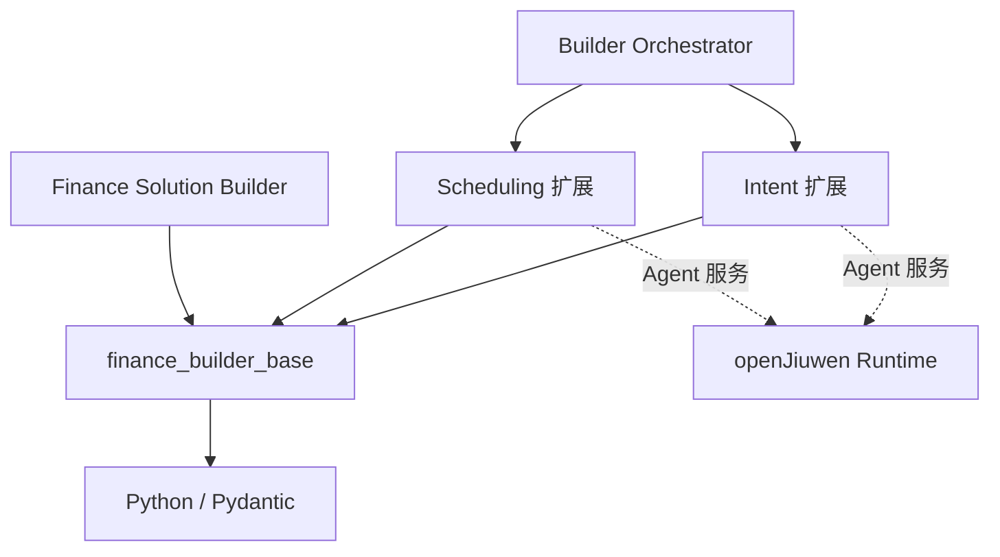

# Finance Builder Base L2 架构

## 1. 目标与边界

Base 为多个金融 Builder 提供领域无关的公共模型和可执行构件。它不包含场景业务流程，不替代 openJiuwen
Runtime，也不实现 Orchestrator 的路由算法。

## 2. 逻辑组件

| 组件 | 职责 | 非职责 |
|---|---|---|
| Contracts | 严格模型、资源引用、公开错误和版本化扩展纪律 | 场景 Schema 和任意字典扩展 |
| Core | Task、Workspace、Manifest、产物关系和候选动作 | 选择下一 Agent 或固定迭代状态机 |
| Runtime Support | 受信目录解析、根目录包含关系和安全目录复制 | AgentApp/A2A/Session/Checkpoint 和远程文件服务 |
| DataFactory | 生成规格、交付结构、处理单元及参考组合 | 固定场景编排和完整业务生成逻辑 |
| Evaluation | 固定快照、逐样本执行、指标、规则和报告循环 | 场景指标、调用适配和完整 Bad Case 业务 |
| Solution Build | 标准构建阶段、事实事件、取消恢复、资产锁、构建报告及 Runner/Checkpoint SPI | 解析具体 Solution Schema、选择专业 Agent、实现 Runtime/Harness/场景逻辑 |

## 3. 依赖方向

Base 不导入任何具体 Builder。场景通过有类型扩展模型、ProcessingUnit、Evaluation SPI 和薄适配消费 Base。

## 4. 数据流

Builder Session 提供 Workspace Context；Core 表达任务、已有产物和候选动作。DataFactory 处理单元按调用方
给定顺序产生 Delivery；Developer 生成候选 Agent；Evaluation 在固定输入快照上执行并产生三态结论和报告。
Core 把候选动作交给 Orchestrator，但不替它选择。

Solution Build 接收宿主已经校验的 Build Definition、按标准语义排序的 Build Plan 和实际解析资产闭包；
Coordinator 调用宿主注入的 Stage Runner，生成有序事件和唯一终态。Asset Lock 只表达实际装配资产，
Build Report 只表达实际执行检查；Checkpoint Store 由宿主提供，Base 不拥有数据库。

## 5. 稳定接口与演进

- Base `0.1.x` 内保持现有公共字段兼容；新增场景信息先进入版本化 `ExtensionModel`；
- Evaluation 通过 `compare_metric` 和 `evaluate_rules` 提供唯一的确定性规则实现；私有旧名称仅作为
  `0.1.x` 委托别名，不维护第二份算法；
- Runtime 通过 `resolve_directory` 和 `require_path_within` 统一宿主侧可信目录及包含关系校验；
  场景兼容层只负责翻译既有公开错误；
- ResourceRef 支持工作区相对路径、HTTP/HTTPS 和 A2A File Part 逻辑标识；
- 公共错误使用稳定 code、可操作 message、可选 field 和 retryable，不泄露宿主路径或凭据；
- 场景能力提升为公共接口时，必须更新 Feature、兼容策略、L2 和所有真实消费者测试；
- Base 使用仓库 uv workspace 作为稳定安装边界，但不要求外部发布。
- Solution Build v1 遵循
  [Solution Build Protocol](contracts/solution-build-protocol.md)：标准阶段不得重排，不适用阶段显式
  `skipped`，终态后不再接受进展；宿主扩展阶段必须带命名空间并声明标准阶段锚点；
- Solution Build 是增量公共组件，不修改 `BuilderTask`、`TaskStatus`、`Artifact`、
  `ArtifactManifest` 的既有字段、枚举和序列化形状。

## 6. 验证与回滚

Base 单元/契约测试验证自身语义；Intent 和 Scheduling 回归验证真实消费者。公共变更只有在两个消费者完成后
才满足最终验收。纯规则和路径函数以相同输入重复调用必须得到相同结果且不修改工作区；目录复制保持现有的
“目标已存在即拒绝”语义，防止重复执行静默覆盖产物。
Solution Build 另以轻量 Runner 验证完整协议，以 Intent/Scheduling 集成测试验证存量 API 兼容；真实
OpenJiuwen Java + Finance Harness Backend 的 SPI 验证由对应下游 Feature 交付。
