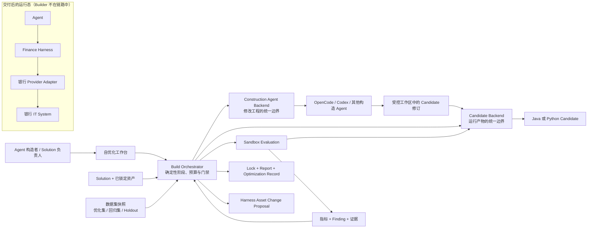

# Finance Solution Builder 0.2.0 L1 架构

> 状态：已接受。Euphoria_Yan 于 2026-09-08 接受 0.2.0 架构增量，并确认依据 Finance Harness 开发指导补充能力覆盖、证据分层与治理边界。

## 1. 定位

Finance Solution Builder 是开发态控制面。它读取 Solution 和已发布资产，驱动构造 Agent 生成或修订
Candidate，在受控环境中完成构建、启动、评测和有限优化，最后输出可追溯的交付物。

0.2.0 用确定的外层流程约束构造 Agent 和 Candidate 的不确定行为：模型可以提出代码或配置修订，但资产
权限、阶段转换、测试数据、验收规则、预算、停止条件和交付裁决由确定性契约控制。

Builder 不进入 Candidate 的生产业务链路。交付后的 Agent 仍通过 Finance Harness 调用标准金融能力，
再由银行项目团队实现的 Provider Adapter 连接本行系统。

## 2. 业务与系统边界



这里存在两条互相独立的可替换轴：

- **Construction Agent Backend** 管理“由哪个构造 Agent 修改 Candidate 工程”，统一任务、工作区、事件、
  审批、取消和结果，不把 OpenCode 或 Codex 的私有会话模型泄露给 Orchestrator。
- **Candidate Backend** 管理“生成的 Candidate 怎样被构建、启动、调用和停止”，统一描述语言、产物、入口、
  健康检查、调用协议和证据，不要求 Java 与 Python 使用相同构建工具或进程模型。

## 3. 输入与输出

### 3.1 输入

- 通过 Schema 校验的 Solution Build Input 和已解析资产闭包；
- 可固定版本的 Runtime、Harness Integration、Profile、Domain/Capability Pack、Provider 与 Eval Pack；Capability
  Pack 可以由 Solution 显式引用，也可以由 Domain Pack 声明依赖，但解析关系必须来自 Harness 发布的机器可读
  元数据，不能由 Builder 根据场景名称猜测；
- Candidate Backend 和 Construction Agent Backend 的受支持能力声明；
- 版本化的优化集、回归集与冻结 Holdout，以及量化验收规则；
- 运行环境注入的模型、构建工具、Provider 和授权 Sandbox 配置；
- 明确的可自动修改、需人工批准和禁止修改边界，以及轮次、时间和成本预算。

### 3.2 输出

- 可独立构建和启动的 Java 或 Python Agent Candidate；
- 描述 Candidate 身份、Backend、语言、Runtime、实际产物及摘要、入口、调用协议、健康检查、实际安装能力/
  工具和能力到 Provider 绑定的 Candidate Descriptor；
- 记录实际资产闭包的 `solution-lock.json` 与如实记录执行事实的 `build-report.json`；
- 逐样本结果、量化指标、结构化 Finding 和三态结论组成的 Evaluation Report；
- 关联父 Lock、新 Lock、数据摘要、修订、指标变化和停止原因的 Optimization Record；
- 对 Builder 无权直接修改的 Harness 资产形成带复现证据的 Change Proposal；
- Candidate、配置模板、Descriptor、Lock、Report 和验证说明组成的单一交付包。

历史证据回放、Sandbox Candidate Evaluation、授权 live smoke 与生产在线评测必须分别标识，不能互相冒充。

## 4. 模块职责与数据所有权

| 模块 | 职责 | 拥有的数据 | 不负责 |
| --- | --- | --- | --- |
| Build Orchestrator | 驱动阶段、预算、门禁、路由、停止条件和恢复 | Build Task、轮次状态、决策摘要 | 自由编写代码或降低验收标准 |
| Construction Agent Backend | 统一构造 Agent 的任务、工作区、事件、审批与取消 | 构造执行句柄、规范化事件、修订结果 | 决定是否交付 Candidate |
| Candidate Backend | 预检、装配、构建、启动、调用、证据收集和停止 | Candidate Descriptor、运行句柄 | 解释业务质量或修改测试数据 |
| Data Factory | 生成带版本与来源的优化数据，不修改冻结回归集和 Holdout | 优化数据 Delivery Package | 冻结 Evaluation Snapshot 或用 Holdout 指导修订 |
| Evaluation | 冻结数据集用途与摘要，实际调用本轮 Candidate，计算指标并输出结构化 Finding | Dataset Snapshot、Case Result、Metric、Finding、Report | 修改 Candidate、优化数据或验收阈值 |
| Optimization Controller | 将 Finding 映射到允许的修正对象并生成受预算约束的下一轮 | Optimization Record、停止原因 | 覆盖 Harness 已发布资产 |
| Asset Resolver / Governance | 解析版本、兼容关系、Owner 和允许优化范围 | Asset Lock、Change Proposal | 在 Builder 内定义金融合同 |
| WebUI | 展示每轮输入、动作、事件、指标、版本变化和裁决 | 用户操作状态与视图投影 | 持有凭据或展示模型思维链 |
| Delivery | 汇总经允许的 Candidate 和可审计证据 | Delivery Bundle | 打包缓存、密钥或工作区垃圾 |

Finance Harness 拥有金融合同、Pack 格式、兼容与装配元数据、Provider SPI、Owner 和验证标准；银行项目团队
拥有本行 Provider Adapter；行业专家审核业务方法、案例和指标。Builder 负责消费、验证并提出修订建议。

## 5. 标准闭环

```text
Solution + 冻结验收输入
  -> 确定性预检、能力覆盖检查与资产锁定
  -> Candidate Backend 装配、构建、启动和健康检查
  -> Sandbox Evaluation 实际调用本轮 Candidate
  -> 指标计算与结构化 Finding
  -> 确定性判断：通过 / 可自动修订 / 等待人工或外部资产
  -> Construction Agent Backend 执行一次有边界的修订
  -> 重建并先复测受影响用例，再运行回归集与 Holdout
  -> 达标、预算耗尽或外部阻塞时停止
  -> Delivery Bundle 或 Harness Asset Change Proposal
```

一轮只允许一个明确的修正目标。每次继续都必须记录依据、允许写入范围和剩余预算。指标提升且已有门禁不
回退时才保留新 Candidate；失败轮次保留证据，但不能覆盖最近一次已验证版本。

Candidate 修订采用受控差异层：父 Candidate 和父 Lock 保持只读，构造 Agent 只在轮次工作副本中修改已授权
路径；Builder 校验实际 Diff 后生成差异层，并在相同父资产闭包上重建。新 Lock 关联父 Lock、差异层和优化
数据摘要，避免下一轮重新装配时丢失修订，也避免把 Candidate 局部变化误记为 Harness 资产升级。详细设计见
[Optimization L2](optimization/L2-architecture.md)。

## 6. 构造 Agent 的受控执行边界

Construction Agent Backend 向 Orchestrator 提供稳定的任务生命周期，而不暴露供应商私有协议。至少覆盖：

- 创建或恢复一次构造任务，并绑定唯一工作区和父 Lock；
- 发送目标、结构化 Finding、允许修改范围和验证命令；
- 输出规范化进展、文件变更摘要、工具调用结果、审批请求和终态；
- 支持取消、超时和失败关闭；恢复时不得重复已完成的外部副作用；
- 只返回可审计结论和证据引用，不持久化模型内部推理。

OpenCode 作为首个参考适配验证契约可用性；Codex 作为第二适配验证契约没有固化单一实现。两者都不能跳过
Orchestrator 的权限、预算、测试和交付门禁。

## 7. Candidate Backend 与语言解耦

Candidate Backend 接收已校验的构建上下文，输出 Candidate Descriptor，并提供环境预检、装配、构建、启动、
健康检查、调用、证据收集和停止能力。

环境预检必须在下载、编译或启动前确认全部必需资产已经解析，并验证 Solution 所需能力能够由已安装
Domain/Capability Pack 提供、由所选 Provider 支持且操作类型兼容。Profile、Host Wiring、身份或授权配置
缺失时返回 blocked；不得静默改用另一个 Backend、Provider、语言或场景配方。

Backend 启动 Candidate 后返回受控运行句柄；健康检查通过只表示可以开始评测，不能提前停止实例。
Evaluation 完成、中止或失败后由同一 Backend 停止该实例。Descriptor、运行句柄、Build Report 和 Evaluation
Report 必须通过 Build Task、Lock 摘要、Candidate 身份及实际产物摘要形成一致关联。

OpenJiuwen Java Backend 首先承接 0.1.x 已验证的 Maven/JAR 装配链，行为与报告不得回退。Python Backend
后续以 Python 包或隔离环境实现相同的逻辑生命周期；Orchestrator 和 Evaluation 只能依赖 Descriptor 与
Backend 结果，不能依赖 Maven、JAR、模块路径或 Python 内部入口。

## 8. Evaluation、数据隔离与裁决

- Evaluation 必须调用本轮 Candidate，不以历史报告或冻结证据回放代替实际预测；
- 每个 Dataset Snapshot 记录用途、版本、来源、内容摘要和授权范围；
- 优化集用于定位和修正，回归集用于检查既有行为，冻结 Holdout 只用于最终门禁；
- Finding 至少包含失败类型、受影响样本引用、指标影响、建议责任边界和安全证据引用；
- 通过条件由版本化量化规则确定，LLM 可以辅助归因但不能决定门禁；
- 未执行、样本不足、环境不可用或证据不完整时，Evaluation Report 的结论只能是 `indeterminate`，不能计为
  通过；`passed_with_risk` 只属于汇总交付事实的 Build Report，不是评测结论。

验证证据按六层分别报告：合同与 Schema 校验、接口 Conformance、历史 Replay、本轮 Candidate 的 Sandbox
Evaluation、授权 live smoke、生产在线业务验收。前一层通过不能自动推导后一层通过；0.2.0 的核心交付门禁
止于真实 Candidate Sandbox Evaluation，在线业务验收保持独立状态。

Sandbox Evaluation 在快照门禁通过后启动 Candidate；健康检查、协议探针和逐样本调用复用同一运行实例，
最后统一收集证据并停止。任一阶段异常都必须进入结构化报告；若 Candidate 已启动，则失败路径仍须尝试收集
证据和停止。历史 Replay 继续作为辅助证据，不能替代本轮 Candidate 的实际调用结果。

## 9. Harness 回沉与跨仓治理

Builder 可以自动修改自身配置和 Candidate 局部覆盖层；修改 Harness 合同、兼容关系、Domain/Capability Pack、
Provider/Integration、Conformance Fixture 或正式 Eval 资产时，只生成 Change Proposal。Proposal 记录目标资产、
Owner、父版本、Finding、复现条件、建议差异和回归结果，由对应 Owner 与行业专家审核后在 Harness 发布新版本。

Harness 需要逐步提供机器可读的资产身份、依赖、兼容关系、Owner、允许优化范围和验证入口。Builder 不再通过
持续添加场景分支来维护这些事实。

0.2.0 通过 Finance Harness 的
`contracts/json-schema/catalog/finance-asset-catalog.v1.schema.json` 校验资产目录，并使用
`contracts/json-schema/governance/finance-asset-change-proposal.v1.schema.json` 校验待审提案。Builder 在 Lock 中
记录 Catalog 版本、Harness 固定修订、内容摘要和完整资产闭包；提案只写入当前 Builder 工作区，不自动写入
Harness 仓库。

自优化在处理 Harness 合同、Pack、Provider、Integration 或 Eval 资产 Finding 前，至少要获得目标资产的
Owner、允许修改范围和验证入口。缺少任一项时只允许形成安全摘要并停止等待人工处理，不能自动修改资产，
也不能回退到 Builder 内的场景硬编码。完整 Catalog 接入、硬编码迁移和 Change Proposal 交付由独立 Feature
完成。

## 10. 部署、隐私与可观察性

- 0.2.0 仍以单机开发态和受控 Sandbox 为主，Builder 不建设生产多租户调度；
- 构造 Agent 与 Candidate 使用相互隔离且按任务绑定的工作区/运行环境；
- 凭据只由执行环境注入，不进入 Solution、Checkpoint、事件、报告、Prompt 或交付包；
- 默认使用合成、脱敏或明确授权的数据，报告不记录真实客户身份、完整生产响应或模型思维链；
- 所有阶段、轮次、审批、修订、指标和停止原因形成有序事件，可回放为 WebUI 视图；
- Provider、合同或外部系统结果不确定时失败关闭，不通过修改数据或阈值制造通过结果。

## 11. 架构演进

本次保留 `finance_builder_base` 的 Solution Build 阶段、事件、Lock 与 Report 语义；新增的 Backend、Descriptor、
Evaluation 和 Optimization 契约先在 Finance Solution Builder 内通过两个实现或测试 Backend 验证。确实被多个
Builder 复用且语义稳定后，再按独立公共契约评审提升到 Base。

0.1.x 的 Java 装配入口通过适配层迁移，不要求一次性重写。OpenCode/Codex 和 Java/Python 分别验证两条扩展轴，
任一实现都不能成为公共接口中的必填私有字段。

## 12. Feature 映射

| Feature | 架构落点 |
| --- | --- |
| FEAT-001 | Candidate Backend 与 Descriptor |
| FEAT-002 | OpenJiuwen Java Backend 行为保持 |
| FEAT-003 | 受控 Construction Agent 执行契约 |
| FEAT-004 | OpenCode Construction Agent 适配 |
| FEAT-005 | Sandbox Evaluation 与数据隔离 |
| FEAT-006 | 受预算约束的自优化闭环 |
| FEAT-007 | Harness 资产修订提案与治理元数据 |
| FEAT-008 | 自优化过程工作台 |
| FEAT-009 | Codex Construction Agent 适配 |
| FEAT-010 | OpenJiuwen Python Candidate Backend |
