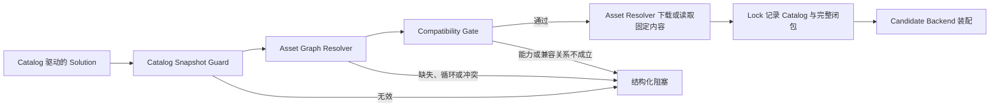
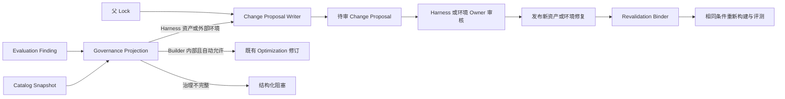

# Finance Solution Builder 资产解析与治理 L2 架构

> 状态：已接受；Euphoria_Yan 于 2026-09-10 接受 FEAT-007 Plan 与本 L2；适用版本：0.2.0。

## 1. 定位与边界

资产解析与治理模块把 Solution 中的逻辑资产选择，转换为经过版本锁定、依赖闭包校验和兼容性校验的装配输入；
当 Evaluation 将问题归因到 Builder 无权修改的 Harness 资产或外部环境时，它生成可交给责任方审核的 Change
Proposal。

Finance Harness 拥有 Catalog、资产关系、治理元数据和共享 Schema。Builder 只消费固定快照、形成 Lock 和
提案，不修改、提交、合并或发布 Harness 资产，也不根据场景名称、目录结构或代码分支补猜缺失事实。

## 2. 逻辑组件

| 组件 | 职责 | 输出 | 失败关闭条件 |
| --- | --- | --- | --- |
| Catalog Snapshot Guard | 校验 Catalog Schema、身份、版本、固定修订和内容摘要 | 已验证 Catalog Snapshot | 身份不可固定、摘要不符、未知主版本或内容不安全 |
| Asset Graph Resolver | 从 Solution 的显式选择和资产依赖解析唯一闭包 | Resolved Asset Closure | 依赖缺失、循环、同一资产多版本或重复身份冲突 |
| Compatibility Gate | 校验 Runtime、Integration、Profile、Pack、Provider、能力和 Eval 之间的声明关系 | Assembly Decision | 能力未覆盖、类型不符、组合被禁止或关系不完整 |
| Governance Projection | 将 Catalog 中的 Owner、提案范围、审批策略和验证入口投影为 Optimization 治理目标 | Governed Target Set | 目标不唯一或治理字段不完整 |
| Change Proposal Writer | 把外部 Finding、父资产和可公开证据写成不可变提案 | Change Proposal | Finding、父 Lock、Owner、复现证据或验证入口不可核验 |
| Revalidation Binder | 将已发布的新资产闭包与原 Finding、原验证条件关联 | Revalidation Record | 数据、规则、运行配置或证据层级不可比 |

## 3. 资产目录与 Solution 关系

Harness 已发布的 `catalog/finance-assets.v1.json` 是资产目录真源。本 Feature 在保持其 v1 身份和现有六类集合
兼容的前提下，补足以下信息：

- Catalog 身份、Schema 版本、发布版本、固定源码修订和内容摘要；
- 每个资产的逻辑 ID、类型、版本、内容来源和摘要；
- 资产提供的能力、传递依赖和明确的不兼容关系；
- 可参与装配的 Integration、Profile、Domain/Capability Pack、Provider 和 Evaluation Pack；
- 可进入问题治理的 Owner、允许提议的范围、审批策略和验证入口；
- 外部环境等非 Harness 资产目标的稳定责任引用和验证入口，不包含连接凭据。

既有 `solution-build-input.v1` 继续作为装配输入。Builder 从当前固定 Harness 修订读取 Catalog，并要求 Solution
中的资产 ID、版本和 source 与 Catalog 一致；不一致时失败关闭。Catalog 身份、Harness 修订和内容摘要进入
Lock，因此不需要为本 Feature 再创建一个 Solution 主版本。迁移后的财富样例不得再回退到 Builder 内置组合。

Git checkout 必须精确位于请求修订，Catalog 与 Schema 不得有未提交变更。通过 GitHub 归档获取的非 Git
Harness 快照必须由 Builder 的受控配置或已锁定发布记录提供独立可信锚点，锚点包含 GitHub 发布源、完整
commit SHA 和归档树摘要。归档内的 `.asset-source`、`.asset-revision` 与 `.asset-integrity.json`
仅记录下载来源和缓存事实，不能作为信任根。Builder 在读取 Catalog 前，分别比较外部锚点、归档元数据和
重新计算的树摘要；锚点缺失、字段不一致或内容漂移时失败关闭。

Capability Pack 有两种合法入口：由 Solution 显式选择，或由 Domain Pack 声明传递依赖。两者进入同一个图解析
过程；相同身份和版本去重，不同版本冲突。Lock 记录最终闭包和每条资产的解析来源，使隐式依赖仍可追溯。

## 4. 确定性解析与装配门禁

解析过程以逻辑资产身份和固定版本为键，不以列表顺序、路径前缀或场景名称决定结果。Compatibility Gate 只
使用 Catalog 声明，要求：所选 Profile 与 Domain Pack 相容；Domain/Capability Pack 覆盖 Solution 所需能力；
Provider 支持这些能力和操作；Integration 支持所选 Runtime 家族、语言与 Profile；Evaluation Pack 对应同一能力与
使用者范围。Runtime Template 是 Builder 固定的外部 Candidate 输入，继续单独进入 Lock，不由 Harness Catalog 声称
所有权。

任一关系没有声明时返回结构化阻塞。失败发生在下载、编译和启动之前。

## 5. 治理与 Change Proposal

Change Proposal 至少包含：提案和来源任务身份、Catalog 身份、目标资产或外部目标、Owner、父版本与摘要、
Finding/证据引用、脱敏复现条件、建议变更范围与摘要、验证入口、已有验证结果和状态 `proposed`。提案不包含
完整客户输入、Prompt、模型推理、凭据或宿主绝对路径，也不授予目标仓写权限。

Catalog 缺少 Owner、允许提议范围、审批策略或验证入口时，Builder 只输出缺失字段和已知目标，不能生成一个
看似完整的提案。Proposal 文件只追加且不可覆盖；相同输入可得到稳定内容摘要。

## 6. 发布后复验

Harness Owner 发布新资产后，Builder 使用新的 Catalog 固定快照重新解析完整闭包。新 Lock 必须同时记录新
Catalog 摘要、新资产版本及其来源；旧 Lock 和旧报告保持不变。

Revalidation Binder 使用原 Change Proposal 绑定 Finding、父 Lock、父 Catalog 和目标资产，再比较新旧 Lock
的完整资产闭包。只有 Proposal 指向的目标资产版本或内容摘要发生变化，且其他资产保持一致，才能把本轮结果
归因到该发布；仅 Catalog、Lock 或无关资产变化均不可比较。

只有 Evaluation Pack、数据快照、验收规则、运行配置和证据层级均与原 Finding 一致时，复验结果才可比较。
复验通过可以形成关闭建议，但 Builder 不直接修改 Harness Issue、Proposal 审批状态或资产发布记录。

## 7. 版本化契约与所有权

本 Feature 的关联 Harness PR [#11](https://github.com/bitlhk/finance-agent-harness/pull/11) 已合入并形成两项语言无关契约，Builder 固定到合并修订
`9d8fb89683cdc60da8167f95294237104030d01b` 进行契约验证：

1. `contracts/json-schema/catalog/finance-asset-catalog.v1.schema.json`：约束 Catalog 身份、六类资产、依赖、
   兼容关系和治理策略；
2. `contracts/json-schema/governance/finance-asset-change-proposal.v1.schema.json`：约束待审提案的目标、父 Lock、
   Finding、脱敏复现条件、建议范围和验证入口。

Finance Harness 仓中的 Schema 是共享契约权威，Builder 只消费 Schema 并实现适配模型。Harness PR 合入前，
Builder PR 必须保持对该固定修订的显式依赖；合入后再把依赖更新为最终合并修订，不得复制一份 Builder 私有
Schema 作为替代。

## 8. 依赖方向与兼容

- Catalog Guard、Graph Resolver 和 Compatibility Gate 不依赖 Builder 装配器或 Optimization Controller。
- `SolutionBuilder` 消费已验证的资产闭包；`Optimization` 只消费治理投影与 Proposal Writer，不自行解析 Catalog。
- 既有 `AssetResolver` 继续负责固定内容解析，不拥有资产类型、依赖或兼容语义。
- 既有 v1 Solution 继续工作；启用 Catalog 门禁后，资产引用必须与固定 Catalog 精确匹配。
- 回滚 Builder 时恢复旧 v1 入口和旧财富样例；已发布的 Catalog/Schema 保持向后兼容，不删除已有版本。

## 9. 安全与可观察性

- Catalog 与 Proposal 在载入和写出时执行公共安全文本校验。
- Source 只能使用受支持的仓内或固定 Git 引用；摘要不符时拒绝。
- Builder 记录 Catalog 校验、图解析、兼容门禁、提案形成和复验绑定的阶段事实，不记录模型思维链。
- 所有阻塞使用稳定代码和缺失字段列表，供 CLI、报告和后续 WebUI 复用。
