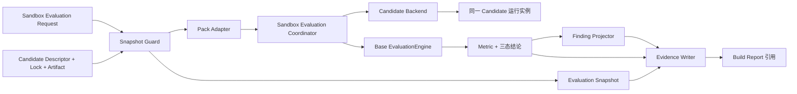

# Finance Solution Builder Sandbox Evaluation L2 架构

> 适用版本：0.2.0；对应 FEAT-005。本文描述 Finance Solution Builder 模块内的 Sandbox Evaluation。

## 1. 定位与边界

Sandbox Evaluation 用明确授权的数据和量化规则，实际调用本轮构建出的 Candidate，输出可复核的样本结果、
指标、三态结论、Finding 和证据引用。它服务于上线前冷启动验证，不调用生产系统，也不承担自动修改
Candidate 的职责。

本模块复用 `finance_builder_base.evaluation` 的 Case、Result、Metric、RuleGroup、三态结论和执行引擎；
Candidate 的启动、调用和停止只通过 Candidate Backend。模块不修改 Base 公共契约，也不依赖 Java、Maven、
JAR 或某一种 Candidate 内部实现。

## 2. 逻辑组件

| 组件 | 职责 | 输出 | 失败关闭条件 |
| --- | --- | --- | --- |
| Evaluation Snapshot Guard | 固定 Candidate、父 Lock、产物、Eval Pack、数据分区、授权和规则 | `EvaluationSnapshot` | 身份或摘要缺失；数据重复、交叉或越权；Holdout 使用方式不符 |
| Evaluation Pack Adapter | 将显式 Pack 转成 Base Case、Evaluator、Metric 与 RuleGroup | `PreparedEvaluation` | 版本、字段、指标或规则不受支持 |
| Sandbox Evaluation Coordinator | 使用一个 Candidate 实例完成健康检查、协议探针、逐样本调用、证据收集和停止 | `SandboxEvaluationExecution` | 任一生命周期阶段失败、身份不一致或样本执行不完整 |
| Finding Projector | 将失败映射到 Candidate、Solution/资产、Provider/Harness/环境、数据或规则责任边界 | `EvaluationFinding` | 不修改对象，只报告无法归类的安全摘要 |
| Evaluation Evidence Writer | 写入快照、样本摘要、指标、Finding、Holdout 访问事实和报告 | 工作区相对引用与 SHA-256 | 路径越界或证据无法完整写入 |

## 3. 输入契约

`SandboxEvaluationRequest` 是模块内版本化入口，包含：

- `requestId`：本次评测的稳定身份；
- `mode`：`tuning` 或 `final-gate`；
- `actorId` 与 `purpose`：数据访问责任主体和用途；
- `pack`：Pack 身份、版本、数据分区、样本、指标和量化验收规则；
- `evidenceLevel`：固定为 `sandbox`，避免历史回放冒充真实执行。

每个数据分区必须声明 `optimization`、`regression` 或 `holdout` 用途，带授权编号、来源引用、内容摘要和
样本数量。非 Holdout 分区必须在请求中加载全部已声明样本。调优模式禁止加载 Holdout 样本；最终门禁必须
加载已授权 Holdout，并记录访问事实。

样本明确给出请求载荷、期望结果、封闭或开放期望类型，以及可选 JSON Pointer。Adapter 不根据 Solution ID、
Profile、场景名或展示名猜测响应字段。

## 4. 执行与数据流

标准顺序如下：

1. 在启动 Candidate 前冻结 Snapshot；门禁失败时不得启动。
2. 校验真实 Candidate 产物摘要并启动 Candidate。
3. 检查健康状态；如配置协议探针，使用同一运行句柄执行。
4. 按 Snapshot 固定的顺序逐条调用样本；每个调用保存输入、期望和实际结果的摘要、时延、状态与响应引用。
5. Base EvaluationEngine 计算指标，并使用版本化 AND/OR 规则得出 `passed`、`failed` 或 `indeterminate`。
6. 收集生命周期证据并停止 Candidate；已启动后的失败路径同样执行这一步。
7. 写入 Evaluation 证据，并把报告引用加入 Build Report。

协议探针和样本评测必须共用一次 Candidate 生命周期，避免“探针验证一个实例、业务评测另一个实例”造成
身份和状态漂移。

## 5. 输出与状态语义

`evaluation/evaluation-report.json` 包含 Snapshot、进度、指标、三态结论、逐样本摘要、Finding 和六层证据
状态。公开报告不保存 Query 原文或凭据；必要原始请求仅留在本轮授权工作区，通过摘要和相对引用关联。

Evaluation Report 只有三种可交付结论：

- `passed`：全部样本执行完整，量化验收规则满足；
- `failed`：全部样本执行完整，但量化验收规则不满足；
- `indeterminate`：执行不完整、环境异常、证据不足或指标不可计算。

Build Report 的 `passed`、`passed_with_risk`、`failed` 是构建交付状态。两者不得相互替代：例如历史回放通过
但 Sandbox 未执行时，Build Report 可记录已有构建事实和风险，但不能生成 Sandbox `passed`。

证据层级固定为：

1. `contract-schema`
2. `conformance`
3. `replay`
4. `sandbox`
5. `live-smoke`
6. `production-online`

每层分别记录是否执行、结果和证据引用，不从低层结果推导高层结果。

## 6. Finding 与责任边界

Finding 使用稳定错误码和样本引用归类：Candidate 普通错路由或响应错误归 Candidate；已发布资产装配问题归
Solution/资产；Provider、Harness 或外部环境故障归对应外部边界；数据和验收规则问题分别归 Data 与 Rule。
Finding 只给出责任边界和可复核证据，不自动改写 Candidate、数据、Pack、Provider 或验收阈值。

## 7. 兼容与演进

`SolutionBuilder.build(..., sandbox_evaluation=None)` 保持 0.1.x 行为：执行协议探针和可用的历史证据回放，
并明确标记 Sandbox 未执行。提供 `sandbox_evaluation` 时，Builder 使用 Coordinator 接管 Candidate 从启动到停止
的单次生命周期。

当前契约先在 Finance Solution Builder 内验证。只有当多个 Builder 已使用且语义稳定后，才通过独立公共契约
评审提升到 `finance_builder_base`。FEAT-006 可以消费 Finding 形成受预算约束的修正轮次，但不得改变本文的
数据隔离、量化门禁和证据分层。
