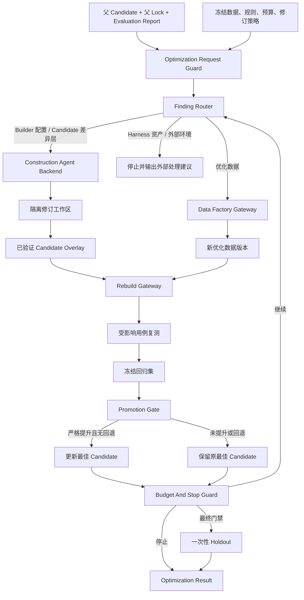

# Finance Solution Builder Optimization L2 架构

> 适用版本：0.2.0；对应 FEAT-006。本文描述上线前、受预算约束的 Candidate 自优化闭环。

## 1. 定位与边界

Optimization Controller 消费本轮 Candidate、Lock、Evaluation Report、冻结数据与修订策略，选择一个有权限的
修正目标，驱动一次受控修订、重建和复测，并决定保留新 Candidate、继续下一轮或停止。

它不修改验收阈值、冻结回归集或 Holdout，不直接修改已发布的 Finance Harness 资产，也不替代 Construction
Agent、Candidate Backend、Data Factory 或 Evaluation。模型可以提出解释和候选改法，路由、权限、预算、
可比性、晋级与停止均由确定性逻辑裁决。

## 2. 逻辑组件

| 组件 | 职责 | 输出 | 失败关闭条件 |
| --- | --- | --- | --- |
| Optimization Request Guard | 冻结父 Candidate/Lock、数据与规则摘要、预算和权限策略 | Optimization Snapshot | 身份、摘要、预算或授权不完整 |
| Finding Router | 根据 Finding 责任边界和显式治理元数据选择一个目标 | Correction Target | 无证据、多个同优先级目标、缺 Owner/写入范围/验证入口 |
| Round Planner | 将目标转换为一次 Construction 或 Data Factory 动作 | Round Action | 动作触碰冻结数据、阈值、未授权路径或已发布资产 |
| Revision Workspace Guard | 从父 Candidate 创建隔离工作副本，核验实际 Diff 并物化差异层 | Candidate Overlay | 工作区漂移、越界修改、摘要不一致或验证未通过 |
| Rebuild Gateway | 在相同父资产闭包上应用差异层并通过 Candidate Backend 重建 | 新 Lock、Descriptor、Build Report | 父资产漂移、差异层校验失败、构建或身份门禁失败 |
| Evaluation Gateway | 先跑受影响用例，再跑冻结回归；最终门禁才解封 Holdout | Evaluation Report | 数据/规则/运行配置/证据层级不可比或执行不完整 |
| Promotion Gate | 比较新旧结果并维护最近一次已验证最佳版本 | promote / retain | 必需门禁回退、指标不可计算或没有严格提升 |
| Budget And Stop Guard | 统计轮次、时间、成本和连续无提升次数 | Continue Decision / Stop Reason | 达标、预算耗尽、需审批、外部阻塞或无可执行目标 |
| Optimization Evidence Writer | 按轮写入公共安全、可回放记录 | Optimization Record | 记录不完整、引用越界或包含敏感内容 |

## 3. 修正目标与责任边界

修正目标只有五类：

- `builder-config`：本轮 Solution 或 Builder 的可授权配置；
- `candidate-overlay`：只作用于本轮 Candidate 的差异层；
- `optimization-data`：只新增或重生成带来源的优化数据版本；
- `harness-asset`：合同、Pack、Provider、Integration 或正式 Eval 资产，只能转外部治理；
- `external-environment`：银行系统、部署身份、凭据或 Sandbox 环境，只能等待责任方处理。

Finding Router 不只看责任类别。它还必须获得显式的目标引用、Owner、允许动作、写入范围、审批策略和验证入口。
当一个 Finding 同时可能落到 Builder 配置与 Candidate 差异层，且策略无法确定唯一优先级时，本轮停止等待人工，
不能让模型自行选择。`acceptance-rule` Finding 永远不能触发自动降低阈值或改写冻结规则。

## 4. 数据与控制流

每一轮最多执行一个专业修正动作。Round Action 终态后才能进入重建；重建完成后才允许 Evaluation。任一终态
出现后不得再创建 Construction、Data Factory、Candidate 或 Evaluation 任务。

代码入口与上述逻辑组件一一对应：`routing.py` 负责确定性路由，`revision.py` 提供 Construction 修订与
`SolutionBuilder` 重建适配器，`data_factory.py` 适配 Base DataFactory，`promotion.py` 负责可比性和晋级，
`records.py` 负责预算与只追加记录，`controller.py` 串联完整循环。Optimization 通过独立包
`finance_solution_builder.optimization` 使用，不扩大顶层 Candidate 公共 API。

## 5. Candidate 差异层与 Lock 链

上一轮 Candidate 和父 Lock 保持只读。Construction Agent 在轮次工作副本中修改允许路径；Builder 对照父
Candidate 计算实际 Diff，拒绝未声明路径、删除冻结资产或修改评测输入的变化，并把通过校验的文件集合物化为
Candidate Overlay。

重建时先按父 Lock 对应的资产闭包装配，再应用 Candidate Overlay。新 Lock 在保留实际资产列表的同时记录父
Lock 摘要、Overlay 摘要、轮次和优化数据摘要。这样同一父版本与同一 Overlay 可重复得到可核验的构建输入，
也能区分“资产升级”与“本轮 Candidate 修订”。父资产摘要发生漂移时不得继续比较。

未提供差异层时，现有 Solution 构建入口和 Lock/Report 行为保持不变。

## 6. 数据生成与隔离

Optimization Controller 通过 Finance Solution Builder 内的 Data Factory Gateway 调用 Base 的
`GenerationSpec`、`ProcessingPipeline` 和 `DeliveryPackage`。Gateway 只接受用途为 `optimization` 的来源，输出
新的版本、内容摘要和来源引用；`unsupported` 或 `failed` 直接成为本轮停止事实。

回归集与 Holdout 始终由 Evaluation Snapshot Guard 冻结。Data Factory 不拥有或改写其快照；Holdout 内容只在
最终门禁获授权后加载一次，不能进入 Finding、Construction 任务或下一轮优化数据。

## 7. 可比性与晋级

新旧 Candidate 只有在以下摘要全部一致时才可比较：Evaluation Pack、回归数据、验收规则、运行配置和证据层级。
其中回归数据摘要由 Evaluation Report 的有序 Dataset Snapshot 规范化计算并在入口核验，不能由调用方单独声明。
优化数据可以增加版本，但必须单独记录，不能改变回归口径。

新 Candidate 同时满足以下条件才晋级：

1. 构建、启动、健康检查和样本执行完整；
2. 所有必需门禁不低于当前最佳版本；
3. 至少一个本轮目标指标取得严格提升；
4. 没有新增禁止级 Finding。

未满足时保留当前最佳版本。最终 Holdout 只决定是否达到交付门禁，不再触发基于 Holdout 内容的自动修订。

## 8. 状态、预算与停止

优化状态按 `snapshot-ready → routed → revising → rebuilt → evaluating → promoted/retained → terminal` 推进。
每次状态变化写入单调递增的轮次事件和预算用量。

稳定停止原因包含：`acceptance-met`、`max-rounds`、`max-duration`、`max-cost`、`no-improvement`、
`approval-required`、`external-blocked`、`no-executable-target`、`final-gate-not-met` 和 `failed`。预算在创建下游任务前检查；
单次修订实际返回的时间或成本超过剩余预算时，不再创建后续重建和 Evaluation 任务。

轮次 Evaluation 只加载受影响用例和冻结回归集。二者已通过且不再存在活动 Finding 后，Controller 才在
获得授权时单独执行一次最终 Holdout；Holdout 结果直接形成终态，不得成为下一轮 Finding 或修订数据。

## 9. 版本化契约与记录

模块内 v1 契约包含：Optimization Request、Optimization Snapshot、Correction Target、Correction Execution、
Candidate Overlay、Data Version、Rebuild Outcome、Promotion Decision、Round Record、Routing Decision 和
Optimization Result。公开字段使用稳定逻辑标识、摘要和
工作区相对引用，不保存客户身份、凭据、Query 原文、完整 Prompt 或模型内部推理。

每轮记录父/新 Lock、父/新 Candidate、数据和规则摘要、Finding、目标、权限与审批事实、实际 Diff、验证证据、
指标差异、预算消耗、最佳版本和继续/停止决定。终态结果另记录最终预算与 Holdout 报告摘要。记录只追加，
不覆盖失败轮次。

这些契约先由 Finance Solution Builder 独立拥有。出现第二个真实 Builder 消费者并完成语义比较后，再按公共
契约评审提升到 `finance_builder_base`。

## 10. 兼容与演进

- Candidate Backend、Construction Agent Backend、Sandbox Evaluation 和 Base DataFactory 公共契约保持不变。
- Optimization 是显式可选入口；未启用时现有 CLI、Workbench 和 `SolutionBuilder.build` 输出保持兼容。
- FEAT-007 承接 Harness Asset Change Proposal；FEAT-008 承接 WebUI 过程展示。本 Feature 只产出可供后续展示的
  有序记录和安全摘要。
- 回滚时停止创建新轮次并保留当前最佳 Candidate、父 Lock 和全部已写记录；删除未晋级的轮次工作副本不影响
  已验证交付物。
