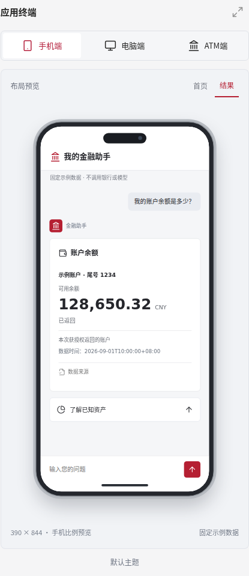
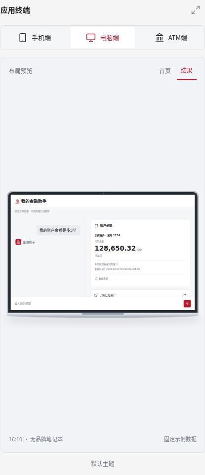
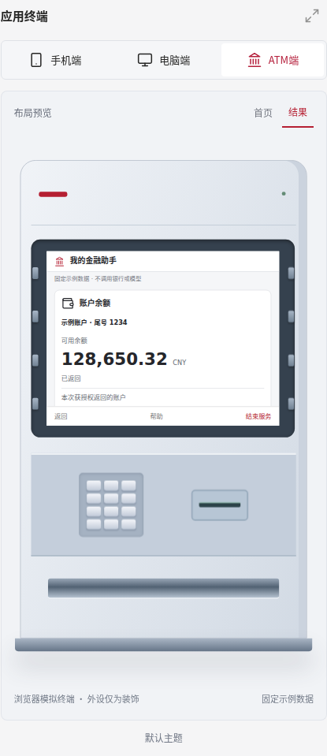
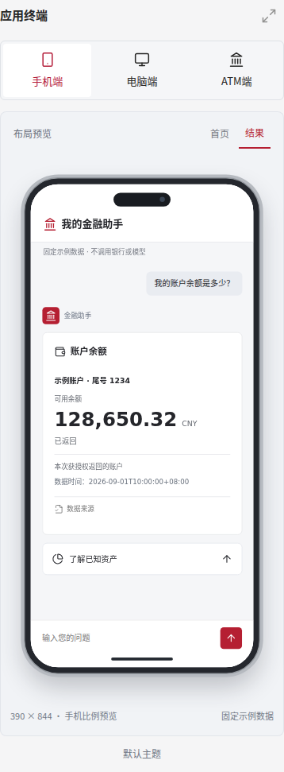

# Device Preview and Card Polish V1

## Scope

This document records the original local frontend stage on
`feat/studio-terminal-ui-v01`, based on `f2d4e5ce`. The subsequent push, fresh
Candidates and deployment of `283e6d52` are documented separately in the
[2026-09-10 release record](device-polish-release-20260910.md).
No Harness, Provider, Base, Runtime or backend code changes are included.

- Builder previews use real shared renderers inside unbranded phone (390:844),
  laptop (16:10) and ATM (4:3 screen) shells. Hardware decorations are not controls.
- A single terminal selector updates the existing build selection. Home/result,
  enlargement, source details, keyboard navigation and focus restoration work.
- The existing 26-module catalog, eight featured modules, two selectable read-only
  modules, search, details and unavailable states are retained.
- Theme and balance-card selection are independent. Both balance renderers retain
  exact decimal strings, currencies, account labels, availability, scope and time.
- Device CSS is Builder-only. Generated Agent assets include the shared card
  changes but no device shells. Existing generated Agents and locks are unchanged.
- Preview data is fixed and labeled. Preview operations issue no model, bank or
  build requests. A configured model is not required for this frontend check.

## Re-run

Use the existing Python 3.10+ environment with project/test dependencies,
Playwright and a Chromium installation, plus the repository's Node dependencies.
Commands run from `community/finance/builder/finance-solution-builder/`.

```bash
npm run build:ui
node engineering/test_device_cards.mjs
PYTHONPATH=src:../base/src python -m pytest tests -q
PYTHONPATH=src:../base/src python -m finance_solution_builder.workbench \
  --harness-repo /path/to/finance-harness --port 18168 \
  --data-dir /path/to/isolated-preview-data
```

Keep that loopback workbench running while executing in another terminal:

```bash
python engineering/verify_device_polish.py \
  http://127.0.0.1:18168 /path/to/device-preview-evidence
```

An explicit existing Chromium can be selected with `--chromium /path/to/chrome`.
The checker retains CSP, fails with a nonzero exit on a failed assertion and
records PASS/FAIL, executed checks and asset SHA-256 values. Stop the local
workbench with Ctrl+C when finished; no generated Agent processes are started.

## This Stage's Results (2026-09-10)

| Check | Actual result |
| --- | --- |
| Frontend bundle | `npm run build:ui` succeeded |
| Existing Python suite | 389 passed, 0 failed, 0 skipped (final run 11.13s) |
| Shared renderer | 16 checks passed; precision, zero/missing, escaping, source, shell exclusion |
| Browser | 162 checks passed, no page errors; 1440/1024/390 widths, all three devices |
| Screenshots | 45 images: home/result full-page and preview crops, plus enlarged views |
| Rendering inspection | Phone, laptop and ATM captures checked; source details remain scrollable |
| Backend effects | Browser preview requests were same-origin GET only |
| New Java Candidates / actual model / ASR | Not run in this stage |
| Push / deployment / human acceptance | Not performed in this stage |

Local browser environment: Python 3.12, Playwright 1.58.0 using the explicitly
installed `chromium-1234` binary. The default expected Chromium binary was absent;
this was resolved without disabling CSP. A checker wait was changed to a function
predicate for CSP compatibility; a keyboard test now selects its initial radio
before testing ArrowRight. These initial checker failures are not UI acceptance.

[Machine-readable checks and asset digests](device-polish-evidence/verification.json)
accompany representative screenshots:






## Release Follow-up Completed

The user subsequently authorized push and deployment. Clean `283e6d52` Candidates
were regenerated and checked, including 736/320 preview widths, and Shanghai was
switched from `a8064117` to `283e6d52` with a retained rollback release. Actual
model/ASR checks and preview checks are separate evidence sets in the release
record; independent human use remains NOT_RUN. The preceding local-stage results
above are historical and have not been relabeled as live acceptance.
