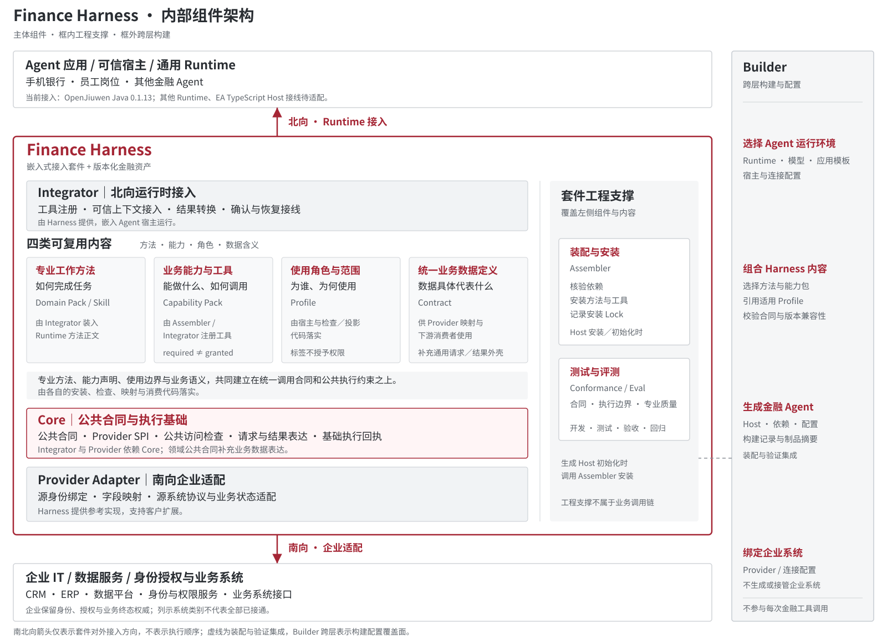
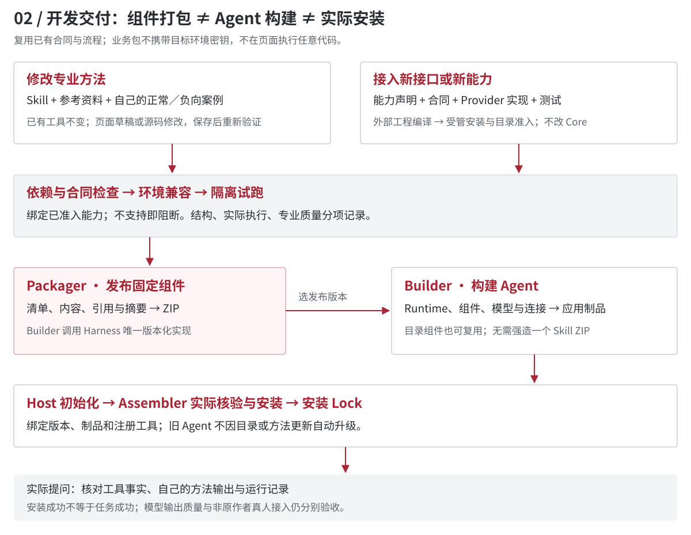
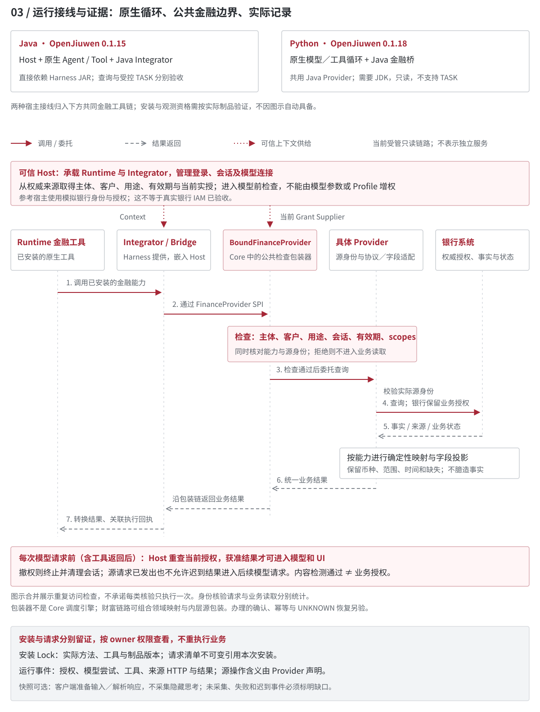

# Finance Harness 当前架构入口

核对日期：2026-09-20。文档版 V1.2；不是 SDK 版本升级。

## 实现基线

| 对象 | 固定版本 | 说明 |
| --- | --- | --- |
| Harness 执行与 Packager | b8f15ff91343cd1db367eb181287d6b69b29ccbd | Builder 固定来源；文档提交不能替换其资格或摘要 |
| Builder / 业务资产 V0.2.2 | accdc9b222d6d8f8560a5332afde3a14c1b9606e | 部署版本；MR186 及其前置待维护者接纳 |
| 文档 | 本文所在 Git 提交 | 公开正文、图示和生成工具同仓维护；发布清单记录源码及制品摘要 |

## 三张图

Core 提供合同、SPI 和公共检查；Integrator 属于 Harness、嵌入 Host；Provider 映射企业接口。Domain Pack/Skill、Capability Pack、Profile、领域 Contract 是不同形态的可复用内容。工程支撑含 Packager、Assembler、Conformance/Eval，不能画成一条额外业务执行流水线。

Packager 校验、封装业务组件；外部语言工具编译 Provider；Builder 生成 Agent；Host 调用 Assembler 核验与安装。目录组合、发布 ZIP、生成 Agent 与安装 Lock 分开。接入新 Provider 需受管安装，不是任意上传后执行。

Java 使用 OpenJiuwen 0.1.15 集成，Python 0.1.18 使用原生模型/工具循环加 Java 金融桥，共用金融 Provider 和执行约束。Python 不是纯 Python Harness，不支持当前 TASK。Host 在模型前、工具执行边界保留当前授权检查；声明不是授权，快照不是网络送达证明。

## 去哪里开发

- 方法：`domain-packs/`、SKILL 与案例，或 Builder 中创建私有草稿。
- 能力：`capability-packs/` 的输入、操作类型、所需权限与装配声明。
- 业务合同：`contracts/` 与领域模块。通用结果外壳不等于完整业务合同。
- 企业接口：`providers/`，实现 `FinanceProvider`，经工厂与目录准入。
- Runtime 接线：`integrations/` 以及 Builder 的对应 Host 模板；不由业务包复制 Runtime。
- 打包：`engineering/business_package.py`；Builder 固定引用，不维护第二套生产实现。
- 验证：`conformance/`、各模块测试及受管 Builder 的安装/运行验收。

操作与文件规则只在 [公开开发指导](public/developer-guide.md) 中维护，本文提供架构入口，不再复制一份教程。第 14.4 节可完成首次方法修改；第 16 章给出关系生成规则和新特性交付卡。

## 尚未证明的范围

### 报价与优惠咨询候选（2026-10-19）

新增[只读报价合同](quotation-readonly-v01.md)与[Harness FEAT-001](features/FEAT-001.md)：quotation领域包提供严格版本事实、整数分金额关系、绑定及有效期验证；quotation-reference通过既有受管Factory提供无网络合成源，只有quotation.offer.query。依赖方向为Provider→Core/quotation，领域不依赖SDK、Host或UI；Core/SPI/Execution不改。

装配要求新增quotation-disclosure.v0.1。这不是既有Host支持声明：H1组件通过不代表公开出口、动态授权或原生SDK已验收。具体Host必须在每个公开分片发送前重新校验权限、主体、事实及有效期；H2实际接线、H3 Builder交付、上游维护者接纳和发布分别验收。下述历史范围及基线不被新候选替换。

适配完成、指定版本通过、当前部署可构建是三种状态。Python 观测资格等运行前提见指南第 13.5 节。未接入 Runtime、任意包自动发现执行、跨版本图节点完整隔离、所有企业接口通用适配及非原作者真人独立接入均不能据此宣布完成。

本轮只整理文档，不修观测资格、不扩展 Runtime，也不改历史 Agent 或运行证据。

### 原标准法资本候选（Agent Store 场景工业化 FEAT-001）

新增 `market-risk-capital` 领域、`market-risk-capital-original` Provider 和
`market-risk-capital-java` 受管扩展，目录版本为 0.2.18 候选。
Provider 依赖 Core 与有限领域 DTO，Integration 依赖 Provider 与既有 openJiuwen Java 安装器；
Core、Execution、原 Python 公式和旧资产语义保持原义。独立原工具由 Agent Store Workshop 发布，
与原 bank-mktrisk-kit / risk-llm-coach 两个消费者绑定，方法明确为派生。

能力包和领域包沿用标准 `pack.yaml` 入口，来源与版本在 Catalog、方法和交付记录中可核对。
领域包由既有 Catalog 的依赖与 `pack.yaml` 表达，不另造一个公共 Domain Assembly 协议。
本地组件/Runtime 测试、Builder 独立交付、上游接纳和正式发布分别取证；候选目录不是发布资格。
详见 [有限只读合同](market-risk-capital-readonly-v1.md) 及
[原生接线说明](../integrations/market-risk-capital-java/README.md)。

### 原算法受管计算候选（Agent Store 场景工业化 FEAT-004）

`original-calculation-readonly` 通过七个有限 QUERY 接入八份原资产：FTP、流动性、市场风险、操作风险、debt/entity 两类 Logistic、组合收益与固定面板回测。LCR/NSFR、VaR/回测、BIA/原命名 TSA 是显式变体。目录增量为 0.2.19 候选，旧资本入口独立保留。

依赖方向：Agent Store Workshop 原工具服务拥有输入快照、独立 Python 3.12 环境、原函数和原值；`calculation` 领域只定义保真结果；`original-calculation` Provider 依赖 Core 与领域包；`original-calculation-java` 复用现有 openJiuwen Java 0.1.15 安装器。Builder 复用既有构建、安装与授权机制装配独立 Host 和结果视图。不修改 Base、Core、Execution、通用 RuntimeBuilder 或原金融公式。

公共能力包可安装七类定义，但每项私有任务只绑定一个选中资产。模型不能选择源码、输入文件、凭据或其他资产，不能提交代码、pickle、表达式、行情或写库请求。源码、适配器、依赖锁、输入、参数、运行与原返回各有独立身份；数值不来自模型摘要。

原值按受限类型保存，未舍入数字、行列顺序、缺失与非有限标记保留；表图是带原值位置的展示投影。`calculatedAt` 是计算时间，`dataAsOf` 缺失时保持缺失。改参产生新运行，当前失败/取消不展示旧成功值；显式历史回查仍复核当前授权。源目录保留原快照/返回，运行索引及 Host 会话历史目前是进程内状态，重启恢复不在本候选范围。

取消先关闭结果披露，再终止自有进程组并确认退出；Linux 验证包含抗终止子进程、内存上限和网络/派生进程禁止。正式 worker 不允许自行派生进程。局部审计限制不等于操作系统沙箱，生产仍需部署环境的权限、网络与容量治理。

工程接线、原新数值对照、专业金融有效性、生产部署及上游发布分别取证。两个独立消费者只证明共享能力复用，不代表全部场景完成。参见 [计算合同](calculation-readonly-v1.md)、[Java 接线](../integrations/original-calculation-java/README.md) 和 Agent Store 的固定版本验证记录。

## 原材料工程切片（FEAT-002候选）

新增`packages/java/financial-material`、`providers/financial-material`和`integrations/financial-material-java`，分别持有材料合同、有限原服务调用及原生SDK接线。原文件、原返回和修正仍在来源服务；Host选择当前任务文件并复核授权/代次，Builder仅装配。Core/Execution及既有openJiuwen SPI不变，旧JSON/文本领域不自动升级。详见[材料接线](financial-material-processing-v1.md)。目录许可与真实视觉质量仍需独立资格。

## 原方法与报告工程切片（FEAT-005候选）

`packages/java/professional-report` 保存报告、依据引用、受控制品与不可变版本语义；`providers/professional-report-readonly` 对接独立原服务，`integrations/professional-report-java` 通过既有 SPI 加载原生 ReActAgent 与安装方法。原 Skill、原财富 MCP 和完整市场风险引擎在固定来源发布物中保留，公式及 Core/Execution 公共接口不改。

原服务按资产使用独立且精确锁定的 Python 环境，保存实际输入、原返回和文件，控制真实进程停止。报告页区分原工具内容、模型说明和人工备注；每次读取历史、图表和导出均重新授权并核对摘要。工程、原引擎保真、专业质量和生产资格分别记录，不能因固定模型接线成功而自动通过银行验收。见[报告接线](professional-report-readonly-v1.md)。
