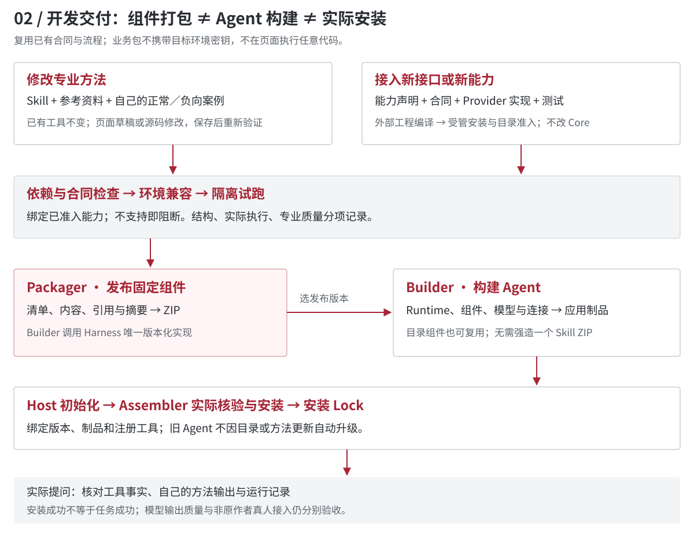

# Finance Harness 当前架构入口

核对日期：2026-09-20。文档版 V1.2；不是 SDK 版本升级。

## 实现基线

| 对象 | 固定版本 | 说明 |
| --- | --- | --- |
| Harness 执行与 Packager | b8f15ff91343cd1db367eb181287d6b69b29ccbd | Builder 固定来源；文档提交不能替换其资格或摘要 |
| Builder / 业务资产 V0.2.2 | accdc9b222d6d8f8560a5332afde3a14c1b9606e | 部署版本；MR186 及其前置待维护者接纳 |
| 文档 | 本文所在 Git 提交 | 公开正文、图示和生成工具同仓维护；发布清单记录源码及制品摘要 |

## 三张图

Core 提供合同、SPI 和公共检查；Integrator 属于 Harness、嵌入 Host；Provider 映射企业接口。Domain Pack/Skill、Capability Pack、Profile、领域 Contract 是不同形态的可复用内容。工程支撑含 Packager、Assembler、Conformance/Eval，不能画成一条额外业务执行流水线。

Packager 校验、封装业务组件；外部语言工具编译 Provider；Builder 生成 Agent；Host 调用 Assembler 核验与安装。目录组合、发布 ZIP、生成 Agent 与安装 Lock 分开。接入新 Provider 需受管安装，不是任意上传后执行。

Java 使用 OpenJiuwen 0.1.15 集成，Python 0.1.18 使用原生模型/工具循环加 Java 金融桥，共用金融 Provider 和执行约束。Python 不是纯 Python Harness，不支持当前 TASK。Host 在模型前、工具执行边界保留当前授权检查；声明不是授权，快照不是网络送达证明。

## 去哪里开发

- 方法：`domain-packs/`、SKILL 与案例，或 Builder 中创建私有草稿。
- 能力：`capability-packs/` 的输入、操作类型、所需权限与装配声明。
- 业务合同：`contracts/` 与领域模块。通用结果外壳不等于完整业务合同。
- 企业接口：`providers/`，实现 `FinanceProvider`，经工厂与目录准入。
- Runtime 接线：`integrations/` 以及 Builder 的对应 Host 模板；不由业务包复制 Runtime。
- 打包：`engineering/business_package.py`；Builder 固定引用，不维护第二套生产实现。
- 验证：`conformance/`、各模块测试及受管 Builder 的安装/运行验收。

操作与文件规则只在 [公开开发指导](public/developer-guide.md) 中维护，本文提供架构入口，不再复制一份教程。第 14.4 节可完成首次方法修改；第 16 章给出关系生成规则和新特性交付卡。

## 尚未证明的范围

新增[面客反诈专业方法候选](../domain-packs/anti-fraud-customer/README.md)
以 `transfer-anti-fraud@0.1.1-rc.1` 与旧 0.1.0 并存；依赖独立只读
`fraud-risk-readonly@0.1.0-rc.1`，Pack 与 fraud-mining Provider 均有通用装配声明。
旧混合 risk-review-basics 保持不变，不由反诈 Provider 声称完整覆盖。派生来源固定，六项内容边界
已由业务 Owner 接受。它仍需维护者审核与固定提交发布。安装回归不证明真实模型遵循、
客户效果或生产授权；金融合同、Provider 与可信 Host 的交易/确认权不变。

新增面客反诈转账案例资产见 [受控合同验证定义](../evaluation-packs/anti-fraud-transfer/README.md)。
它定义合成场景下的确认、幂等、未知结果和所有权断言；离线门禁只验证资产结构。
现场 Builder 的 Java Host 接线与逐案例运行证据仍需单独交付；不据此宣称真实模型
反诈效果或生产授权验收通过。既有 Query/Task、Provider SPI 与金融规则不变。

适配完成、指定版本通过、当前部署可构建是三种状态。Python 观测资格等运行前提见指南第 13.5 节。未接入 Runtime、任意包自动发现执行、跨版本图节点完整隔离、所有企业接口通用适配及非原作者真人独立接入均不能据此宣布完成。

本轮只整理文档，不修观测资格、不扩展 Runtime，也不改历史 Agent 或运行证据。
