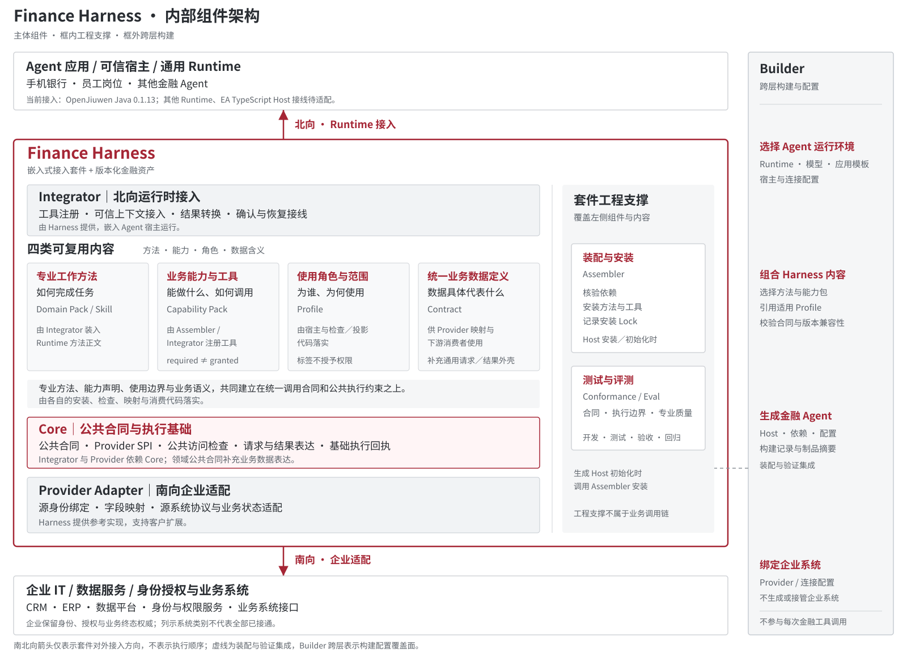
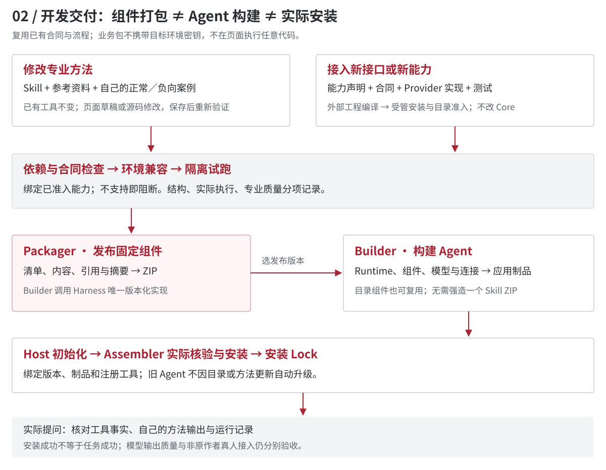
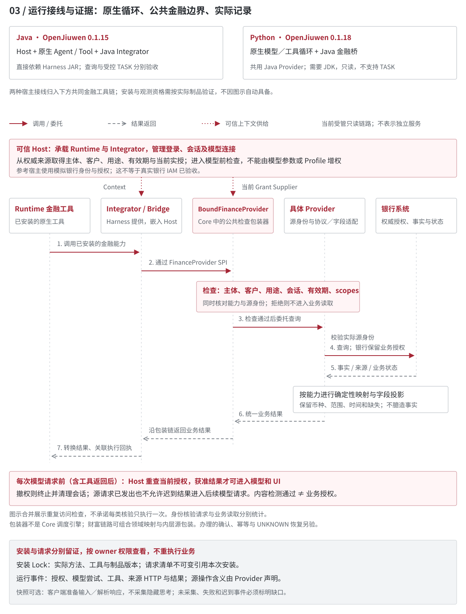
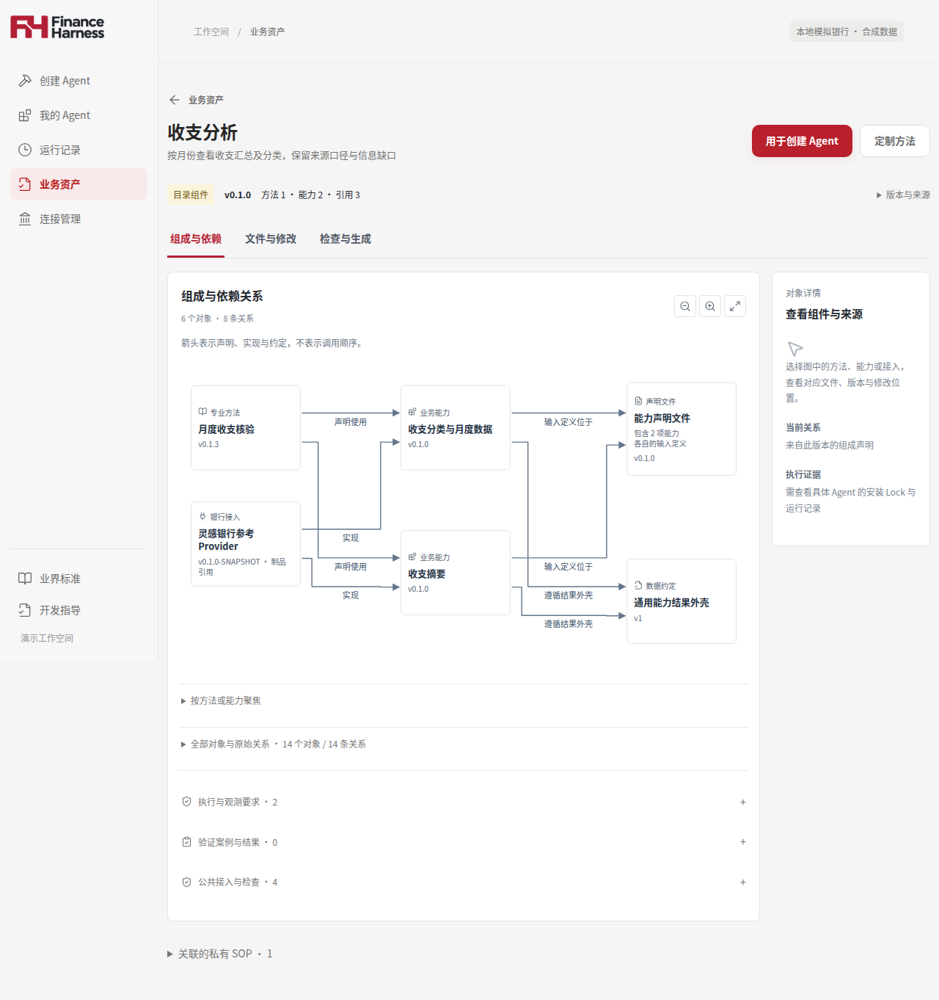
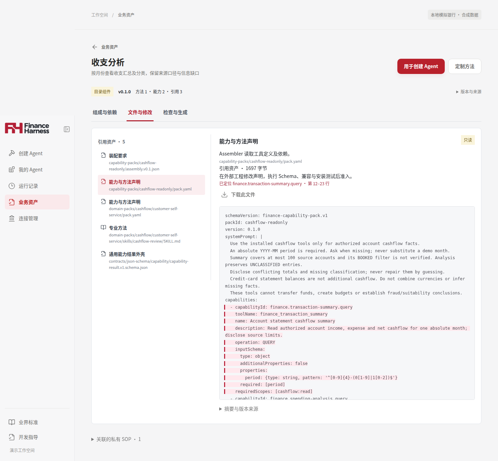

# Finance Harness ����ָ��

**���������� V1.3 �� �����׼���ѡ V0.1 �� 2026-10-18**

��ƪ����ԭ���½ڼ�ê�㣬��Ϊ�ܹ���API����ͬ�Ͱ汾��ʷ�ο�����һ�ο������[��ɵ�һ�� Agent](first-agent.md#step-1)��ʼ�������ȶ��걾ƪ����ǰʵ�ٻ����뻷����[ȡ�ÿ�������](first-agent.md#materials)Ϊ׼�����ı����ڵľɰ汾˵����������ǰ����״̬��

����ӿ����ߵĵ�һ��������ʹ�������������ϴ�רҵ��������������Դ��������������֤�� Agent �Ƿ���İ�װ��ʹ�����ǡ���������԰�����ģ�塢ģ����ҵ��ģ�顢�ײ�����֯��26 ��ģ������ԴĿ¼����������ȫ��ʵ�֡��ĵ��汾����ʾ�µ� SDK ��ҵ�����հ汾��

���򳡾����ߡ��������俪���ߡ�Builder ������������Ŷӡ�ָ�ϰ汾���������� SDK ��ҵ��������������ָ�Ϲ�����ơ���չ�������Բ���ڣ�������˽��Դ�븽¼���������á�ƾ�ݻ�ͻ����ݡ�

��һ��ʹ���ȿ��� 0 �£��ܹ����� 1 �� 4 �£��ϴ��뷢������ 14 �£�����ҵ��Դ���� 8��9 �£��� Agent ��ȷѡ���������� 15 �¡����д�����Ҫά�����ṩ����Ȩ�IJֿ�򿪷������Ķ�ָ�ϱ�������Ҫ��¼��

�� 16 �°��Ѳ����ҵ���ʲ� V0.2.2 ˵����ʵ����ͼ���ļ���λ���޸����̣��� 14.4 ���ṩһ���޸ķ���������������������֤����ϰ�����ĺ����� HTML������ HTML��PDF ʹ��ͬһ���ܰ汾�����������ɣ����ڷ���������һ���ĵ���

**��ǰʵ�ٺ˶Ի��ߣ�**Harness `4771cfe5de94757d099daa44bbd41d3177311740`��Builder `0a38ec183c832eab847e60158e06271b14e25d6b`����ƪ�ɽ�ͼ����ʷ��Ŀ�Զ�Ӧ Builder `accdc9b2`����ʱ MR186 ����ǰ�ô�ά���߽��ɣ���Harness `b8f15ff9`����ð���°汾��ͼ���ĵ����²�����ִ����Ʒ��ȡ�ò��Ϻ�׼�뽻�Ӽ��½̳̣������治��˽��Դ�롣

## 0. ������·����ʼ

| ��Ҫ��ɵĹ��� | ���͸Ķ� | ���������֤������ |
| --- | --- | --- |
| ����������� | ����̨������ Agent��ѡ��ģ�塢ҵ��ģ�顢Runtime�����������ӣ���д Provider | �����ɹ�����װ Lock ����ѡ������δѡ����ʵ�ʲ��ɵ��� |
| ����רҵ���� | ��ҵ���ʲ������� `.md`��Skill ZIP �������ҵ���ƣ��޸� `SKILL.md` �Ͱ��� | ����ݸ塢У�顢�ܿ����ܡ������汾���ٹ����� Agent������� 7��14 �� |
| �ַ��ѷ����ķ������ | ���ع���̨���ɵ�ҵ����� ZIP��Ŀ�깤����������������� | Ŀ�����º������������ܡ�������ѡĿ��汾�������ϴ��ɹ�����������׼�� |
| ������ҵ��Դ��ҵ������ | ����Ȩ������е� Provider��������ͬ�����ԣ���Ҫʱά���߸����ܹ�Ŀ¼ | ����Ȩ�޺�ȱ������ͨ�������ʲ�׼�벢װ��������ҳ��ѡ������� 8��14 �� |

**�������·�ߣ�**���úϳ�������ɡ�������������������޸�һ�� Skill �����¹�����ֻ�����к�ͬ�޷���������ʱ�Ž����� Provider��Capability ����������̨�˺š�Դ��Ȩ�ޡ�Ŀ�����в�����Ȩ��������ͬǰ�ᡣ�����ļ���������ͻ�����Ȩ�ޣ�Ҳ���ܰ��ϴ��Ĵ��뵱�����ִ�С�

��ָ���е���ʷ��������ֻ���ڶ�Ӧ�̶��汾����ǰ����̨�Ͱ��淶��˶�ʵ��Ŀ¼�밲װ Lock���� Agent ����Ŀ¼���ĵ������Զ�������

## 1. ���Ŀ��������ֵ�ԭ��

**�ø��࿪������ͨ�� Agent Runtime �ϣ�װ��רҵ���������������������������Ѿ�����֤�Ľ���ִ��Լ����**

ͨ�� Runtime ����ģ�͡�Agent Loop�����ߺͻỰ��Harness �ѽ������������ݡ���ʵ�����ҵ��״̬������Щ���ơ�������ӵ����Ȩ����ء��ʵ��Ժ�����ҵ����������װ��һ�� JAR ���Զ���ý���רҵ�ԣ�Ҳ������������ Harness ����

| ���ԭ�� | ����ʱ������ʵ | ����ʲô |
| --- | --- | --- |
| ��ҵ��������������ӿ������� | ͬ�ھ��ӿڲ���� Provider��������Ϊ���� Capability | ������������ʲô���ɼ��ݲ��� |
| ��ģ�������񣬰�ְ�������������� | ģ����ҵ��ģ�����ù�ͬ����������ǰ������������� | ������Ƭ���� Pack������ģ������Ȩ�� |
| ������ִ�������ֿ� | Domain Pack д���裻Capability �������ߣ�Provider ���� | �ķ����Ƿ�Ҫ��д�ӿ� |
| �ͻ�����������չ�ʲ� | ���á�Skill��ӳ���빫��ʵ�ַ��� | ����ͬһ��Ʒ�����Ǹ��� Core |
| ��Ȩ����ʵ����ģ�Ͳ��� | ʵ�����Կ���������ȷ����ӳ�䣻��ȷȱʧ | �����ݲ�����ȱ����Ĭ������ |
| ����������ʵ��·����ִ�� | ����ǰ��ģ��ǰ��ȷ�Ϻͻָ����Ӽ�� | ����ֻ�� Prompt д��ȫҪ�� |
| ֻ��װ������Ҫ�Ĺ��� | �̶��Ϸ���ϼ���װ�嵥 | α��δ��װ����Ҳ����ִ�� |
| ÿ��׶����Բ⡢׷�� | ������������ִ����ڡ��汾��֤�� | �ղ��Բ�ͨ����Ŀ¼��������ִ�� |
| ���ظ���������� | ���������ߺ�ҵ�����ݣ�������������ͬ | ����ԭ�Pack ����֤����ֵ |

Ҫ���͵���**�ظ�ʵ��ִ��Լ�����ظ�����Ĺ�����**����������ҵ��ھ�ȷ�ϡ��ӿ�����ͻع顣�����������ӣ�����ͬ����Ȩ��ȷ�ϡ��ָ��߼���Ӧ�����ظ����ӡ�

## 2. ����ܹ��빹�������й�ϵ

### 2.1 �׼�����ʲô��������������������



������**�׼��������**���飬����ʾ�������˻���ϵ�������ִ�С��������չʾ Integrator������ɸ������ݡ�Core �� Provider��Harness ������Ҳ������Ǹ�����Щ����Ĺ���֧�ţ���������Ҳ��� Builder��**�����ͷ�� Harness �ϱ߽����Ͻ� Agent ���л����������ͷ���±߽����½���ҵϵͳ��** ������ͷֻ��ʾ������뷽�򣬲������������ݵĵ���������ִ��˳��Ҳ�����ڲ����������Integrator �� Provider ͬΪ��ɫ����㣬Core ��dz��ɫͻ��������������ɫ����ʾ��֤״̬��

������á���ҵ���䡱�����޶�Ϊ����ϵͳ����ǰ����ģ������ EA �IJο����估��֤��Χ����ԭ�б߽磻ͼ�е� CRM��ERP ����ϵͳ���ʾ�⣬�������ѽ���������������

**Integrator �Ĵ�������� Harness������λ���� Agent ������** ����ֻ���׼��ڻ�һ������������ⲿ�����ٻ�һ�ס�����ʵ�ʳ��� Runtime �� Integrator���ṩ�������ݡ�ʵ�ڼ��Ự����Щ���м������һ��ͼ��չ����

**����ɸ������ݻش��ĸ����⣺��ô���¡�����ʲô��Ϊ˭ʹ�á����ݴ���ʲô��** ���ǹ�ͬ������ͳһ���ú�ͬ�빫��ִ��Լ��֮�ϣ������������ߣ������ĸ��������棬Ҳ���� Core ͳһ���ػ���͡�������������˵����;��Ӣ�������������Ŀ¼���ֲ��䡣

| �ɸ������� | ��Ӧ��� | �ش�ʲô | ��Ҫ��������߽� |
| --- | --- | --- | --- |
| רҵ�������� | Domain Pack / Skill | ������רҵ���� | Integrator װ�� Runtime �������ģ������ܿ�����ȡ����ʵ��Core ������ SOP |
| ҵ�������빤�� | Capability Pack | ����ʲô����ε��á���Ҫʲô���� | Assembler��Integrator ע�Ṥ�ߣ����ò��� Core ���󡢽���� Provider SPI���嵥��ʵ�����нӿڣ�����������ʵ�� |
| ʹ�ý�ɫ�뷶Χ | Profile | Ϊ˭��Ϊ��ʹ�á����չʾ | ��������飯ͶӰ������ʵ�����ÿ��� Context ��ʵ�ڼ�飬Profile ��������Ȩ |
| ͳһҵ�����ݶ��� | Contract�����򹫹���ͬ�� | ���ʲ������ռ�¼�����ݴ���ʲô | Provider ӳ��������߹�ͬʹ�ã�������Դ�ھ����죻���� Core ͨ����ǣ�����ȫ��ҵ���ֶη��� Core |

ͼ�� `Contract` ������ҵ�����ݺ�ͬ��չʾ���ƣ�Core ��ͨ�����󡢽����ͬ������ Core����һ���Ƶ���������ģ�飬Ҳ���ı����Ŀ¼���ͬ�汾��

���硰�˶��ʲ���Ϣ��������ȱʲô����רҵ�����涨�˶Բ��裻�����������ɲ�ѯ��Щ��ʵ��Profile ˵���ͻ�������Ա��������;�����ݶ�����ȷ���֡�ͳ�Ʒ�Χ��ʱ�估ȱ�����塣�����ķ����Ծ�������������Ȩ�������Ƿ���ѭ�������⡣

Core �� Integrator �� Provider ��ͬ�����ĺ�ͬ��SPI �빫��������������С���ȶ������Ŀ�꣬��������ѡ�汾�Ѿ���ŵ API �ȶ���Provider ʵ�� SPI��Core �������������� Adapter��Harness �ṩ Provider �ο�ʵ�֣��ͻ������������չԴ���ݰ󶨡��ֶ�ӳ���Э��ת����������ͬ��ͬ��߽�������֤�����ظ��ƻ��޸� Core��

Builder ���򸲸��Ϸ� Agent���м� Harness���·���ҵϵͳ�������򣬱�ʾ**��㹹�����ø�����**��ѡ�� Runtime��ģ�ͣ�ģ�塢��Ϸ��������������������� Profile��У���ͬ�����ԡ��� Provider �����ӣ����� Host ����Ʒ����ͬ�����Э��Լ��������ҵ���ܿ��ء�Builder �����ɻ�ӹ���ҵϵͳ��������ÿ�ν��ڹ��ߵ��á�

Builder ���׼�����֧�ŵ����߱�ʾ��װ������֤���ɡ���ʵ�ʰ�װ������ Host �ڳ�ʼ��ʱ���� Assembler��Builder �Ĺ�����¼�� Assembler �İ�װ Lock ���໥�����

**�׼�����֧�Ÿ��������������ݣ���ר���� Provider��Ҳ������ Core��** ͼ��Ϊ Harness ���Ҳ������������Խ Integrator �� Provider���Էָ����������������ݣ�����������������װ�䰲װ��������⡣�����ⲿ Builder ������ͬ�����ܰ�������Ϊͬһ�������

| ����֧�� | ��ʲô | ��Ҫʹ��ʱ�� |
| --- | --- | --- |
| ��������Packager | У���嵥��·����ժҪ���γɿ��ƽ���ҵ����� ZIP | �����뵼��ʱ�� Builder ���� Harness �İ汾��ʵ�֣������� Provider |
| װ���밲װ��Assembler װ��� | ������������װ�����빤�ߡ���¼��װ Lock | Ӧ�ð�װ����ʼ������ Host ���� |
| ���������⣺Conformance��Eval ���� | �����ͬ��ִ�б߽���רҵ���� | ���������ԡ�����������ع飻����Ӧ�����ʵ�ʼ�����ִ�� |

�����ǡ���ʾ֧��ְ�������׼����������������ҵ�񳡾��Ѿ�ȫ����֤��ʵ��ִ�з�Χ��δ��������ʵ����״̬���Ա���Ϊ׼��

��ǰֻ������̨֧�� **OpenJiuwen Java 0.1.15 �� Python 0.1.18��ͨ�� Java �����ţ�**������� 13 �¡�EA ���� Provider ��ʾ Java Agent �ɶ�ȡ�ܹ� EA ���ݣ������� EA TypeScript �����ѽ��� Java Harness������ Runtime����������ϵͳ��Ҫ�����͵������գ����ܰѿ���չλ�õ���Ʒ��ŵ��

### 2.2 �ӿ������ݵ������� Agent



**�������͹��� Agent �����β�ͬ�Ľ�����** �ķ����� Skill�������밸�������½ӿڽ�������������ͬ��Provider Դ�뼰���ԣ��������ⲿ���̱��벢׼�롣ҳ�治�����а���������롣Packager ���Ѽ������ݡ����ú���֤ժҪ��� ZIP��Builder ���÷����汾��Runtime ��Ŀ���������� Agent��Assembler �˶�ʵ�ʰ�װ��������ʵ���� Lock��

Ŀ¼���û�з��� ZIP Ҳ���Ա������䷽���ã���ǰ ZIP �������������ܹܷ����������ǿ���� Skill �IJ�ѯ��������ٷ���������ͼչʾ������Lock չʾ��װ�����м�¼չʾʵ�ʵ��ã����߲��ܻ��������

### 2.3 һ�ν��ڹ��ߵ��ã�ʵ�ʾ�������



��ǰ�ܹܽ���Ϊ��`Runtime ���ڹ��� �� Integrator / Bridge �� BoundFinanceProvider �� ���� Provider Adapter �� ����ϵͳ`��Bridge ͨ�� `FinanceProvider` SPI ����ע�����`BoundFinanceProvider` �� Core �еĹ�����Ȩ����װ�������Ƕ����������棬Ҳ����������� Core ���Զ�ע������������

���ؽ����ԭ��������Provider�����������߸�����Ӧ����ʵӳ�����ֶ�ͶӰ��Bridge ת�������������ִ��Դ���ݼ������Ӧ Provider ��ʵ��������ÿ�κ���ģ������ǰ�ز鵱ǰ��Ȩ�����ݼ�⡢��ȫ��ʾ������ HTTP �ܾ����ܴ�����Щ��顣ͼ�кϲ����ظ����飻�Ƹ����������������ӳ����ڲ�Դ��װ������ŵ���г�������ǡ���������

**�����밲װ�ֿ���** Builder ѡ���ʲ���У�����������ð󶨣�����Ӧ����Ʒ�빹����¼������ Host ����ʱ���� Harness Assembler������ʵ����������װ�����빤�ߣ�������װ Lock��Builder ��װ�� UI ������ Agent ��Ӧ��ģ�岻ͬ��������ֹͣ�ǹ���̨�������������� Agent �������� Builder �������С�

Builder ����ÿ�����е��õ��м䣻Domain Pack��Capability Pack��Profile Ҳ��������ִ�е��������档

AG-UI �����������֮��Ľ���Э�飻Markdown �Ű���ǰ����ɡ����Dz�����������Ȩ�����ھ�����ȷ�ϡ�ĿǰҲ�������� Runtime������ǰ�˶��ܴ�ģ��ѡ��

## 3. �ڲ��������̬��ְ����߽�

�� **Integrator������ʱ���䣩** �� **Provider Adapter����ҵ�����䣩** ���ֱ��������򣬴���Ŀ¼Ϊ `integrations` �� `providers`�������������׻��ơ��������вο�ʵ���԰�ʵ��Э��˵������������������չ����������֤��Χ��

| ��� | ��ǰ������̬ | ����ʲô | ��Ӧ��ʲô |
| --- | --- | --- | --- |
| Core | Java �⡢�ĺ�ͬ�� SPI | ���������ġ�QUERY/TASK ��ǡ����ʱ߽硢������ִ | Agent Loop�����вƸ��ֶΡ����з�ء�UI |
| Integrator | Harness �ṩ��Ƕ�� Host �� OpenJiuwen Java ���ɿ� | ԭ�� Tool ��װ�����ת��������ȷ�Ϻͻָ���װ����� | ���ظ��������������Runtime ������ҵ��״̬�� |
| Provider Adapter | Java ʵ����Դ���ݽ��� | ����Э�顢�ֶΡ����������״̬ӳ�䣬�˶�Դ���� | ��ģ�Ͳ��ֶΡ���������Ȩ����� |
| Capability / Pack | �汾�� `pack.yaml` | ���� ID������ Schema��QUERY/TASK������ scopes������֯һ������ | Key��Ȩ�����衢ÿ�ӿ�һ�׹������� |
| Domain Pack / Skill | Pack ������ `SKILL.md` | רҵ�����������������Լ�������ص� Runtime ��ʾ���� | ӲȨ�ޡ������������桢�������վ��� |
| Profile | ��ɫ����;���ɼ���Χ��Լ�������� | ����ͶӰ�߽磬�������������飯ͶӰ������ʵ | ��ǰ����ͨ�� Profile Engine���ı�ǩ������Ȩ�� |
| ���򹫹���ͬ | �Ƹ� Java ģ���� Schema | ����Χ����������Դ��ȱ�ڵ�ȷ���Ա��������� | ȫ��ҵ���塢�������ϵ�������ʵ����ƶ� |
| Catalog / Solution / Lock | Ŀ¼��װ�����롢��װ��� | ��ѡ�ʲ����̶���ϡ�ʵ�ʰ汾��ժҪ | Ŀ¼������ UI ��ѡ��Lock ����֤Զ������ |
| Packager | Harness �İ汾�� Python �⣯CLI���� Schema | У���嵥���ļ������죯������ ZIP��Builder ����ͬһʵ�� | ������ Java������װ Provider��������Ȩ�� |
| Assembler | �� Integrator ʹ�õ� Java װ��� | �� Solution ������ʵ��Ʒ��ע�᷽���빤�ߡ����ɰ�װ Lock | ����� Builder ������Ҳ�����µ�ִ������ |
| Conformance / Eval | ��ͬ����Ϊ��ҵ������ | �߽���֤��רҵ�������ģ�ͺ�ר������ | �ø�ʽ������ҵ����ȷ�Ի���ʵ��Ȩ���� |

�ĺ�ͬΪ `FinanceContext`��˭Ϊ˭������;�뵱ǰ��Χ����`CapabilityRequest`���������������������ã���`CapabilityResult`����ʵ�����״̬����`EvidenceReceipt`��������Դ������������������

������Dz�����ÿ�����������ϸ�ҵ����� Schema�����������ֶ�Ӧ������ģ�鶨��汾��ͬ��������һֱ�� Core ������ Map ���ֶΡ�

## 4. �������ȣ���������ʲô

**�ӿڡ��������������������������ֲ�ͬ�ʲ�������һһ��Ӧ��ϵ��**

| ��� | ʾ�� | ��ʱ���� |
| --- | --- | --- |
| ���нӿ� | ���ڡ����ڡ�����Դ�ӿ� | �ԽӸ���ϵͳ����Ҫ����Դ���� |
| Capability | ��ѯָ����Χ���˻���� | �����������Ȩ��ִ������������Ҫ������Լ |
| Capability Pack | һ����������ֻ������ | ��ͬ������������Χ�Ͱ汾������ÿ���������� |
| Skill / Domain Pack | �ʲ����顢��ǰ׼�� | רҵĿ�ꡢ������������֤���������ͬ |
| Solution | �ͻ�������Ա����ǰ���� | ѡ��ģ�塢���������������Ӻͽ�ɫ�߽� |

### 4.1 ��������ж�˳��

1. ��˵���������������裬��ʵ��Ȩ�޲��䣺���ȸ� Skill��
2. ����ھ��ͱ߽���ͬ��ֻ�DZ��нӿڲ�ͬ�����Ȼ� Provider ӳ�䡣
3. Ҫδ�е���ʵ������������µ���Ȩ��Χ�������� Capability �����������汾��
4. �Ӷ�ȡ���޸ģ���ȷ�ϡ��ݵȡ���֤����ı䣺��������������������ܽ��ѯ͵͵ִ�С�
5. ���������ȷʵȱͬһ����ִ�����壬������ Core��Integrator �ļ����ݽ���

��������Ҫ˵�壺ҵ�����Ƿ��ȶ����Ƿ�ɿ������ã�Ȩ�ޣ�������쳣�Ƿ�������ܷ�����滻����֤����Ҫ��е��������ִ���ҵ���жϡ�

### 4.2 ���������߽�

- �����ʿ����͡�ij�ſ�������ͬ�ھ���Ȩ������Ϊͬһ�����IJ����������͡���ͥ���ʲ�������ͬһ��ʵ������Ϊ����������ϡ�
- ���Ƹ���������ָ��ʵ��ȡ��Ҳ��ָ��֯˵������ǰ������Ƭ��ȷ������ʵӳ�䣯���������� Skill ��֯������ӳֲַ�������ϵ��¼���Ƽ����ɣ�Ҫ����ȷ�������뷽��������ȫ�������ܸ������ߡ�

��ֹ�������ˣ�ÿ API ����һ�� Harness������ֻ�� `execute_any_api`�����ֶΡ�Ȩ�������ѡ�񶼽���ģ�͡��������Ժܶ࣬һ�� Agent Ӧװ������֤�������Ӽ������DZ�¶ȫ�й��ߡ�

### 4.3 ��������Ƭ��ҵ������������Ӧ

**������ģ����֯��ڣ���ҵ��ģ��ѡ���ܣ���ҵ��ְ�����������**

ģ�����������������ַ�������������װ�䡢����֤��ҵ���졣��Ƭ������һ�������������ؼ��ϣ�
��ǿ�Ƶ���һ���ӿڡ�Pack��Agent������Ƭ������ʾ���巶Χ��������ʵ�ʹ��ߣ������á����ƹ��򡱡����ÿ��������ڸ�δʵ��ҵ��

����ѯ�ɶ�����������ת�˰���Ӧ����Ԥ�졢���ᡢ����ȷ�ϡ��ύ����֤�������ڣ�����е������⹴ѡ�IJ��衣
�տ��˲�ѯ���������ж��������ߣ���������ѯ��ֻ��ѡ�񲻵ð�װ�������ߡ�����İ���������ʾ�������DZ��ֿ��Ź��ܡ�
�Ƹ��Ƽ������ս�����Ͷ�б���ͨ����רҵ�����򳡾�������������޶�����������

��թ����������Ȩ���ӿڡ�ǿ�ư���Լ����רҵ��˷�������Ҫ��ء���Ȩ��ȷ�Ϻ�֤�ݲ��ɹرգ�ģ�ͻ�����������о��ߡ�
�����֡����á���Դ����ʵʱ�䡢������ϵ��ȱʧ״̬��Contract���壬���س�Ϊ��Ƭ��
�·�����Skill���²�����Capability/Provider/������������Ų�����Contract����Χ���û����Profile����Runtime����Integrator�������������Ծ��½������ʲ���

BIAN Service Landscape �ķ���������ࡢISO 20022 Business Model ��ҵ�����ɹ��ο������Dz�ֱ�ӹ涨����Agentԭ�UI��Ƭ����Ŀ��Ȩģ�͡�
���ݴ����Ʒ��ϱ�׼������ҵ��ھ��Խӿڡ������ֵ��ҵ������ȷ��Ϊ���ݡ�

### 4.4 ҵ���׼���ο�ʲô������ŵʲô

����̨���¡�ҵ���׼���ṩ���¹ٷ�������ʵ��¼����ʵ����Ϊ2026-09-10��
������Ʋο������Dz�Ʒ��֤��Ҳ���涨����Ŀ��26ģ���������װ��ϡ�

| �ο���汾 | ��; | �Ѻ�ʵ�����ñ߽� |
| --- | --- | --- |
| [BIAN Service Landscape 14.0](https://bian.org/deliverables/service-landscape/) | �ο�������ķ�������֯��ʽ | �ٷ��汾�ͷ�����;�Ѻ�ʵ��δ����ģ�������������ӳ�� |
| [ISO 20022 Business Model](https://www.iso20022.org/iso20022-repository/business-model) | �ο�ҵ������ϵ�������ֵ� | �Ѻ�ʵ�ٷ�ģ��˵����δ�̶�ģ�Ϳ��գ�δ�����ֶη����� |
| [GB/T 27926.1-2021](https://std.samr.gov.cn/gb/search/gbDetailed?id=C8394B1AA0EF4558E05397BE0A0A8876) | ����ҵͨ�ñ��ķ�����1����Ԫģ�ͣ����ڲɱ�ο� | ����ʵ�ٷ���Ŀ����ͬ����ISO 20022-1:2013�Ĺ�ϵ��ȫ������δ��ʵ |
| [WCAG 2.2](https://www.w3.org/TR/WCAG22/) | ͨ��Web���š����̡����㼰���زο� | ��ATMӲ��������ר�ù淶������Ʒ���������δ���� |

�����򡰲ο��˱�׼�����ſ�������Ȩ�����ݿھ���ҵ����ߣ�û��ֱ�Ӻ�ʵ����ʱ��ȷ��Ϊ��ĿԼ�����ȷ�ϡ�

## 5. ˭���������ͻ���������

| ���ʲô | ˭��Ҫ��� | �����빤���߽� |
| --- | --- | --- |
| ����ģ�͡����ӡ�������� | ʹ���ߣ������� | ��֧��ѡ�����ã���д Core����ͨ�� UI ��Ȩ |
| ���������Ͻṹ��������ȱ������ | �������ߣ�ҵ�������� | Skill��Pack �汾��ҵ������δ֧���ʲ��迪���߽��� |
| ���нӿڡ��ֶΡ��������� | Adapter �����ߣ����� Owner | Java ӳ�䡢���ݽ��ߡ���ͬ�븺����� |
| ����ҵ������ | ������ Adapter ������ | ���������������ͬ��ʵ�֡�ע�������� |
| ������ϻ�ҳ��ѡ�� | Builder ������ | ���� recipe���������������ߡ�������ȡ�������ع� |
| ����ִ�л��� Runtime | �����ܹ���Runtime �Ŷ� | ��������Integrator�����������������߻ع� |

�ͻ�Ӧ�����Լ�����չ�ʲ��� Adapter������ͬһ Harness SDK������ Fork Core ���ڷֲ档**��ǰ���߱����ϴ����� Skill���ӿ��ļ����Զ������������ Agent����������** ���ʲ�Ҫ��ʽ����֧�ֵ�װ�䣬����ʾ�����Զ�����г���

�ѶȰ��Ķ������жϣ�����ŵ��ÿ�ӿڼ����ӡ������øĶ�ͨ�����٣�������Ҫҵ�����⣻Դ������Ҫ���ݡ��������쳣��֤����������ȷ�ϡ��ָ����ԡ����п���Ӧ��ģ�塢��ͬ����������ϣ���ֻ�Ƕ��ܹ����ܡ�

�����������αװ��ҵ�� Capability��֪ʶԴ�� Provider�������Ĺ�������������ʵ Host ģ�ͻ򹤾߽߱磬����Ȩ����Ȩ��UI ��չʾЭ�顣�Ƿ���������ȡ���ڶ���ҵ�����壬��ȡ���ڴ����Ƿ���д��

## 6. ��������Щ�ɸ��û���

| �ʲ������� | �������� | ʹ������ |
| --- | --- | --- |
| `account.balance.query` | ��Ȩ��Χ���˻�����ָ���˻���� | accountId ������Ȩ�ޣ�ֻ����ϲ�����ת�� |
| `wealth.facts.describe` | ��Դ�ʲ������ղ�����¼����Ϣȱ�� | ���Ǽ�ͥ���ʲ�����ʽ�Ƽ����ʵ��Խ��� |
| `finance.transaction-summary.query` | ָ���·ݵ����롢֧���뾻��ժҪ | UTC���ڡ�ǰ100�˻�����ʷ����δ��ʵ����Ĭ���·� |
| `finance.spending-analysis.query` | ָ���·ݵ���֧������������ʵ | BOOKED/CNY��Դ����ʱ�������ƿɱ���δ��ʵ�������ɱȽϽ��� |
| `transfer.internal.create` | ģ������ת����������Ԥ�졢ȷ�ϡ��ύ���֤ | �� Java �ܿػ���������ֻ������������װ�����ʵ�ڻ���ʵ���а����ʸ� |
| �Ƹ������շ�ǰ���ڲ�������˷��� | ���� Domain Pack �Ͳο����� | ��Χ���죬�����ڵ�ǰ UI ȫ����ѡ |
| ���ŵ��á�����ȷ�ϡ�����ָ� | Core��Integrator��Provider ����Լ�� | ����������ߣ�����������ģ��ع� |
| �Ƹ���ͬ��ʵ�������� | ����Դ�ṹȷ����ӳ����ȱʧ���� | �¸�ʽ������룻������ϵ�����л��� |

��ǰֻ������Ϊ **4��ҵ��Capability��3��װ�䵥Ԫ��7�ַǿ����**�����Ƹ���ʵ����֧��ѯ���������ǰ�ܹ�Ŀ¼����������ת�� TASK��Java ģ������� Python ֻ��֧�ַ�Χ��ͬ����֧��Ԫ����������������ǰ���鰲װ��������ҳ�浥��ȡ������һ�����ߡ��ֿ���������������Զ���Ϊ�˵���������Դ��Ϊ�����ϳ�����ģ��������������ʵ������Ȩ���ա�ʵ�ʿ�ѡ��Ӧ�Ե�ǰĿ¼��Runtime ���ݼ��͹��� Lock Ϊ׼��

### 6.1 ģ�塢ҵ��ģ������

��ǰ������ڣ�**����ģ�� -> ҵ��ģ�� -> ���п�ܡ�ģ�͡������������ʽ**��
ģ�Ͷ�ѡ��ָ��Ĭ��ģ�ͣ���ܵ�ѡ�����Ƕ�AgentЭͬ�����ݽ�ɫ����ģ������������У�������ҳ��ǩ����Ȩ�ޡ�

| ģ��/ģ�� | ��ǰ��Χ | �߽� |
| --- | --- | --- |
| �ֻ����У��˻����� | ����ѯ | �������˻�ȫ��ҵ�񣻰���������ת�˷��� |
| �ֻ����У��Ƹ��ۺϷ��� | �Ƹ�����������״̬����Ϣȱ�� | ������ԴDemoȫ���Ƹ�ҵ���ѽ�ͨ |
| �ֻ����У��������� | ����ժҪ����֧������������ʵ | ģ�⻷���ѽ��룻������FAQ���Ƚϡ���������������δ���� |
| �ֻ����У�ת�˷��� | �ܹ�����ת�� TASK | Java ģ�������Python TASK ��֧�� |
| ����ģ������� | ����ǰ�ܹ���Ŀ¼չʾ | ÿ���������������������ʷʣ�������ж��Ƿ���� |
| �Ƹ����֡����ս�����������ˡ�������ˡ�Ͷ������ | ����δ������ģ������� | ��չʾ������ |
| OpenJiuwen Java 0.1.15 | ��ѯ����֧�ֵ��ܿ� TASK | �����밲װʱ����ʵ�ʰ汾��ִ��Ҫ�� |
| OpenJiuwen Python 0.1.18 | �ѽ�����Ԫ����� | ԭ�� Python ѭ�� + Java �����ţ��Ǵ� Python SDK |

**��ʷĿ¼��Դ��**�ֻ����г�ʼ�̵�̶�����main�ύ `3b430100b38037884f7eec51b33a7625e4276cca` ��26��ҵ��Agentģ�飬
��������ڼ��ĸ�����ģ�飬���򹩸�Ŀ¼��չ��D29�����������Ĭ�ϰ����չ���������Ͳ鿴���顣
�ϲ�ģ�鲻��һ�����߻�һ��Pack��������ȷ����ԭDemo���������뵱ǰ��ʵ���롣

����ΪǨ����ʷ�����ǵ�ǰȫ������״̬��Ŀ¼0.1.1�����˻����֡�ת�����֡����ÿ����ֵ���ʾ��ͳһΪ�����񡱣���������Ϊ��������������
Ŀ¼0.1.2����26��ģ��ID���䣬���������ֵ���֧��Ԫ���������䷽�����������԰���������FAQ���ȽϺͲ���������խΪ����֧����������֧���������������� `db38c7f`�������ð汾ð������26��Ŀ¼�����̵�İ汾��

��ȫ����ģ����������ҵ�񣬲��ǹ�����ȫ���أ���ѡ����Ҳ���ܹر����ݡ�ʵ�ڡ�ֻ����֤�ݼ�顣
���ɫ����ʵ��Ȩ��ͬ����Provider�滻�ֱ����ա�

### 6.2 ���ļ���ҳ������֤

����·����Ի���ȨBuilder�������� `community/finance/builder/finance-solution-builder/`������Harness Core��

| �ļ� | �޸Ļ�˶�ʲô |
| --- | --- |
| `src/finance_solution_builder/template-modules.v1.json` | ģ��/ģ��������̶���Դ��Ĭ������״̬ |
| `src/finance_solution_builder/template_modules.py` | ����ʵ�ʹ��ߡ����½���ѡ�񡢺˶�ģ������������֧�־��� |
| `src/finance_solution_builder/workbench_contracts.py` | ��ǰͳһѡ������ `schema_version: 0.9`���ɰ���ɽ������ݣ����þɽӿڽ̸̳��������� |
| `src/finance_solution_builder/unified_catalog.py`��`managed_selection.py` | ���ܹ������װ����������ѡ��Runtime ֧�ֺͰ󶨣���������������ͼ��֧ |
| `src/finance_solution_builder/service.py` | ������װ�䵥Ԫ������ֻ���䷽�IJο�·��������������Χ�빤�߰�װ��Χ�ֱ��� |
| `browser/workbench.js`��`examples/local-workbench/live.css` | ҳ��Դ������ʽ���޸ĺ����´�� |
| `tests/test_template_modules.py` | ������ȱ�ʲ�������ģ��/��ܡ�������ӳ�䲻һ�� |
| `engineering/verify_template_modules_ui.mjs` | ʵ��ҳ�桢�ܾ�·����խ�����ѡ��ʵ���� |

��ϰ������Provider��Profile�����������䣬���ֻ�����ģ�� `defaultModuleIds` ��Ϊ
`["agent.account"]`������Ŀ¼�汾��Ĭ�Ͻ�ѡ���˻����Ƹ�ģ���Կ��ֶ����롣
����Ĭ��ѡ���빹�����ԣ�ȷ��ʵ�ʹ���ֻ�������踴��Pack��Provider��
�½�ɫ������������ҵ��ģ�鲻��ֻ�޸�JSON���ã������������ʵ��������֤��

```bash
python -m pytest tests/test_template_modules.py tests/test_directory.py tests/test_workbench_contracts.py -q
npm run build:ui
python -m finance_solution_builder.workbench --harness-repo <harness��������> --port 18158 --data-dir <��������Ŀ¼>
node engineering/verify_template_modules_ui.mjs "$STUDIO_LOCAL_URL" <ҳ��֤��Ŀ¼> build
python engineering/verify_multi_model.py --harness <harness��������> --output <ԭ��֤��Ŀ¼> --template-modules
```

���з�����ն˱��ִ򿪣�����һ�ն˽� `STUDIO_LOCAL_URL` ����Ϊ������־��ʾ�ı�����ַ��������ҳ���顣
��Builder README׼��Python��Node��JDK21��Maven��Playwright/Chromium��Ŀ¼���ա�����Solution����ƷLock��
ʵ�ʰ�װLock�ֿ��˶ԡ�ԭ�����ʹ���ܿ�HTTPģ����ϳ����У�������ʵ��ģ�����������˶������롣
��ѡδ����ģ��/����ʱ�ɹ������������Ա������Ž���ϡ�

0.2��0.8����ļ��ݷ����Ե�ǰ����Ϊ׼��0.5���ǵ�ǰͳһ��������0.9�� Builder ����汾������ Harness �� Schema �汾����˫���������ű����������°�ҳ�����ա���Agent���Զ��������޸����ò����°汾��
��������Ʒ��������Ŀ¼����ѡ�񹤾ߡ��ͻ������ơ�Ĭ����������Core���²��������ͬ��Provider�͸�������

Skill��������רҵ������ʾ�½ڣ�����ִ�����档allowed-tools������Ȩ�ޣ�Ӳ�߽���ʵ��ע�������ִ�м����ʵ��

### 6.3 �ڹ���̨ѡ��������ά��רҵ����

���ڸ��Ǽ��з��������뱾����֧����������ʵ�ְ汾�Խ����嵥��������ƷLockΪ׼��ָ�ϰ汾����SDK�汾��26 ��ҵ��ģ���ǵ��������� 26 ���ѽ��� Harness ����
ģ������չʾ�ѽ�������Ƹ�����֧������ϣ����鹴ѡ��ģ�鿨Ƭͬ����������ѡ������Ϊ�����롣
�����Լ��ʱ����ѡ�񡣵�ǰ������������������ȡ�������ݡ�ʵ�ڡ���Ȩ���Ҫ֤�ݲ���Ϊ�ɹرյ�ѡ�

����˳��**ҵ���ʲ� �� �½�������Ĭ�Ϸ������� �� �༭������ �� �ܿؼ�� �� �����汾 �� ������ Agent �� ������������˶�**��

| ���� | ʵ�ʲ������߽� |
| --- | --- |
| ���� | ֧�� `SKILL.md` �򺬸���ڵ� ZIP����Ŀ¼��һ���װĿ¼���ο��ı��� `references/` |
| �༭ | ��д������ά���ˡ���֧�ֵ���������������ο��ı����������޸ĺ��ȱ����ټ�� |
| ��Դ | �ϴ����512 KiB��32�ļ������ļ�64 KiB��չ������256 KiB���ܾ�Խ�缰���ӣ�������Զ��URL |
| �ű� | `scripts/` �����桢��ִ�У����������ű�ִ��ʱ���治�����ã���αװΪ�ѽ��� |
| �ܿؼ�� | ��ʵJava�������ܿ����кͽű�ģ�ͣ��Ƚ�Ĭ��/�ݸ��ʵ�ʰ�װ�͵��ã�����רҵ�������� |
| ��ʵģ��Ԥ�� | ��ȷѡ������ģ�ͣ����ͷ�����ϳ���ʵ������ģ�Ͷ�ȣ���ʾ��ʵ�ش𡢹�����ʵ����Դ |
| ���� | ���ᵱǰ��������������Դ��ͬ�汾��鱨�棻�޸Ĺ��IJݸ岻�����þɼ��ֱ�ӷ��� |
| Ӧ�� | ѡ���ѷ����汾������Agent������Ʒ���Զ����£���������������Ȩ�� |

����ο��ı���ժҪװ�뷽������ֻ�DZ�����Ŀ¼������Ԥ�ڴ𰸲�����������ʾ�ʡ�
��ʵģ��Ԥ�����ܿؼ�������¼��ģ�����Խ����������ƶ���Դ�����Ǵ����� BadCase��������Ϊ��ͨ����רҵ����ͨ����
�����������ڵ�ǰ��¼�����ߵ�˽���ʲ��������Զ�д�� Harness �����ʲ�Ŀ¼��

���ƻ�װ�䡹�������ã�ʵ�����к��¼�ķ���ID���汾��ժҪ����������Ʒ�汾���ǰ�װ֤�ݡ�
�����뵱ǰbuildId����ƷLock���Ự���غ˶ԡ���ʷ��װ��¼ֻ֤������Ʒ����װ����֤����ǰ��Ȩ����Ч��
ȡ���������¹�����������֤����δ��װ�������ǽ��۲�˵����ء������滻������Domain PackΪ���ȣ�����������ժҪ�ķ����ɶ��������������н����߰�װ��Χ��Ϊ��֧��ϣ��������д�������������滻Ĭ����֧�����������Զ�����Ĭ��֧������SOP�������������ܿذ�װ���޹زƸ�������������������������Skill����Ȩ��ɳ�䡣

�ܿؼ�鸴�ü���Host���ӣ�ɾ�������ظ�����JAR������С��˽��֤�ݡ���ʽAgent��Ʒ�Ա�����ֹͣ���������߹���ɾ����
�����Ӽ�����������ά���߸��𣬲��Զ�����û���ʷ���״β����������������̨��ͬһPython������װ
Harness�� `engineering/requirements-conformance.txt`��ȱʧ���ڸ�ʽ��֤��ʱ��ͬУ���ʧ�ܣ�����������

�������˲�����ҵ��ר��Ч�������������а��ţ����ɱ�ָ�ϻ�AI�Բ��ǩ��

### 6.4 ��ʷ�����̵��뵱ǰ��֤���

����������������֧����ʱ�ĺ�ѡ�̵㣬�����ֻ����й̶�Դ�� `db38c7f` ���ܿ�ģ�������ɷ�֧ `162ef4e`�����ǵ�ǰĿ¼�����嵥��
ģ���������м��ɷ�֧�������Ƹ��ύ�ѽ���ͬ�����Ρ�����ֻ�˶�Դ�������в�����ڣ�δ���������������β��ԡ�
���Ǵ���������ģ�飬����Ҫ��������һ��ģ�顣��ʱֻʵʩ��һ����֧��������ĵ�ǰ׼��ͻ���״̬Ӧ���ܹ�Ŀ¼�����ܴ�������ʷ���ƶϡ�

| ˳��ҵ��ģ�� | ��ѡHarness���� | ��Ҫ�ɸ������� | ����ǰ���벹�� |
| --- | --- | --- | --- |
| 1���������֣�ģ�⻷���ѽ��룩 | ����ժҪ����֧���������� | ����ֻ������������/���/�����ͬ����ͷ���0.1.1 | ��ʽ���£�����ͳ�Ʒ�Χ��ʱ������ʷ���Ǽ����ƿɱ���ȱ�ڣ���ʵ������������˽�������� |
| 2���˻����� | ������ϸ���½���� | ��ϸ�ͻ�����ʵ���ܿ��˻����ý��� | �˻���������ҳ���·��������ԣ��޽��ײ�������Դʧ�� |
| 3���������� | ���ղ���״̬��ѯ | �ɸ������вƸ���ʵ�е���ϵ���汾����Ч������ | ����������δ��װ����Ч�����������ʵ���ͨ�� |
| 4��Ȩ����Ӫ | ���˻��֡�ר��Ȩ�� | ���ֵ�λ���ʸ񡢵��ڡ������ͻ�����ӳ�� | ���ֿͻ������ÿ����֣��������һ�����ȡ���������� |
| 5��ת�˷��� | �տ��ˡ����򡢷������޶��ѯ | ת��׼����ֻ������ | ���۰󶨶��󡢽������ʱ�䣬������ת����Ȩ��POSTҲ������ҵ��ֻ�� |
| 6��ת�˷��� | ����ת��״̬��ѯ | �������á�����״̬���֤���� | UNKNOWN�Ȳ�֤�������᣻�˹���֤�����ת��ִ�����д��� |

Դ���̵㡢��ͬͨ����ԭ����װ����ʵ��Դ���շֱ��¼������ɹ���Ŀ¼ǰ������Providerӳ�䡢Ȩ����ȱ��������
��װ/ȡ����װ֤�ݼ�����Agentʵ��������֤��ԴӦ��Skill�е�ȱʧ���㡢��λת�����ⲿ��������Ҳ�������º��顣

��֧�������λ��Builder��������`engineering/verify_cashflow_assembly.py`��������Ϻͽ�ժҪ˽�з�����`engineering/verify_cashflow_service.py`��֤����Java��������Ȩ��ȱ�������뼰��Ȩʱ������ʹ���ܿ�ģ�ͣ�������ʵ��ģ���������⡣`engineering/verify_cashflow_browser.py`����ʽʵ��ģ��������ģ������������ڣ���ά�������ã�������ͨCI�Զ����Ķ�ȡ����н̳��߰����ͲƸ������û��߱��ָ��Է�Χ��������������ϻ�ơ�

### 6.5 ����Agent����ʵ����ҳ��

Builder�ڵ��豸Ԥ��������ʾ�⣻������򿪵�����ҳ����ʵAgentҳ�棬���߲�����Ϊͬһ������֤�ݡ�

| �ն� | ��������Ʒ����Ϊ | �߽� |
| --- | --- | --- |
| �ֻ� | �������ֻ�����ڲ���ʵ�ʶԻ����ֻ�ȥ����������Ϣ������������������ɼ��ӿ����� | ������ѹ���ӿ��Զ����Բ���������ֻ���飻�������÷���˽��� |
| ���� | ʹ��������������ڣ�����������Դ����С����Ĭ�������û�����������˳�ȫ�� | ��ǿ��16:9�ü�������16:10��С���ڣ����������氲װ�� |
| ATM | ��Ļ��򡢴󴥿���ڡ���ҳ����������ȫ��ʱ����ʵ�ʲ�ѯ | �������ģ�⣬����ʾ������PIN�����Ӳ���ѽ��룻��ҳ�����ڽ����Ự |

���˹���ԭ��AG-UI����Ȩ�볷Ȩ��ģ�����ӡ���Դ��Ƭ�ͻỰ�����������ƽ��ڹ���
��Ϣ���鿨����֪�ֶ���ʾΪ�ʲ����Ƿ�Χ���ʲ�ͳ�Ʒ�Χ��δ������Դ��ԭʼ�ֶμ���״̬������ִ��֤���У�δ֪�ֶβ��²���ҵ���塣
UI��ԴժҪ��������ƷLock����Agent����Ĭ������������ʽ���¹�����ģ����Կ�����Ȩ�޲������նˡ�
�ܿ���֤��鳤�ش�ȫ����ʵ�ʲ�ѯ���������ǰ������������½��룬���þ�̬Ԥ�����ʵ����·��
����ֻ���Ի���������Ȩ����ʵ��Ȩ�����˶��������Էֿ����ա�

## 7. ·�� A���Լ����Ʋ���֤һ��רҵ����

���̳�ֻ��רҵ������������׼��� `wealth.facts.describe`���������ӿڻ��޸� Core������ǵ�ǰ�ѻ���Ȩ�� Builder ����̨��һ�������õ�**�ϳ�����**���ӣ��� 14 ����˵����� ZIP �Ŀ繤����������

### 7.1 �����з��������ݸ�

1. �򿪡�ҵ���ʲ������ҵ��Ƹ���ʵ������ѡ����רҵ������Ҳ�ɵ㡸���� Skill���ϴ�һ�� `SKILL.md`���������ǵ�ǰ owner �IJݸ壬�����Զ������������е� Agent��
2. �ڡ�����������ֻ���� `wealth.facts.describe`���鿴�Զ����������������ü�顣��ֻ�ܷ���һ���ֹ������ã�δʶ�𹤾߲���ƾ�����Զ�������
3. �򿪡��༭ԭ�ġ����ѷ����ijɡ��Ƹ���Ϣȱ�ں��顱���ȵ������вƸ���ʵ���ߣ����г����ı��֡����Ƿ�Χ�͹�ֵʱ�䣬����˵�����ղ���״̬��ÿ��ȱ�ڡ���Ҫ��δ���صĽ��д���㣬Ҳ��Ҫ����Ʒ�Ƽ����ʵ��Խ��ۡ�
4. �ڡ���֤�����������������������ʲ���ȱʧ�����������ݺ��ʺ����ࡣ�����˶�ʵ���ֶ�����Դ���ʺ�Ӧ����ҵ���ȡ�������ݵ�ҵ���ȡ��ӦΪ�㡣�����е�Ԥ�ڴ�ֻ����飬����װ��������ʾ��
5. ����ݸ壬ִ�С�У���������͡������ܿؼ�项���ṹУ�顢�ű�ģ��ִ�к�ʵ��ģ��רҵ�����Dz�ͬ���ۣ���Ҫҵ���������ʱ������ʵģ��Ԥ�����˹��˶ԡ�
6. �鿴�����ν�����������߽硹���˶Թ��ߡ������������룯�����ͬ������֧�֡����� scopes ����֤��Χ�������°汾���ص������� Agent��ѡ��ð汾���������˶� Lock ��ʵ�ʹ����嵥��

ԭʼ�ο������ڻ���Ȩ Harness Դ��� `domain-packs/wealth/shared-facts/skills/wealth-facts-description/SKILL.md`���ܹ�ҳ������� Builder �� `browser/method-assets.js`�����У���뷢���� `src/finance_solution_builder/method_api.py`��**ָ�ϲ�Ҫ���˽��Դ���ϴ�������վ�㡣**

### 7.2 �Լ����һ���޸ģ�������ֻ����

�������汾�������ٴ���һ���ݸ壬��Ϊ���Ƹ���Ϣȱ�ں��� V2����������̶�Ϊ����֪��ʵ��ȱʧ��δ���ǣ���һ�����ʵ������һ������Դ�����á����������°汾�����������ܿؼ�飻�ɷ����汾�;� Agent �İ�װ Lock Ӧ���ֲ��䡣������û�и���������������ȡ���Ƹ������󹤾��Կɵ��ã�������Ϊ�޸��Ѿ���֤��

| Ӧ������֤�� | ��ȷ���� |
| --- | --- |
| �ݸ��뷢���汾��ͬ | δ�����༭�������ѷ����ʲ� |
| ���ܱ�������������� | �·���ȷʵ���ܼ�飬���ǽ��ɲ���ȫ�� |
| �� Agent Lock �����°汾��ժҪ | �¹���װ���˴˴η��� |
| �� Agent Lock ���� | �汾����û�о�Ĭ������ʵ�� |
| �ܾ���ȱ���������ֱ߽� | רҵ����û�д���������Ȩ������ʵ |

### 7.3 ��������

| ���� | �ȼ�� |
| --- | --- |
| ����󿴲������� | ��ǰ�������Ƿ���׼��� Capability Pack��ֻд����������װ���� |
| ������Բ��ܷ��� | �ݸ��Ƿ�ͨ���ṹУ�顢��ǰ�汾�ܿؼ��Ͱ�ȷ�� |
| �����������ʾ����ȱʧ | Ŀ�깤������ Pack���汾��Runtime ��Э���Ƿ�����嵥һ�� |
| �� Agent ���þɷ��� | �Ƿ���ȷѡ���·����汾�����¹������˶԰�װ Lock |
| ģ��δ�� SOP �ش� | �˶�ʵ��װ�����ġ����߽����ģ�Ϳɼ������ģ�����רҵ�������� |
| ��ѯ���� PARTIAL | �鿴��Դ��Χ����ʵʱ���ȱ�ڣ�������������ʧ�� |

������Ӧ��¼ʵ���޸��ļ���ҳ���ֶΡ��ܿذ��������� ID����װ Lock����ʱ�������������Զ����� AI �Բⲻ����δ���뿪����ͬ����ɶ������롣
## 8. ·�� B��C������Դ������������

### 8.1 �����ֶζ���������

| Ҫ˵��ʲô | ���ٻش� |
| --- | --- |
| �����뷶Χ | ���û������������л����ⲿ�ʲ� |
| ��Դ������ | �ӿڰ汾��Դ Session ����˭��˭��Ȩ����ͻ� |
| ��ֵ��ʱ�� | ʮ���ơ����֡����ȣ���ѯ����ֵʱ�䣻�Ƿ���� |
| ���ռ�¼ | ��ϵ���汾���ȼ�����Ч�ڣ����������Ƶ��ʵ��� |
| ȱʧ���ͻ | �㡢δ���ء�δ���ǡ������á����ڡ���ͻ�ֱ��� |
| ת������֤ | ȷ����ת������������ҵ�� Owner ��ȷ���� |

���������Ѻ�ʵ�ӿڡ������ֵ��ҵ��ȷ�ϡ���ʵֱ���������ʱ�ű��׼�汾����Χ��û�����ݾͱ���ĿԼ�����ȷ�ϣ������ֶ�Ӳ�ұ�׼����

### 8.2 ͬ������ Provider

�̶���������ɫ�����壯��;���ȼ���Ȩ���ʲ��ھ���ʱ����������ʵ��Դ���ݰ���ӳ�䡣����������ֻ����ͬ��ͬ�������ӡ����� A ���ֶ� X������ B ���ֶ� Y���� Prompt��

Provider �������������첢ע�룻Solution binding ѡ����ʵ�� Provider�����Զ����� HTTP �ͻ��ˡ���ǰ�Ƹ� Mapper ֧����ȷ��ʽ���¸�ʽ��Ҫ�����Ͳ��ԣ����Ǹ����ӵ�ַ���滻������

### 8.3 ��������

�����������ܱ���������ʱ���������� ID�����룯������塢QUERY/TASK������ scopes��Provider ������ʵ�֣��ٽ�װ��Ͳ��ԡ������ͬ���ȷ�����ģ�飬��ǿ��ÿ����һ�� Maven ģ�顣

������**������֯���飬�����Զ�ɨ��IJ��Ŀ¼Э��**��

```text
customer-extension/
  capability-pack/       ��������������Ҫʱ��
  domain-pack/           ������ Skill����Ҫʱ��
  adapter/               Դ���ݽ�����ȷ����ӳ��
  cases/                 ��ͬ�����塢Ȩ�ޡ�ʧ�ܰ���
  solution/              ��֧�ֹ�������������ռλ
  README.md              �������������Ԥ��������
```

�״�ע������ά��������ܹ�Ŀ¼��Provider ��װ����ݼ�飻���ʲ�׼��� Builder Ӧ��Ŀ¼���֣�������Ϊÿ����ҵ��Ĺ���ҳ�������ҵ���֧��������ִ��Э��ȷʵ��֧�ָ������������� Host��Integrator �Ĺ�����չ��ÿ����Դ��Ҫ���Ƽ�Ȩ���� Core �������д Bridge����˵�������߽���Ҫ���ġ�

## 9. �ӵ�ʵ�� Host������ֻװ�ļ�

�����ֽ�����ڣ�����ʹ��ͬ���İ�װ�����л��ƣ���Ҫ�����п������Ƚ� Builder��

- **������룺** Host ���� SDK�������ܹ� Provider ������������ݣ����� Assembler ���鰲װ��Ȼ�������Ự��ִ�в�ѯ��֤���� 10 ���ṩ����������ڣ��� 7 ���ǹ���̨��������·����
- **Builder ���룺** ѡ��ģ�����ʲ�������������Դ�� Provider������ Host ���̺���Ʒ�����ɵ� Host �ڳ�ʼ��ʱ���� Assembler��������ͬ�ĻỰ���ѯ��֤·����

| ����λ�� | ������� | ���ܴ������Ķ��� |
| --- | --- | --- |
| ������ʵ�� | ʵʱ��ȡ���塢�ͻ���Χ����;���Ự����Ч�ڣ��˶�Դ���� | ǰ�� ID��Profile ��ǩ��requiredScopes |
| ���ߵ���ǰ | ��鵱ǰ��Ȩ�Ͳ������ٷ�����Դ | Token ���ڻ����ֻ���Ȩ |
| �������ģ��ǰ | ������ͶӰ��ÿ��ģ������ǰ�ز���Ȩ | ֻ������ HTTP ��Ӧǰ�ܾ� |
| ��Ȩ��Ự | ����������ʷ����ϳٵ��������ģ�� | ���¹���ȴ���Ծɿͻ����� |
| �������� | ����ȷ�ϰ����񣯲�����δ֪�������ԭ���ò�֤ | ģ���� confirmed=true������ʧ������ |
| װ����ʵ�� | ʵ�� JAR��Pack ժҪ�� Lock ��Ӧ����ʵ�� | UI ���� Harness ��־ |

Core�����߽߱硢Host ģ��ǰ����ǹ�ͬ���Ρ�ֻ���� Core ��������� Runtime �Զ����ӳ�Ȩ Hook�����������ַ���������֤���ţ�ҵ����Ȩ����Ȩ��ϵͳ�жϡ�

��ǰֻ��ģ�岻ע��������ߡ�δ���Ӱ���Ҫ����ȷ�ϡ��ݵȺ� UNKNOWN �ָ�������ֻ��ͨ���Ϳ��Ž��ס�

## 10. �Լ���֤�����Ԥ���붨λ

### 10.1 �����������߻���

ά�����ṩ�ɻ�ȡ�Ĺ̶� Harness �ύ��������������Ϊ Git��JDK 21��Maven 3.8+��Python 3.10+��Bash��������ʱ�ػ��˿ڡ��״��������������磻��ָ�ϲ������� SDK ��������

�ڲֿ��Ŀ¼��**������ƾ�ݵĸ��뻷��**���У���ʵ Smoke ���ر��ֹرգ����������������ù���������

```bash
python3 -m venv .venv
.venv/bin/pip install -r engineering/requirements-conformance.txt
.venv/bin/python engineering/verify_contracts.py
mvn -B -ntp verify
.venv/bin/python -m unittest discover -s engineering -p 'test_*.py' -v
bash examples/solutions/wealth-facts-kit/run-controlled.sh
.venv/bin/python engineering/verify_wealth_kit.py
```

Maven ���� Python �ع飬��������ʵ�� Java ʱ��������Ĭ��������Ԥ��Ϊ���� COMPLETED������ REJECTED���ܾ�ҵ���ȡΪ�㣬ҵ���޸ij���Ϊ�㡣���λ�� `examples/solutions/wealth-facts-kit/target/runs/`����Щ���ܿع���������������ʵģ��רҵ�������ա�

�̶��ɾ� Git �ύ�Ͽ��� `.venv/bin/python engineering/run_onboarding.py` ��¼���ܣ��������������ݺ�����������������ڲ��Զ���������ͻ�Ŀ¼���°������뽫������������ʵ�ʲ��ԣ��˶�ִ������

### 10.2 ÿ�ֹ���Ҫ֤��ʲô

| ���� | �����֤ | ʧ��ʱ�Ȳ� |
| --- | --- | --- |
| �ķ��� | ��������������ȱ������ͻ����ʵ���á�ģ����ҵ������ | �����Ƿ���ء���ʵ�Ƿ��㹻��������ͻ |
| �� Provider | ���塢���ȡ���Χ��������ϵ��ʱ�䡢�������뻵��Ӧ | �ֶ����ݡ����Ű󶨡�ӳ��������� |
| ��ֻ������ | �����߽磫����һ�¡���װ���Ƴ���δ֪���� | Descriptor��Schema��recipe�������嵥 |
| �� Host��Integrator | ��Ȩʱ��������ʷ���ͻ����롢ʵ�����ʡ�ֹͣ������ | ģ��ʵ������ԭ���¼����ܹܽ��� |
| �Ӱ������� | ģ�� confirm��submit��query �������ظ�������Ӧ��UNKNOWN | ԭ������ݵȼ�����ֻ���İ� |

### 10.3 Ӳ�߽粻�ܱ��ûش����

| ������ | ���뿴������Ϊ֤�� |
| --- | --- |
| �����壯�ͻ����޷�Χ������ | �ܾ�������ʵ��ҵ���ȡ���� 0�����ݺ������� |
| Դ�����ѷ���������ǰ��Ȩ | �������ѷ����󣬵��ٵ���ʵ���ý�����ģ�����������Ự |
| ���ֺ������ͻ� | �ڶ����׸�ģ���������Чǰ�ֱ���빤�߽������һ�ͻ�û�� |
| �㣯ȱʧ��δ���ǣ����� | �ֱ�����ʽ missingSources ���ܱ�˵������ |
| ȡ���������¹��� | ��ʵ��ʵ�ʲ���װ��α����ò���ִ�У�ֻ��д��Ϊ 0 |
| UNKNOWN����ģ�⣩ | ��ͬһԭ���񣬲��½��������ᡢ���ѹ۲�ʧ�ܵ�����ʧ�� |

HTTP �ܾ���֤��û�ȶ����ݣ���Ϣ����������֤�����ּ��䡣���Զ���ʵԴ��ģ��������Ч�������ع�Ӧ���ڹ��ϰ汾�����ע����ʧ�ܡ�

## 11. ���ס��汾�뽻���嵥

���ڷ�֧�� PR ��˳�������ж� �� �ֶΣ��������� �� ʵ�������� �� ����Ʒ �� ���󽻽ӡ������߲�������ȫ�� Core����Ҫ��������߽硣

| �ύ�� | ��д���� |
| --- | --- |
| ������ Owner | Ŀ�ꡢ��ɫ���ͻ�����;������ʲô |
| ����ѡ�� | ������Щ��Ϊ�θ� Skill���� Provider ���½����� |
| ר���빫���Ķ� | �ʲ���ӳ�䣯���ã�Core��Bridge ��Ҫ�ԣ�Builder ע��� |
| ҵ������ | Դ��ͬ���ֶι���ȱ�ڡ�ҵ���ȷ���� |
| �Բ���� | ʵ�����ִ�У�ʧ�ܣ������������������� |
| �̶��汾 | Harness��Runtime��Provider��Pack��Builder��������ժҪ |
| ��������� | �������ع顢��ʵ������������Ʒ�� Lock ���� |
| ������ | ��ʵ��Ȩ����ʵ�滻��ά���߽��ɡ���ԭ���߲����ֱ�� |

��ʹ�� Pack ���ݱ仯Ӧ���°汾�����á����¹����������Ǿ� JAR �����þ� Lock��SNAPSHOT ���Ʋ��������֣�Ӧ�˶�ժҪ�������ֶ�Ҳ�����ƻ��ϸ��ȡ������Ĭ�ϡ����ֶξͼ��ݡ���

ҵ�� Owner �ܳ�����ھ��������ܹ���ܹ��� Harness �Ͳο����䣻Runtime �Ŷӹ����棻Builder Owner �����ɺͽ��棻����������ܶ�������͸��ơ�AI �Բⲻ������Щ��ɫǩ�ϡ�

## 12. ����֤�������͸�����ĸ�����

��������ʵ�飬�����żӼ�ʮ������

| ʵ�� | �̶�ʲô���ı�ʲô | �м�ֵ�Ľ�� |
| --- | --- | --- |
| �������� | �̶���ʵ�����������ʲ����� SOP | ��Ҫ�� Skill�������������ƶ�ȡ��ִ�й��� |
| ��Դ���� | �̶������������ߡ���ɫ���ȼ���Ȩ���� Provider | ˽�в����������䣬Skill �� Provider ��֧ |
| ���������� | ����һ����ȷֻ����ʵ | ��������ӳ�䡢ע�ᡢ���ԣ�������Ȩ��֤�ݡ�װ�� |

��ǰ׼����Ҫ�µ���ϵ��¼���Ʒ��ϸ������ʵ��Ϊ�������������������ɡ�ֻд SOP ����ɡ�����Ч������

��¼ר���������ļ��Ķ����˹���ʱ���Զ�������ʱ���䣯�Ȼ��桢��������ʧ��ԭ�򡢾ɹ��ܻع顣�޾����̻��߲�����Ч������������ͬ�²��벻д��������ͨ����

| ����ά�� | ��֤��ʲô | ����˳������ |
| --- | --- | --- |
| ���ߺ�ͬ����Ϊ | �Ѹ��Ǹ�ʽ�����塢�߽� | ��ʵ������Ȩ��ģ��רҵ��ͨ�� |
| �ܿ�˫Դ�����ɫ | ӳ�䡢����ͶӰ��Ч | ������ֻ�� binding �ѿ��� |
| ģ��������ʵģ�� | ָ������ܲ�ģ�����ݲ��Ի� | �������ݡ��ͻ�������ģ�������� |
| ͬ������ʵ�滻 | ������������Դ���滻 | ���ɫչʾ��������� |
| ��ԭ�������Խ��� | �ĵ����ʲ��߱�����ʹ��֤�� | AI ִ�е����������� |

**����Ŀ�꣺������������ͨ�������ɣ����в��켯�������䣬���������ȶ��߽���������չ����֤��** ��֤��������������ײ��ط����Ĺ���ִ�й����ٰ�ʵ���ظ����������׼���


## 13. Java �� Python ���롢�̶���������ʷ����

���ڸ��µ�ǰֻ������̨�����з�Χ��ǰ�ľɽ̵̳Ĺ̶��汾����ʷ����������ֻ����ԭ�̳̣�����������ڶ�Ӧ��Ʒ�����ա�

### 13.1 ��ǰ֧��ʲô

�Ķ�֧�ֱ�ʱ�ֿ����㣺**�Ѿ�����**�Ǵ����н��ߣ�**ָ���汾��֤ͨ��**���й̶��ύ��ģ�ͣ�ģ�������뱨�棻**��ǰ�������Թ���**��ȡ�����ܹ���Ʒ���۲��ʸ����������ӡ��˵���ѡ����ʷ����ͨ��������֤����ÿ����������������

| ѡ�� | ��װ������ | ʵ������ |
| --- | --- | --- |
| OpenJiuwen Java 0.1.15 | ���Ƹ���ʵ����֧�Լ����ַǿ���� | Java Runtime �� Harness Java ��Ʒ |
| OpenJiuwen Python 0.1.18 | ͬ��������ֻ����Ԫ���ĸ����ߺ�������� | Python ԭ��ģ���빤��ѭ�����Ӷ��� Java ������ |

����ת���������ܿص� Java TASK ��������������������ֻ����ϡ�Python TASK �ڵ�ǰ���������Ӧ�ܾ������Զ����˵� Java����ʵҵ������Դ���Ȩ�ͻ������ա�

��֧��Ԫ������֧���ܡ�֧�������������ߣ�����������������ҵ��ģ�顣������Ԫ���ù�ͬ���ݡ���Ȩ����ʵӳ�估��ʷ���ƣ����� Runtime ���� Provider��Python ��ǰ����Ҫ JDK 21�����ܰ��� Python SDK ����Ҳ����ζ������ Runtime �������ѽ�ͨ��

Builder ��ѡ������ҵ��ģ�顢Runtime��������ģ������ҵ���ӣ����ɶ�����Ʒ��ѡ����������ʵ�ʰ�װ�嵥��δѡ���δ������������ܽ���ģ�Ͳ������á���ǰֻ���ο���ڲ�����ȫ����ʽ Candidate Backend ���Զ�����ɡ�

### 13.2 �޸ķ����������ƽ���ִ�л���

��ҵ���ʲ��д������뷽��������������������Ӧ�������������У�飬�������ܿ�װ����ִ�м�飬ͨ���󷢲����ɱ�汾��Ϊ�� Agent ѡ����巽���汾�����¹������������ü�ժҪ���뱾����Ʒ��¼��

�°汾���Ḳ�Ǿ� Agent �еķ�����Ҳ�����Զ��޸Ĺ�ȥ����İ�װ��¼���޸Ľ��ھ�����Դ�ӿڻ�ʵ�ڷ�Χ���Ǹ�һ�� SOP ������ɵ��£��ֱ���� Provider ӳ�䡢������ͬ�Ϳ�����Ȩ���ߣ������ж�Ӧ������

### 13.3 ��ʷ��¼�ܺ˶�ʲô

���м�¼��������ʵ�������ߡ���Դ����������װ�汾���鿴��ʷ������ģ�͡�Skill ����ҵ�ӿ���ִ�С�ҵ������ִ���쳣������ȱʧ�͹۲�ȱ�ڷֿ����֡�

ģ�����Ŀ���Ĭ�Ϲرա�����Ȩ�����󣬿ɺ˶Կͻ���׼���������������Ŀɼ���Ӧ��

- `CLIENT_REQUEST_PREPARED`���ͻ���׼����Ϣ�����߶����������¼�IJ�����
- `PARSED_MODEL_RESPONSE`��������Ŀɼ��ش�򹤾ߵ��ã���������������
- `dispatch=NOT_OBSERVED`���ÿ��ձ�������֤��������ʵ�ʷ��͡�

���߷��ص���ʵ���������ģ�������ġ��ش���գ���ģ�Ϳɼ����߽������δ������������ԭʼ���ġ��������ضϡ�δ�ɼ���д��ʧ��Ӧ��ȷ��ʾ���ɼ�¼û������ʱ���ܲ�����ա�

�ɼ�Ȩ�ޡ���ʷ�鿴Ȩ�ޡ��ͻ�ҵ����Ȩ�����ֲ�ͬȨ�ޡ���Ȩ�������ֹ��һ��ģ�͵���ʹ��������ʵ����ǰ�Ϸ��ɼ�����ϼ�¼��������ʷ���ʼ����������������ͨ�����߲���ͨ����ҳ���û���ʶ��ȡ���˵���ʷ��

### 13.4 ���뼰���ձ߽�

��������Ҫ Python 3.11 �� 3.13��JDK 21��Maven���Լ��̶��� Builder/Harness �汾��ǰ�˿������� Node �������������Կ�����˵���ṩ����֤���Ϊ׼�����нű�ʱ��ȷʹ�øð汾ģ�飬����ɰ�װ��������֤��

Ŀǰ�Ƿ���ʽģ�͵��ã�AG-UI �¼�����Ȳ�����ģ�� token �����۲�����IJɼ����з��㿪������δ�������� P95 ��������ʵģ����ģ��������֤��������ʵ������Ȩ���գ�AI ����Ҳ���������˶������롣���м�ش������Զ���ִ�к��µİ������������ڱ��ַ�Χ�ڡ�

### 13.5 �����ڵĻ���˵����ʧ�ܴ���

2026-09-20 �˶Ե� Builder `accdc9b2`��Harness `b8f15ff9` ����֤���У����뻷�� Java��Python �ķ�����������������װ���ϳ����в�ѯ����ͨ����¼������������¼ֻ���Ǹô� Java ��ʵ������Щ֤�ݲ�����Ϊ���з��� ZIP������ TASK �����е�ǰ���������á�

ͬ��ʹ���������� Python �������۲��ʸ�����ϡ����IJ��Ѹñ���д�ɡ�Python ��֧�֡���Ҳδ��ȱ�ٸô� buildId �ͽ׶���־ʱ�϶�����ԭ������ͬ����ϰ�����˳������

1. ���� buildId��Runtime��ѡ������汾��ʧ�ܽ׶Σ��ڹ�����־�鿴ʵ�ʴ����롣
2. ��ά���߼�� `FH_OBSERVATION_QUALIFICATION_FILE`��`FH_OBSERVATION_QUALIFICATION_SHA256` �������������ģ��������¼�Ҫ���Ƿ�ƥ�䣻��Щ�Ƿ�����ʸ����ã����ǿ������ڰ��ﹴѡͨ����
3. ȱ�ʸ�ժҪ��һ�»�Э�鲻֧��ʱֹͣ������������ʵ���պ��ܹ����ú��½����������������Ž������� Java �ʸ���Զ��� Runtime��
4. ����ͨ������Ҫ�˶Ը�ʵ�� Lock�������嵥����ѯ�����м�¼�����IJɼ��������Ȩ�ޡ�����������Ӱ�죬�ɼ�ʧ�ܲ���д��ģ��ҵ��ʧ�ܡ�

ģ��δ�󶨡����в������ݲ����á�Packager �̶�Դ�벻һ��Ҳ�Ƕ���ǰ�ᡣ�ĵ���Ŀ¼���²��޸���������ѵ���ʵ�������ڿ��������������ⳤ��ָ�ϻ���һ�������ڵġ�ȫ�̡�״̬��

## 14. �ϴ�һ�����������ʱ��������

��ǰ��ֱ���ϴ�����ҳ���������**רҵ���������ܹ�ҵ�������**���������� Provider JAR������ API �������ִ�в����ZIP �ǽ�����λ�������汾��װ�䵥λ���ϴ��ǿ�ʼ�������Զ���Ȩ���Զ�ִ�С�����������������ͻ�Ȩ�ޡ��װ����������Ŀ�껷��**�Ѿ���װ��׼��**����������ǰ�����׼��ֻ��֤ Java ֻ��ִ��Ҫ��Python ֻ�� Agent ֧�ּ����ܹܷ������ߣ���Ӧ�ɴ��ƶ�ͬһ����� ZIP ��ͨ�� Python �绷��׼�롣

### 14.1 ��������̲���

1. ��ù���̨�˺ż���Ӧ������Ȩ�ޣ��ڡ����� Agent��ȷ��Ŀ��������Runtime �������ѿ�ѡ��ֻ�������˺Ż�ֻ�� ZIP ��������
2. �ڡ�ҵ���ʲ���ѡ�񡸵��� Skill����`.md` ����֧�ֵ� Skill ZIP�������ҵ�����鸴��Ĭ�Ϸ���������������������ѡ�񡸵�������������ɱ�����̨������ҵ����� ZIP����**��Ҫ�� `.rar` ����չ��αװ�� ZIP��**
3. �ڲݸ��к˶� `SKILL.md`���ο����ϡ�������������֤�������ı��ᵽһ�����߲������Ѱ󶨣�δ֪�����벹������������ȷ��Ϊ��֧�֣�����ѡ�������������档
4. ����ݸ壬ִ�С�У���������롸�����ܿؼ�项�����ʵ�ʰ�װ�����ߵ��á�ȱ�����ܾ�����Դ��ģ��Ԥ����ѡ�����ܴ���ҵ�� Owner ���ۡ�
5. �ڡ�����ʹ�á��˶�ҳ����ʾ�Ĺ�������Capability Pack �汾�����룯�����ͬ��Э�顢Runtime������ scopes�������۲��ʵ����֤��Χ����ȷȷ�ϰ󶨺󷢲����ɱ�汾��
6. ѡ���**�ѷ����汾**������ Agent���������������˶Թ�����¼�Ͱ�װ Lock �еķ����汾��ժҪ�������� Provider����������ʵ�����ʡ��� Agent ���Զ�������
7. ��Ҫ������һ������ʱ�����ر��汾��� ZIP��Ŀ�깤�������µ���Ϊ�Լ��IJݸ壬������������桢���ܡ�����������Ŀ��汾���¹���������̳���Դ owner����֤���ۻ���ʵ��Ȩ��

����ҳ��·����ʵ�ʽӿڿ��ڻ���Ȩ Builder �������� `browser/method-assets.js`��`src/finance_solution_builder/method_api.py` �к˶ԡ������Ҫ���Ϊ `package-preview`��`package-import`���ʲ� `validate`��`trial`��`package-plan`��`publish` ��汾 `packages` ���أ���Ҫ�ƹ�ҳ��ֱ�Ӱ��ļ��Ž�Ŀ¼��`engineering/verify_business_package_publish.py` ���ܿ��ϴ����������ص��뼰�� Agent װ�䰸�������������������ա�

### 14.2 ZIP ��ͬ��׼���ż�

�����ʹ�� Harness `finance-business-component-package.v0.1` Schema �� `engineering/business_package.py` �������ȡ��Builder ����̶��� Harness Packager ��Դ���ļ�ժҪ�������з����ڶ��� ZIP ���塣�������嵥��`skill/SKILL.md`����������֤ժҪ����ѡ�ı����ϣ�ÿ���ļ���·������С�� SHA-256��·��Խ�硢���ӡ�δ֪��ִ�����ݡ�ժҪ��һ��Ӧ�ܾ���˽����Դ��ģ�� Key���ͻ�ԭ�ĺ����� Token ��Ӧ������ڡ�

| �׶� | ͨ����ζ��ʲô | ������˵��ʲô |
| --- | --- | --- |
| �ļ��ɶ� | ZIP �ṹ�����ͺ�ժҪ���ϰ��淶 | Ŀ���������ڻ�ҵ��������ȷ |
| ����׼�� | Ŀ���������� Pack����ͬ������Э�顢Runtime ��ִ��Ҫ�� | ��ǰ�ͻ�����Ȩ���� Provider �����Ѱ�װ |
| �ܿ�����ͨ�� | �ð汾�ںϳ����������ָ����װ��ִ�м�� | ��ʵ��Դ���û�ģ��רҵ�����Ѻϸ� |
| �����汾 | ���ݡ���������֤ժҪ�̶����ɱ��¹������� | ������ Agent �Զ����汾 |
| �� Agent ��װ������ | Lock ��ʵ�ʹ��ߡ������汾��Ӧ | ����������Ȩ��ҵ��Ч�������� |

׼��ʧ��ʱ�ȿ� `missing`��`mismatched`��`unsupportedRuntime`��`requirementMismatches` �� `pendingBindings`�����ǵ�������Ѻ˶ԡ�����Խ������֧�ֵ� Runtime��Э���ȷ�ϣ��ָ�Ҫ�����ܾ���Provider ���������ܹܰ�װ�����޸� `SKILL.md` ���γ��²ݸ壬�޸� Pack ��ͬ�����߻� Provider ����뽻����Ӧ���롢�������ܹܰ�װ�����ܽ�ƾ ZIP ���ߡ�

### 14.3 �������Լ��Ļع�

��**�̶� Builder �� Harness �汾���ϳ����ݡ��հ�����Ŀ¼**���������ܿ���ڣ���ʵ�������ر��ֹرա������ Builder ��Ŀ��Ŀ¼ִ�С���ָ���޶���� Builder �ܹ� Packager ê��Ϊ Harness `b8f15ff`���������������� main��`HARNESS_DIR` ����ָ�� Builder ��ǰ����������Ĺ̶��ύ�������Դ�롢Schema ժҪ���������������ύ���ྻ״̬�����飻Agent ���������������˶�ʵ�� JAR �� Lock��

```bash
PYTHONPATH=src:../base/src python -m pytest -q tests/test_business_packages.py
PYTHONPATH=src:../base/src python engineering/verify_business_package_publish.py --harness "$HARNESS_DIR" --data "$EMPTY_ACCEPTANCE_DIR"
```

Ԥ�ڣ�����ͨ�������ձ�����Դ���������롢Ŀ�깤����׼�룯���·������� Agent ʹ��Ŀ��汾��Ϊͨ����`realModel`����ʵ������Ȩ�����˶������밴ʵ�ʽ���ֱ��ǡ�����Ļ� ZIP ժҪ��ɾ��Ŀ��������������֧�� Runtime ʱӦʧ�ܣ�û���������������������þɲֿ�ȫ�������

### 14.4 �Լ����һ���޸ģ�����ֻ�Ǹ���Ĭ������

**��ϰĿ�꣺**���òƸ���ʵ�����������Լ��ġ��Ƹ����Ϻ��顱���������������нӿڡ����Ĺ������롣��Ҫ���õ��ܹ� Java ������ģ�����Ӽ��ϳ����в������ݡ�û����Щ��������ά����׼�������ýű��ش�ð��ʵ��ģ�͡�

1. ��ҵ���ʲ����򿪲Ƹ���ʵ���Ŀ¼��� ������������ɡ��������Ʒ����������������ݸ壬���޸Ĺ���Ŀ¼�������Լ��� Skill ��ӡ����� Skill����ʼ���״���ϰ����������������Ч�󶨡�
2. ��д�Լ������ƺ�ά���ˣ��༭�������ġ���ԭ����Ȩ����Դ��ȱ������֮�����ӣ�`���ջش��Ϊ����ȷ����ʵ���͡���ȱ���ϡ����Ρ���ʵ�������֡���Χ����Դ��û������ʱ��ȷȱʧ��������ֵ������` ������������ Provider��
3. �����鲽�裬�޸��Լ��������������ƺ����⣬���硰���ѯ�ҵ��ʲ��������г����ղ�������Ϣȱ�ڡ���������һ��ȱ���ϰ�������ʵ�ʱ���֧�ֵ�Ԥ���ֶκ˶�ȱʧ˵������Ҫ�Ѱ���Ԥ�ڴ�д�� Skill���������У�������������ܿؼ�顣
4. �鿴������**�Լ��İ������ơ�����ͽ��**��ȷ�ϲ���ֻ��Ĭ�ϰ������޸����Ļ����󣬾ɼ�鲻�ٴ����²ݸ�ͨ�����������¼�顣Ȩ�޾ܾ���ȱ�����Ѱ�װ���߷�Χ�Ļ��߶����Ա�����
5. ��������ʹ�á��Ķ��󶨼�ִ��Ҫ����ȷ�ϲ������������ʲ� ID���汾��releaseDigest ����֤��Χ���ѷ�����ֻ����������� ZIP �ǿ��ƽ����ݣ����ؿ���������Դ�룬���߲�Ҫ�����ϴ������
6. �ӷ�����ġ���������ɡ��㡸ʹ�ô˰汾���� Agent����ѡ�������� Java ���л������������ӣ������������������ 3 �����⡣���ʵ�ʻش��Ƿ�����Լ����������䡢�Ƿ�����Դ��ȱ�ڣ�������ʱ��¼ʧ�ܣ�����Ϊ�𰸷ǿվ��㷽����Ч��
7. �˶Ը� Agent �İ�װ��¼������ ID���汾��ժҪ���뷢����һ�£����м�¼����Ŀ�깤�ߵ�ʵ�ʽ����������Ȩ����ģ�����ģ����ٺ˶Կͻ������뺬�·������ģ����Բ�֤����Ӧ���ڲ�����������˼��������δ�ɼ�ʱ�� Lock ֤����װ���ÿɼ��ش�������ѭ����������ա�
8. ���ѷ����洴���²ݸ壬�ı�һ�仰�����棬ȷ��ԭ ZIP ժҪ���� Agent ��װ��¼û�б仯��ֻ�����·����������� Agent���޸IJŽ��������а汾��

**���ռ�¼���ٰ�����**�Լ��޸ĵ� Skill��������ִ����ڡ��°������������ժҪ��buildId����װ Lock��������ʵ���ɼ��ش��ȱ����˵�ͬ�� Skill �������仯��������Լ���������Ч֤�ݡ�רҵ��ȷ����ҵ����Աȷ�ϣ�AI �Զ������������ԭ�������˶������롣

ά���߿��ڿհ�����Ŀ¼���ܵ�ǰ��������̣��� Builder ��Ŀ��ִ�У�ģ��ƾ�ݽ��ɷ���˻����ṩ����

```bash
PYTHONPATH=src:../base/src python engineering/verify_package_studio_lifecycle.py \
  --harness "$HARNESS_DIR" --output "$EMPTY_ACCEPTANCE_DIR" --chromium "$CHROMIUM_PATH"
```

����ڴ�ʵ�����鶨�Ʒ������İ��������������أ��ٹ��� Java��Python �ܹ�ʵ�����˶԰�װ�����ж�ȡ��**����ǰ��ģ�ͻش������Ҫ�Ƿǿգ������Զ������ 6 ���������������ʵ�˶ԣ���������Ҳ���ڱ�����ȷ��ʵ��ִ�С�** �����ʸ�ʧ�ܱ����ֳ��������Ž���ͨ�����Զ����������˹���ϰʹ��ͬһ�������ˣ���֤�ݷֱ�Ǽǡ�

## 15. ������ Agent ׼ȷʹ���������

������װ�ϣ�������ģ��֪����ʱ���ã���������һ�����������µ���������ɡ�������Ӧͬʱд**�����߽硢�����ʷ����������������հ���**��������ֻ��������һ���������ơ�

| ����λ�� | Ӧд��ʲô | ��֤��ʽ |
| --- | --- | --- |
| Capability Pack �������ͬ | ���롢�����Χ��QUERY��TASK�����������ȱʧ״̬ | Schema��Java ��Ϊ���ܿ� Provider ������ |
| `routing/capability-descriptions/` | ��;�������ʷ��������������`outputBoundaries`����֧�����ࡱ������������룯֧�����ܡ� | ��������ͬʱ��װ��ֻ��װ��һ����δ��װ�ijɶ԰��� |
| `routing/terminology/` | ����������÷�Χ����֪δ֧���� | ��ʶ���ﵫû�й���ʱ��ȷ˵δ֧�֣�ҵ�����Ϊ�� |
| Host ���������� | ҵ�����ڡ�ʱ������Դ�����弰��Ȩ����״̬ | ����·ݰ��������ڽ�����ֻ�С����¡��������������ʱ���壻�����˻���Ȩ��ӳ��ʱ���� |
| Skill �����ⰸ�� | �������IJ��衢ÿ��Ŀ��������ʵ��ȱ���Ͳ�֧��ʱ���˵�� | �˶�ÿ��Ŀ����ʵ�ʹ��߽�����·ݡ����ջش𣬲��ܰѹ��� HTTP 200 ������������� |

��ǰ��ѡʵ������ OpenJiuwen ԭ�� Runtime ѡ�񹤾ߣ�����������**�Ѱ�װ����**�İ汾��˵��������д�빤����������ʾ����װǰ�˶�Ŀ¼�빤�߼���һ�£����� Lock �б��������������������ĺ�Э����ʾժҪ��Java ���ܹ� Python Host ��ֻ����Ƭ�����ܿ���֤���ⲻ�Ƕ��� Router���滮������Ȩ���棬Ҳ�������� Agent ������Ĭ��������֤��`routing/README.md` �� `evaluation/capability-description-ab-v0.1/README.md` ˵���ʲ�λ�ú���ʽģ��������ڡ�

�����û�˵������������֧���ٿ���Ҫ�����ġ�������Ŀ����Էֱ�����֧���ܺ�֧�������ͬ�·�֤�����㡣��������Ч֤�ݿ��Ը��ã�����еҪ�������µ��ã��·ݱ������·�֤�ݲ��ܳ䵱���·ݽ��������ȱʧ����Դ�����û��������ʱ��Ӧ˵��δ��ɲ��ֻ���壬����ģ�Ͳ�����ʵ����ǰ����Ŀ��˶ԡ���ֻ��ģ��ָ����������ԣ�**��������ʱǿ����ɼ����**��������������δ������ŵİ����ظ���֤����Ҫʱ�����󱡼����ơ�

��Ҫ�ѡ���ǿ�������Ʋ��ֹ���ѡ��д�ɡ���ͼ�����ѽ�������ύ���ʲ�ʱ��¼����װ�嵥��Ŀ¼��ժҪ����������ʵ�� Provider ���á����մ𰸡�����δ��ɺʹ���������ԡ�ʵ��Ȩ�ޡ����������ȷ�ϡ���֤��ָ�������ִ����·��ʵ���κ��ʷ���������ж϶�����������

## 16. �ӿ����ʲ�������һ��������

### 16.1 Skill �� Harness ��չ��ʲô����

Skill ��������ָ�� Agent ���ù��ߣ�Ҳ���Ը������Ϻͽű���Harness ���������ǡ��� Skill �ܵ��ù��ߡ������ǰѹ��ߵİ�װ��������Ȩ������������ͬ��ȷ�ϻָ����۲⼰��֤���ɿɸ��ý��ߡ�д�� Skill �еġ�ֻ�鱾�ˡ���ת��ǰȷ�ϡ�����ǿ��ִ�д��롣

����һ�� Harness ҵ�������ͨ��ֻ������Ҫ���ʲ�������Ͱ��������Ǹ��� Core��Ҳ����ÿ�ν���һ���� Maven ģ�顣

| ���� | ��˭���� | �������޸�ʲô | ��������Ϊ |
| --- | --- | --- | --- |
| Skill / SOP | Runtime �����з������߼��� | �����衢�������á�����밸�� | ģ�ͱ�Ȼ��ѭ����ȫ�����ִ�� |
| Capability / Tool | Assembler��Integrator | ��ʶ�����롢QUERY/TASK������ scopes������ | �������ǽӿ�ʵ�֣�required ���� granted |
| Contract | Provider�������ߡ���ͬ��� | ��λ���ھ������ȡ�ȱʧ��״̬���� | ͨ�ý����Ƕ���������ҵ���ֶ� |
| Provider | �� SPI ע����ܹ�ִ���� | Դ���ݡ��ӿ�Э�顢ӳ����Դ״̬ | �ϴ� Skill ���ܰ�װִ�д��� |
| ��֤�ʲ� | ���Լ�������� | �°�����Ԥ�ڡ�ע��λ�ú����� | Ŀ¼׼���ɲ���ͨ������������ͨ�� |
| Trace / �۲� | �ѽ���������Integrator���۲� Sink | ҵ�����ơ���Դ��������Ҫ�׶� | �ص�������֤�������ѷ��ͻ�ҵ��ɹ� |

### 16.2 ����ҳǩ������

��ǰ����ҳǩΪ **������������ļ����޸ģ����������**��������ʵ�ʷ�������������������Լ����������ϵͼ������������ƽ����Ƭ���ֻ��ù�ϵ�����붯�ʵ�������ͼ���ⲻ���������̻�ɱ༭��������



��ͼ���� Builder `accdc9b2` ����ʵ�ϳɻ���Ŀ¼������ʾ��������ݡ�ҳ������˵�������Ե�ǰĿ¼��ԭʼ�����Ա���ԭ�ģ���ǰĿ¼���Ʋ�ð����ʷִ��ʱ���ơ�

| ҳǩ | �ȿ�ʲô | ��һ�� |
| --- | --- | --- |
| ��������� | ��������ʹ����Щ������Provider ʵ����Щ����������������ЩԼ�� | ����ڵ�˶���Դ���汾���޸�λ�ã��޶��� Skill �����������췽�� |
| �ļ����޸� | ѡ�нڵ��Ӧ����ʵ�ļ����������������� | �ѷ�������ֻ����Skill �����ݸ壬��ͬ��Provider ת�ⲿ�����޸� |
| ��������� | ��ǰ��Ŀ¼������ݸ廹�Ƿ����汾����鷶Χ��ȱ�� | Ŀ¼���ƻ򴴽� Agent���ݸ屣�桢��顢���ܡ����������������ء����� Agent �������²ݸ� |



�����ļ������뵱ǰ���������� ZIP һ�£���һ�������ļ��������ʲ���Provider Maven ������ִ����Ʒ��������֤�����������ɼ�¼�����Dz��ܻ���ͬһĿ¼�е�α�ļ������ò��ɶ�ʱֻ��ʾ׼ȷ�汾��ȱ�ڡ����������������²ݸ����������Դ��Ӧע�����������ύ����Դ�����ò���֤��ij�ξ� Agent ʵ�ʰ�װ������

Skill �� `allowed-tools` �����������գ�����������������������δ������δ�����Ĺ�����Ҫ�����߲�����飻���ڱ���������Ҳ�����������֤������������Ҳû�С�ҳ�治������ƿ�ִ�С�

ͬһ�������Ա���� Agent ʹ�á���װ Lock �� Trace ���ھ���ʵ�������󣬲��ǰ����е�һ���ļ����鿴ʹ�ü�¼������ִ�н���ҵ��

### 16.2.1 �����ֹ���ͼ��ʲô��������ʲô��ϵ

���¹����Ӧ Builder `asset_contents.py`��`asset_composition.py` �� `browser/asset-graph.js`����˴���ʵ�汾�������� `composition.nodes`��`relations`��ǰ��ֻͶӰ�Ͳ��֣�����ҵ�� ID ����һ��ͼ��

| ��ʵ��Դ | �ڵ������ | ������Ӧ����ʲô |
| --- | --- | --- |
| ���� `SKILL.md` �ı��⼰�ѽ��� `allowed-tools` | �����ڵ㣻������ƥ�䱾��ͼ�󶨺����ɡ�����ʹ�á���ϵ | ��ʽ������ʵ���ߣ�δ֪��󶨻���Ϊδ�����������ᵽ�������ѽ������� |
| Domain Pack �� `pack.yaml` �� `capabilities` | ���������������������� | ���ǰ�����Χ������ʾ����ÿ�� Skill �ض�����ȫ������ |
| Capability Pack �� `capabilities[]`��`capabilityId` ��汾�� | ʵ�������ڵ㡢���������� | Ϊÿ������д�����ơ����롢�������͡����� scopes�������ð����������� |
| �󶨵� `inputFile` �� YAML �и� `capabilityId` ��λ�� | ���� �� ���������ļ��������붨��λ�ڡ��������λ������ | �����������ͬһ�ļ���������ͬһ�����ͬ������ Schema �Ű���Ӧ���ñ�ʾ |
| �󶨵� `outputFile` ��ɽ�����ͬ���� | ���� �� ��Ӧ���Լ�� | ͨ�� `CapabilityResultV1` ��Dz����������������ͬ��δ�ṩ������������ʵ��ȱ�� |
| �󶨵� `providerId` ��Ψһƥ�����Ʒ���� | Provider �� ��������ʵ�֡� | �ṩ��ʵ Provider ���á��汾��׼����Ʒ�������ܵ��� |
| �����嵥�� `skill.entry` �� `bindings` | ���� �� ��������ʹ�÷�Χ�������󶨡� | ����ʽ�������ò�ͬ����ʾ�汾�󶨷�Χ������ʾ�ô��ѵ��� |
| �嵥����������ļ����汾��ժҪ | �����еİ����ļ���ִ����Ʒ����Դ | �������ݡ��ⲿ���á�ƽ̨���ݡ�ʵ�����ɼ�¼�ֱ��ʶ |

δ�ҵ�Ψһ Provider �汾ʱ����ʾ��ʵ���������ã������������һ�����С�δʶ���ʲ��������������ã�ԭʼ��Ϣ��û����ȷ��ϵ�Ͳ����ߡ���֤������ִ����۲�Ҫ��Ÿ�������ֻ��ȷ�������Ź�������0 ��ר����֤֤�ݡ�������֤ͨ����

**��ǰ�汾�߽磺**Provider �����ڵ���汾�������ڵ�����Ҫ�� `capabilityId`���ļ���·��ʶ�𡣱��治�ݴ˳�ŵͬ������汾��ͬ��ͬ·���ļ��ɰ�ȫ���棻׼��������Ӧ��������ͻ����汾��ʶ�������Ǻ����������������ͼ���Զ��ܾ����г�ͻ��Ŀ¼������ ZIP ��ij�ΰ�װ Lock �������ֶ���

### 16.3 ��֧��������ʵ�ļ���ͼ

����·���ڱ�ָ�Ͽ������ߴ��ڣ���ȡ�õĹ̶��ύΪ׼�����������вο�����Ҫ���������������ͬһҵ��Ŀ¼����

| ְ�� | ����ʵ���ļ� | �޸ĺ��� |
| --- | --- | --- |
| �������� | `domain-packs/cashflow/customer-self-service/skills/cashflow-review/SKILL.md` | �������á��·ݹ���ȱ��������°��� |
| �����汾������ | `domain-packs/cashflow/customer-self-service/pack.yaml` | �����汾������������Ŀ¼һ�� |
| ����ֻ�����߼��������� | `capability-packs/cashflow-readonly/pack.yaml` | ��֧������֧�����಻�ɻ������ |
| װ��Ҫ�� | `capability-packs/cashflow-readonly/assembly.v0.1.json` | Runtime��Provider ��������� |
| ͨ�ý����� | `contracts/json-schema/capability/capability-result.v1.schema.json` | ����ʹ���״̬�����ܴ��������ͬ |
| ҵ��ṹ������ | `packages/java/cashflow` | ��ͳ�Ʒ�Χ����Դ����Ϣȱ�� |
| ��ҵ������ӳ�� | `providers/non-ai-banking` | Դ���ݡ��ӿ����ߡ�ӳ�估 HTTP �۲� |
| �������� | `conformance/fixtures/cashflow` | ���������ȡ��·ݡ�ȱ���ͳ�ͻ |

����һ��С��ϰ������ Provider ��������������������Ϊ����֧��Ϣȱ�ں��顱������һ��������Դ�����õİ����������������ȡ�õĻ�����δ��ɵķ��࣬����Ĭ�����������ȫ����ɡ����·����汾�����ã��ߵ� 7��14 �����̡�֤���·������°������������У��ٺ˶Ծɹ���û���˻���

### 16.4 Provider �ӿڡ�ע���� Trace ����

�ڻ���ȨԴ���ж�λ������ڣ�ҳ����ṩ��ͬ�̶��ύ��Դ�����ã�˽�ֶ�ȡȨ���赥�����룺

- `packages/java/core/src/main/java/io/github/bitlhk/finance/harness/core/spi/FinanceProvider.java`��`query` �� `executeTask` ���� `CapabilityRequestV1`������ `CapabilityResultV1`����֧�ֵİ�����ȷ�ܾ���������Ĭ�ϳɹ���
- ͬĿ¼ `ManagedProviderFactoryV01.java`��`ManagedProviderFactoriesV01.java`���ܹ����Ĺ���ͷ���Э�顣�ο� `providers/non-ai-banking` �µ� `NonAiBankingFactoryV01.java` �� `src/main/resources/META-INF/services/io.github.bitlhk.finance.harness.core.spi.ManagedProviderFactoryV01`��ServiceLoader ���ֲ�����Ŀ¼׼�룬Ҳ������Ȩ�ޡ�
- ͬĿ¼ `BoundFinanceProvider.java`��������ǰ��Ȩ��顣Provider ����У�鱾��������ʵ��Դ���ݵĶ�Ӧ������ģ��ǰ��Ȩ���Ҳ����ʡ�ԡ�
- `packages/java/core/src/main/java/io/github/bitlhk/finance/harness/core/observation/ObservedFinanceProvider.java`��`ObservationSink.java`���������ù۲�����սӿڡ�Դ����ڲ��������������ѽ��ߡ�
- Provider �е� `ReferenceObservationLabels.java`���ο�������ʶ��ҵ�����ơ�HTTP ������·��ģ�壻�½ӿ����� Provider ����������ǰ��ҵ���֧��

˳����ȷ��ҵ�ӿں�ͬ �� ʵ�ֲ����� Provider �� ����ע������Ʒ���� �� ά���ߺ���Ŀ¼�ͼ���Ҫ�� �� Skill ���������� �� ������ Agent �� �˶԰�װ�͵��á�

���ߵ��á���Ȩ���汾�ͻ�����ʱ���ù������ƣ���ҵ HTTP ���ԡ�����ҵ��׶κ���Դ������Ҫ���䡣�����þ�̬�嵥���ƹ۲���������֤���ԡ�����ʵ֤���ܾ����쳣��ҵ��������¼ȱʧ�����IJɼ�Ȩ������ʷ�鿴Ȩ�޷ֿ�����ֹ��Կ���ޱ�Ҫ�ͻ�ԭ�ĺ�����˼�����۲�ʧ�ܲ��ܸ�д�Ѿ���ɵ�ҵ������

### 16.5 ��һ���ο����Կ�ʼ������֤�Լ����޸�

�ڵ� 10 �¹涨�ĸ��뻷���� Harness �ָ�Ŀ¼�������вο���

```bash
mvn -B -ntp -pl providers/non-ai-banking -am -Dtest=CashflowProviderTest,NonAiBankingFactoryTest -Dsurefire.failIfNoSpecifiedTests=false test
```

�˶� `providers/non-ai-banking/target/surefire-reports/` ��������������ʵ��ִ�����������㡣������������ģ��û��ƥ����ԣ�**������Ŀ�����ȱʧ����ͨ��**��

Ȼ����ʵ�� Provider ģ�������Լ��IJ����࣬���Ѷ��������еIJ��������������ࡣ�����н��о���Ͳ���֤������������֤�������ֶ�Ӧ��������ȱʧ�ͷǷ�ֵ������Դ�����ݡ���Ȩ������Ӧ���°�����ȷ�ϡ����ᡢ��֤�ͻָ����ڸ��븱������֤�����������װܡ�����ʵ����Ӱ��ѡ����ع飻�� 10 ��ȫ�����߹�ά���߽����������ߣ�����ÿ��С�Ķ���Ĭ��Ҫ��

�۲�ع�ο� `packages/java/core/src/test/java/io/github/bitlhk/finance/harness/core/ObservedFinanceProviderTest.java` �� `integrations/openjiuwen-java/src/test/java/io/github/bitlhk/finance/harness/integrations/openjiuwen/OpenJiuwenObservationAdapterTest.java`��������Դ�׶�����ר�����ԣ������ù������Դ��档

### 16.6 ��������������ͳһ������

ÿ�������԰�����ģ���ύ�������������á���������ͣ���ǿ���������Զ�����ȫ���ļ���

| ��Ŀ | ��������д������Ҫ�� |
| --- | --- |
| �û�������߽� | Ϊ˭���ʲô����ȷ����ʲô |
| ���������� | ��ϡ��� Skill���� Provider�������������µ�ִ��Э�飻˵��ԭ�� |
| �ļ���汾 | ÿ����ʵ�ļ����ⲿ���ã���Ʒ��ְ��ά���ˡ��汾��ժҪ |
| ����������� | �ӿڰ汾����λ���ھ���ʱ�䡢ȱʧ�ͳ�ͻ��Owner ȷ��״̬ |
| ִ����Ȩ�� | QUERY/TASK����ǰ֧�ֵ�Э�顢�������ݼ�ʵ��·���������ɰ�����Ȩ�� |
| ��֤��� | �²���·�������ʵ��ִ�������������������ƻ����ʧ��֤�� |
| �۲����� | �Զ�������Щ�����¼�����Щ��Դ�׶��貹���޷��۲�ʲô |
| ׼����ʹ�� | ��Ʒ�����ܹܰ�װ��Ŀ¼����ע�ᡢʹ���ĸ��̶����汾���� Agent |
| ���ݺͻع� | �� Agent ���������ɼ�¼����д���°汾���˷�ʽ |
| ���������¼ | �״γɱ���ƽ̨�޸������Գɱ����˹������������ȴ�������ʵ�� |

�������֣��ļ��ɶ�����׼�롢��װ�ɹ����ܿ�ҵ��ͨ������ʵ��Ȩ��֤��רҵ���������������߽��롣��Ҫѹ��һ���� PASS��

��ͬЭ���������ԭ����ֻ�����ʲ�������Ͱ��������޸� Builder ���Ļ�ͨ��ҳ�棻������Э�顢Runtime��֪ʶ����������Ҫ����������ʵ��չ�㣬���ܻ�е��װΪҵ�񹤾ߡ��ȼ�¼��ǰ�ο�ʵ�����ƣ��پ����Ƿ����������ơ�

��ɱ�׼���ǡ��ϴ��ɹ�����������һλ�������ܴӹ̶��汾���ܡ����һ���Լ����޸ģ�ȡ���µ���֤�Ͱ�װ֤�ݡ���ǰ�Զ��������ѡ��������ֻ�Ǽ���Ԥ���գ��в����������Ѷ�����ɡ�

### 16.7 ԭ�㷨��Ϊ���������������׸���ѡ

`market-risk-capital-readonly` ���� Agent Store �̶�ԭ `mktrisk_engine` �ı�׼���ʱ�������
��Ҫ�� Python ������� Skill ִ�У��ȷ�������������Ʒ�����������������ܹ� Provider �ӵ� Java Agent��
������/�����ʹ������ `pack.yaml`��Catalog ��¼�汾������������ע����ԭ����������

�����ṩԭ���߷��񡢱�������/�����˽����Ȩ���̶����պ�����ժҪ��ģ��ֻ�����ղ��� QUERY��
ƾ�ݺ�ͷ���ļ�������Ʒ�⣬������ñ���ʵ�ʷ��ء�ȱ���ڱ���ȱʧ������ʧ�ܲ����þɳɹ���
����ѡԴ���е� `integrations/market-risk-capital-java/README.md` ����˵��������ʵ Runtime ������ԣ�
�ٰ� Agent Store �Ķ�����Ʒָ����֤��������װ�����к�ҳ�棻ǰһ�����Բ��������һ����

��ǰ�� 0.1.0 / 0.1.0-SNAPSHOT �ı��غ�ѡ������ʱ�̶�ʵ��Դ�����ݺ� JAR ժҪ������ԭ��Դ�ύ��
���ܰ�δ�ύ���´���˵��ԭ�ύ�Ѿ߱���Ҳ���ܽ����ز���˵�������ѷ�����
