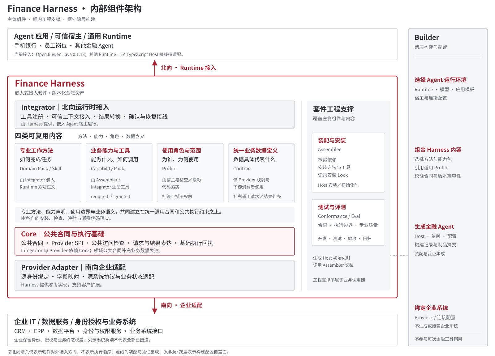
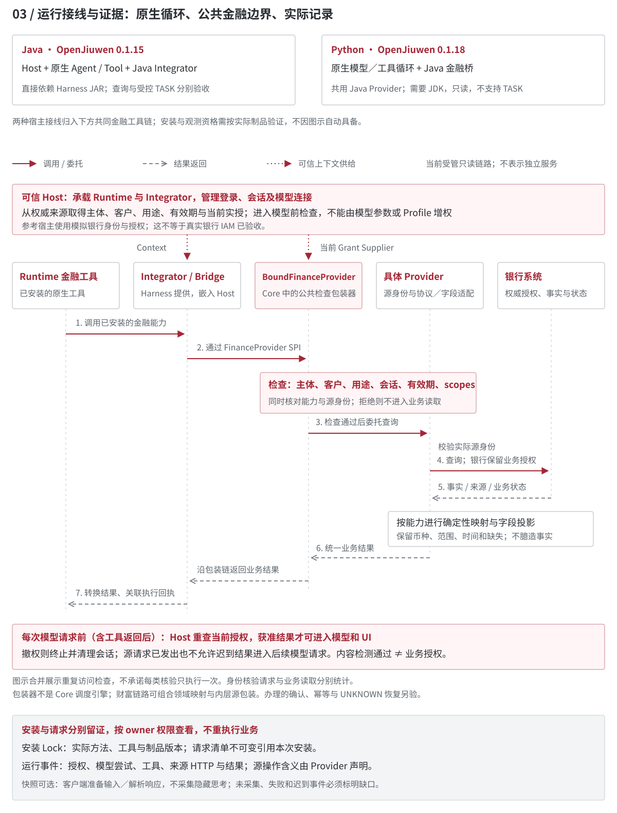

# Finance Harness 开发指导

**公开开发版 V1.0 · 接入套件候选 V0.1 · 2026-09-17**

本版从开发者的第一步出发：使用已有能力、上传专业方法、交付新来源或新能力，再验证新 Agent 是否真的安装并使用它们。创建入口仍按场景模板、模板内业务模块、底层框架组织。26 个模块是来源目录，不代表已全部实现。文档版本不表示新的 SDK 或业务验收版本。

面向场景作者、银行适配开发者、Builder 开发者与接入团队。指南版本升级不代表 SDK 或业务成熟度升级。本指南公开设计、扩展方法和自测入口，不包含私仓源码附录、部署配置、凭据或客户数据。

第一次使用先看第 0 章；架构看第 1 至 4 章；上传与发布看第 14 章；接企业来源看第 8、9 章；让 Agent 正确选择能力看第 15 章。运行代码需要维护者提供获授权的仓库或开发包，阅读指南本身不需要登录。

## 0. 从哪条路径开始

| 你要完成的工作 | 起点和改动 | 交付后如何证明可用 |
| --- | --- | --- |
| 组合已有能力 | 工作台「创建 Agent」选择模板、业务模块、Runtime、已配置连接；不写 Provider | 构建成功，安装 Lock 含所选能力；未选工具实际不可调用 |
| 定制专业方法 | 「业务资产」导入 `.md`／Skill ZIP 或从已有业务复制，修改 `SKILL.md` 和案例 | 保存草稿、校验、受控试跑、发布版本，再构建新 Agent；详见第 7、14 章 |
| 分发已发布的方法组件 | 下载工作台生成的业务组件 ZIP；目标工作区「导入组件包」 | 目标重新核验依赖、试跑、发布，选目标版本构建；上传成功本身不等于准入 |
| 新增企业来源或业务能力 | 获授权代码仓中的 Provider／能力合同及测试；必要时维护者更新受管目录 | 负向权限和缺数案例通过，新资产准入并装配后才能在页面选择；详见第 8、14 章 |

**最短上手路线：**先用合成数据完成“组合已有能力”，再修改一个 Skill 并重新构建；只有现有合同无法表达需求时才进入新 Provider／Capability 开发。工作台账号、源码权限、目标银行测试授权是三个不同前提。导入文件不能授予客户访问权限，也不能把上传的代码当作插件执行。

本指南中的历史测试数量只属于对应固定版本。当前工作台和包规范须核对实际目录与安装 Lock；旧 Agent 不因目录或文档更新自动升级。

## 1. 设计目标与必须坚持的原则

**让更多开发者在通用 Agent Runtime 上，装配专业方法、接入银行能力，并复用已经可验证的金融执行约束。**

通用 Runtime 负责模型、Agent Loop、工具和会话；Harness 把金融能力的身份、事实含义和业务状态接入这些机制。银行仍拥有授权、风控、适当性和最终业务结果。不是装上一个 JAR 就自动获得金融专业性，也不是另建中央 Harness 服务。

| 设计原则 | 开发时怎样落实 | 评审看什么 |
| --- | --- | --- |
| 以业务含义沉淀，不按接口数建包 | 同口径接口差异放 Provider；独立行为定义 Capability | 与已有能力有什么不可兼容差异 |
| 按模板找任务，按职责沉淀，按需组合 | 模板内业务模块引用共同能力；身份前提留在宿主检查 | 不按卡片复制 Pack，不以模板授予权限 |
| 方法与执行能力分开 | Domain Pack 写步骤；Capability 声明工具；Provider 接线 | 改方法是否要重写接口 |
| 客户差异留在扩展资产 | 配置、Skill、映射与公共实现分离 | 依赖同一制品，而非复制 Core |
| 授权和事实不靠模型补齐 | 实授来自可信宿主；确定性映射；明确缺失 | 错身份不读，缺数不默认填零 |
| 公共机制在实际路径上执行 | 工具前、模型前、确认和恢复均接检查 | 不是只在 Prompt 写安全要求 |
| 只安装任务需要的工具 | 固定合法组合及安装清单 | 伪造未安装工具也不能执行 |
| 每项贡献都能自测、追溯 | 交付正反例、执行入口、版本与证据 | 空测试不通过，目录不等于已执行 |
| 从重复需求反向抽象 | 先有消费者和业务依据，再提升公共合同 | 不以原语、Pack 数量证明价值 |

要降低的是**重复实现执行约束和重复接入的工作量**，不是消除业务口径确认、接口适配和回归。能力可以增加，但相同的授权、确认、恢复逻辑不应跟着重复增加。

## 2. 总体架构与构建／运行关系

### 2.1 套件里有什么，北向与南向怎样接入



总览按**套件组件归属**分组，不表示部署拓扑或从上到下依次执行。左侧主体展示 Integrator、四类可复用内容、Core 和 Provider；Harness 大框内右侧纵栏是覆盖这些组件的工程支撑，大框外最右侧是 Builder。**北向箭头从 Harness 上边界向上接 Agent 运行环境；南向箭头从下边界向下接企业系统。** 两条箭头只表示对外接入方向，不代表请求、数据的单向流动或执行顺序，也不从内部组件引出。Integrator 与 Provider 同为灰色接入层，Core 用浅红色突出公共基础；颜色不表示验证状态。

南向采用“企业适配”，不限定为银行系统。当前银行模拟器与 EA 的参考适配及验证范围保持原有边界；图中的 CRM、ERP 等是系统类别示意，不代表已交付所有连接器。

**Integrator 的代码归属是 Harness，部署位置是 Agent 宿主。** 总览只在套件内画一份组件，不在外部宿主再画一套。宿主实际承载 Runtime 和 Integrator，提供可信身份、实授及会话；这些运行检查在下一张图中展开。

**四类可复用内容回答四个问题：怎么做事、能做什么、为谁使用、数据代表什么。** 它们共同建立在统一调用合同与公共执行约束之上，但各有消费者，不是四个运行引擎，也不由 Core 统一加载或解释。中文名称用于说明用途，英文组件名及现有目录保持不变。

| 可复用内容 | 对应组件 | 回答什么 | 主要消费者与边界 |
| --- | --- | --- | --- |
| 专业工作方法 | Domain Pack / Skill | 如何完成专业任务 | Integrator 装入 Runtime 方法正文，依靠受控能力取得事实；Core 不解释 SOP |
| 业务能力与工具 | Capability Pack | 能做什么、如何调用、需要什么条件 | Assembler／Integrator 注册工具；调用采用 Core 请求、结果与 Provider SPI，清单不实现银行接口，声明不等于实授 |
| 使用角色与范围 | Profile | 为谁、为何使用、如何展示 | 宿主及检查／投影代码落实；沿用可信 Context 和实授检查，Profile 自身不授权 |
| 统一业务数据定义 | Contract（领域公共合同） | 金额、资产、风险记录等数据代表什么 | Provider 映射和消费者共同使用，保留来源口径差异；补充 Core 通用外壳，不将全部业务字段放入 Core |

图中 `Contract` 是领域业务数据合同的展示名称；Core 的通用请求、结果合同仍属于 Core。这一名称调整不新增模块，也不改变代码目录或合同版本。

例如“核对资产信息，看看还缺什么”：专业方法规定核对步骤；能力包声明可查询哪些事实；Profile 说明客户自助或员工服务用途；数据定义明确币种、统计范围、时间及缺数含义。真正的访问仍经宿主与银行授权，方法是否被遵循仍需评测。

Core 是 Integrator 和 Provider 共同依赖的合同、SPI 与公共检查基础；保持小而稳定是设计目标，不代表候选版本已经承诺 API 稳定。Provider 实现 SPI，Core 不依赖具体银行 Adapter。Harness 提供 Provider 参考实现；客户可在适配层扩展源身份绑定、字段映射和协议转换，并按相同合同与边界用例验证，不必复制或修改 Core。

Builder 纵向覆盖上方 Agent、中间 Harness、下方企业系统连接区域，表示**跨层构建配置覆盖面**：选择 Runtime／模型／模板、组合方法与能力包、引用适用 Profile、校验合同兼容性、绑定 Provider 与连接，生成 Host 及制品。合同是组件协作约定，不是业务功能开关。Builder 不生成或接管企业系统，不参与每次金融工具调用。

Builder 与套件工程支撑的虚线表示“装配与验证集成”；实际安装由生成 Host 在初始化时调用 Assembler。Builder 的构建记录与 Assembler 的安装 Lock 不相互替代。

**套件工程支撑覆盖左侧组件与内容，不专属于 Provider，也不并入 Core。** 图中改为 Harness 内右侧纵栏，纵向跨越 Integrator 到 Provider，以分隔线区别于主体内容；栏内区分装配安装与测试评测。它和外部 Builder 归属不同，不能把两栏视为同一个组件。

| 工程支撑 | 做什么 | 主要使用时机 |
| --- | --- | --- |
| 装配与安装：Assembler 装配库 | 核验依赖、安装方法与工具、记录安装 Lock | 应用安装／初始化，由 Host 调用 |
| 测试与评测：Conformance／Eval 工具 | 检验合同、执行边界与专业质量 | 开发、测试、发布验收与回归；按对应组件的实际检查入口执行 |

“覆盖”表示支撑职责面向套件，而非所有组件和业务场景已经全部验证。实际执行范围、未检查项和真实接入状态仍以报告为准。

当前只读工作台支持 **OpenJiuwen Java 0.1.15 与 Python 0.1.18（通过 Java 金融桥）**，详见第 13 章。EA 数据 Provider 表示 Java Agent 可读取受管 EA 数据，不等于 EA TypeScript 宿主已接入 Java Harness。其他 Runtime、其他银行系统需要开发和单独验收，不能把可扩展位置当产品承诺。

### 2.2 一次金融工具调用，实际经过哪里



当前受管接线为：`Runtime 金融工具 → Integrator / Bridge → BoundFinanceProvider → 具体 Provider Adapter → 银行系统`。Bridge 通过 `FinanceProvider` SPI 调用注入对象；`BoundFinanceProvider` 是 Core 中的公共授权检查包装器，不是独立调度引擎，也不会仅因依赖 Core 就自动注入任意宿主。

返回结果沿原链处理，Provider／领域消费者负责相应的事实映射与字段投影，Bridge 转换结果并关联回执。源身份检查由相应 Provider 落实；宿主在每次后续模型请求前重查当前授权。内容检测、安全提示或最终 HTTP 拒绝不能代替这些检查。图中合并了重复核验；财富能力还可组合领域映射和内层源包装，不承诺所有场景都是恰好五个对象。

**构建与安装分开：** Builder 选择资产、校验依赖、配置绑定，生成应用制品与构建记录；生成 Host 启动时调用 Harness Assembler，核验实际依赖、安装方法与工具，产生安装 Lock。Builder 的装配 UI 与生成 Agent 的应用模板不同，启动／停止是工作台管理能力，生成 Agent 不必依赖 Builder 才能运行。

Builder 不在每次银行调用的中间；Domain Pack、Capability Pack、Profile 也不是依次执行的三个引擎。

AG-UI 是宿主与界面之间的交互协议；Markdown 排版由前端完成。它们不负责银行授权、金额口径或交易确认。目前也并非任意 Runtime、任意前端都能从模板选择。

## 3. 内部组件：形态、职责与边界

用 **Integrator（运行时适配）** 和 **Provider Adapter（企业侧适配）** 区分北向与南向，代码目录为 `integrations` 与 `providers`，不是新增两套机制。下列银行参考实现仍按实际协议说明，不因总览用语扩展而增加已验证范围。

| 组件 | 当前交付形态 | 负责什么 | 不应放什么 |
| --- | --- | --- | --- |
| Core | Java 库、四合同与 SPI | 调用上下文、QUERY/TASK 外壳、访问边界、基础回执 | Agent Loop、所有财富字段、银行风控、UI |
| Integrator | Harness 提供、嵌入 Host 的 OpenJiuwen Java 集成库 | 原生 Tool 安装、结果转换、宿主确认和恢复、装配核验 | 不重复建设宿主组件、Runtime 或银行业务状态机 |
| Provider Adapter | Java 实现与源身份接线 | 本行协议、字段、错误和任务状态映射，核对源身份 | 用模型猜字段、替银行授权或记账 |
| Capability / Pack | 版本化 `pack.yaml` | 能力 ID、输入 Schema、QUERY/TASK、所需 scopes；包组织一组能力 | Key、权限授予、每接口一套公共机制 |
| Domain Pack / Skill | Pack 声明与 `SKILL.md` | 专业方法、任务步骤与输出约定，加载到 Runtime 提示正文 | 硬权限、独立编排引擎、银行最终决策 |
| Profile | 角色、用途、可见范围的约定与引用 | 描述投影边界，由宿主及具体检查／投影代码落实 | 当前不是通用 Profile Engine；改标签不授予权限 |
| 领域公共合同 | 财富 Java 模块与 Schema | 金额、范围、测评、来源、缺口的确定性表达与消费 | 全行业本体、跨风险体系换级、适当性推断 |
| Catalog / Solution / Lock | 目录、装配输入、安装结果 | 可选资产、固定组合、实际版本和摘要 | 目录不等于 UI 可选；Lock 不认证远端银行 |
| Conformance / Eval | 合同、行为与业务用例 | 边界验证；专业输出另做模型和专家评测 | 用格式检查替代业务正确性或真实授权验收 |

四合同为 `FinanceContext`（谁为谁做、用途与当前范围）、`CapabilityRequest`（能力、参数、任务引用）、`CapabilityResult`（事实或办理状态）、`EvidenceReceipt`（请求、来源、任务与结果关联）。

轻量外壳不代表每个能力都有严格业务输出 Schema。共享消费字段应在领域模块定义版本合同，而不是一直向 Core 或自由 Map 塞字段。

## 4. 沉淀粒度：到底新增什么

**接口、能力、包、方法、场景是五种不同资产，不是一一对应关系。**

| 层次 | 示例 | 何时增长 |
| --- | --- | --- |
| 银行接口 | 活期、定期、渠道源接口 | 对接更多系统；主要增加源适配 |
| Capability | 查询指定范围的账户余额 | 独立结果、授权或执行生命周期需要独立契约 |
| Capability Pack | 一组已声明的只读能力 | 共同交付依赖、范围和版本，不必每能力单建包 |
| Skill / Domain Pack | 资产核验、访前准备 | 专业目标、方法、触发、证据与输出不同 |
| Solution | 客户自助、员工访前助手 | 选择模板、方法、能力、连接和角色边界 |

### 4.1 新需求的判定顺序

1. 换说法、排序或分析步骤，事实与权限不变：优先改 Skill。
2. 结果口径和边界相同，只是本行接口不同：优先换 Provider 映射。
3. 要未有的事实、独立输出或新的授权范围：评审新 Capability 或现有能力版本。
4. 从读取变修改，或确认、幂等、查证语义改变：独立定义办理能力，不能借查询偷偷执行。
5. 多个消费者确实缺同一公共执行语义，再评审 Core／Integrator 的兼容演进。

独立能力要说清：业务含义是否稳定，是否可跨任务复用，权限／结果／异常是否独立，能否独立替换和验证。不要机械用数量打分代替业务判断。

### 4.2 两个常见边界

- “工资卡余额”和“某张卡余额”若是同口径授权余额，可作为同一能力的参数；“余额”和“家庭总资产”不是同一事实，不能为减少数量混合。
- “财富概览”可指事实读取，也可指组织说明。当前公共切片有确定性事实映射／描述，再由 Skill 组织表达。增加持仓分析、联系记录、推荐理由，要逐项确认数据与方法，不能全塞进万能概览工具。

禁止两个极端：每 API 复制一套 Harness；或者只做 `execute_any_api`，把字段、权限与操作选择都交给模型。能力可以很多，一个 Agent 应装配受验证的任务子集，而非暴露全行工具。

### 4.3 场景、卡片与业务能力怎样对应

**按场景模板组织入口，按业务模块选择功能，按业务职责沉淀能力。**

模板表达完整任务或助手方案；组件表达可装配、可验证的业务本领。卡片可引用一个能力或紧密相关集合，
不强制等于一个接口、Pack或Agent。宽卡片必须显示具体范围、操作和实际工具，不能用“理财购买”“信用卡办理”掩盖未实现业务。

余额查询可独立成能力；转账办理应包含预检、冻结、可信确认、提交、查证生命周期，不机械拆成任意勾选的步骤。
收款人查询、报价若有独立消费者，可另作查询。只读选择不得安装办理工具。这里的办理是粒度示例，不是本轮开放功能。
财富推荐、保险教练、投研报告通常是专业方法或场景；智能审核须限定对象和输出。

涉诈风险需区分权威接口、强制办理约束、专业审核方法。必要风控、授权、确认和证据不可关闭，模型护栏不替代银行决策。
金额、币种、引用、来源、事实时间、风险体系及缺失状态是Contract语义，不必成为卡片。
新方法改Skill，新操作补Capability/Provider/案例，新语义才补领域Contract，范围复用或调整Profile，换Runtime才需Integrator；不是新增特性就新建四类资产。

BIAN Service Landscape 的服务领域分类、ISO 20022 Business Model 的业务概念可供参考；它们不直接规定金融Agent原语、UI卡片或本项目授权模型。
不据此宣称符合标准，具体业务口径以接口、数据字典和业务负责人确认为依据。

### 4.4 业界标准：参考什么，不承诺什么

工作台左下“业界标准”提供以下官方入口与核实记录，核实日期为2026-09-10。
它是设计参考，不是产品认证，也不规定本项目的26模块或能力安装组合。

| 参考与版本 | 用途 | 已核实及适用边界 |
| --- | --- | --- |
| [BIAN Service Landscape 14.0](https://bian.org/deliverables/service-landscape/) | 参考服务域的分类与组织方式 | 官方版本和分类用途已核实；未进行模块与服务域逐项映射 |
| [ISO 20022 Business Model](https://www.iso20022.org/iso20022-repository/business-model) | 参考业务概念、关系与数据字典 | 已核实官方模型说明，未固定模型快照，未声明字段符合性 |
| [GB/T 27926.1-2021](https://std.samr.gov.cn/gb/search/gbDetailed?id=C8394B1AA0EF4558E05397BE0A0A8876) | 金融业通用报文方案第1部分元模型，国内采标参考 | 仅核实官方条目及等同采用ISO 20022-1:2013的关系，全文条款未核实 |
| [WCAG 2.2](https://www.w3.org/TR/WCAG22/) | 通用Web重排、键盘、焦点及触控参考 | 非ATM硬件或银行专用规范；本产品整体符合性未评估 |

不能因“参考了标准”而放宽银行授权、数据口径或业务决策；没有直接核实依据时明确标为项目约定或待确认。

## 5. 谁来开发，客户怎样定制

| 想改什么 | 谁主要完成 | 交付与工作边界 |
| --- | --- | --- |
| 已有模型、连接、能力组合 | 使用者／接入者 | 已支持选项配置；不写 Core，不通过 UI 增权 |
| 方法、材料结构、触发、缺数话术 | 场景作者＋业务评审人 | Skill、Pack 版本、业务案例；未支持资产需开发者接入 |
| 本行接口、字段、可信身份 | Adapter 开发者＋银行 Owner | Java 映射、身份接线、合同与负向测试 |
| 新增业务能力 | 场景与 Adapter 开发者 | 声明、领域输出合同、实现、注册与用例 |
| 构建组合或页面选择 | Builder 开发者 | 有限 recipe、依赖、宿主接线、构建与取消能力回归 |
| 公共执行或新 Runtime | 技术架构／Runtime 团队 | 兼容评审、Integrator、生命周期与消费者回归 |

客户应交付自己的扩展资产和 Adapter，依赖同一 Harness SDK，不必 Fork Core 长期分叉。**当前不具备“上传任意 Skill／接口文件就自动生成任意金融 Agent”的能力。** 新资产要显式加入支持的装配，不把示例当自动插件市场。

难度按改动种类判断，不承诺“每接口几分钟”。配置改动通常最少；方法需要业务评测；源适配需要身份、数据与异常验证；办理还需确认、恢复测试。自行开发应有模板、合同、用例和诊断，不只是读架构介绍。

横向组件不必伪装成业务 Capability：知识源接 Provider／上下文供给；护栏接真实 Host 模型或工具边界，保留权威授权；UI 接展示协议。是否新增能力取决于独立业务语义，不取决于代码是否新写。

## 6. 今天有哪些可复用基础

| 资产／能力 | 复用内容 | 使用限制 |
| --- | --- | --- |
| `account.balance.query` | 授权范围内账户，或指定账户余额 | accountId 不等于权限；只读组合不附带转账 |
| `wealth.facts.describe` | 来源资产、风险测评记录、信息缺口 | 不是家庭总资产、正式推荐、适当性结论 |
| `finance.transaction-summary.query` | 指定月份的收入、支出与净额摘要 | UTC账期、前100账户；历史覆盖未核实，不默认月份 |
| `finance.spending-analysis.query` | 指定月份的收支分类与趋势事实 | BOOKED/CNY；源账期时区及趋势可比性未核实，不生成比较结论 |
| `transfer.internal.create` | 模拟行内转账任务，沿用预检、确认、提交与查证 | 仅 Java 受控环境；不是只读能力，不因安装而获得实授或真实银行办理资格 |
| 财富／保险访前、内部风险审核方法 | 已有 Domain Pack 和参考适配 | 范围各异，不等于当前 UI 全部可选 |
| 可信调用、宿主确认、任务恢复 | Core、Integrator、Provider 公共约束 | 宿主必须接线；办理仅隔离模拟回归 |
| 财富共同事实与消费者 | 两种源结构确定性映射与缺失处理 | 新格式仍需代码；风险体系不自行换算 |

此前只读基线为 **4项业务Capability、3个装配单元、7种非空组合**：余额、财富事实、收支查询与分析。当前受管目录还包含行内转账 TASK；Java 模拟办理与 Python 只读支持范围不同。收支单元包含两项能力，当前成组安装；不能在页面单独取消其中一个工具。仓库里的其他声明不自动成为菜单。本轮来源仍为完整合成银行模拟器，不等于真实银行授权验收。实际可选项应以当前目录、Runtime 兼容检查和构建 Lock 为准。

### 6.1 模板、业务模块与框架

新版候选入口：**场景模板 -> 业务模块 -> 底层框架 -> 模型、连接与界面样式**。
模型多选并指定默认模型；框架单选，不是多Agent协同。身份角色留在模板与可信宿主中，不由首页标签授予权限。

| 模板/模块 | 当前范围 | 边界 |
| --- | --- | --- |
| 手机银行：账户服务 | 余额查询 | 交易明细、转账等未接入 |
| 手机银行：财富聚合服务 | 财富概览、测评状态与信息缺口 | 不等于源Demo全部财富业务已接通 |
| 手机银行：金融助手 | 交易摘要、收支分类与趋势事实 | 模拟环境已接入；日历、FAQ、比较、测评等其他操作未接入 |
| 手机银行：其余23模块 | 固定源码目录 | 待接入，不安装工具 |
| 财富助手、保险教练、团险审核、贷款审核、投研助手 | 本轮未核验其模块和宿主 | 仅展示待接入 |
| OpenJiuwen Java 0.1.15 | 当前只读框架 | 构建与安装时核验实际版本 |
| OpenJiuwen Python 0.1.18 | 已接三单元七组合 | 原生 Python 循环 + Java 金融桥；非纯 Python SDK |

手机银行目录固定上游main提交 `3b430100b38037884f7eec51b33a7625e4276cca` 的26个业务Agent模块，
不含总入口及四个分流模块，不因供给目录扩展到D29额外增加三项。默认八项，可展开、搜索和查看详情。
上层模块不是一个工具或一个Pack，详情明确区分原Demo操作声明与当前真实接入。

目录0.1.1仅将账户助手、转账助手、信用卡助手的显示名统一为“服务”，旧名称作为搜索别名保留。
目录0.1.2保持26个模块ID不变，将金融助手的收支单元接入有限配方；金融助手仍包含日历、FAQ、比较和测评，不收窄为“收支分析”。收支操作单独复核上游 `db38c7f`，不将该版本冒充整个26项目录重新盘点的版本。

安全服务模块属于银行业务，不是公共安全开关；不选择它也不能关闭身份、实授、只读与证据检查。
跨角色、真实授权与同条件Provider替换分别验收。

### 6.2 从文件到页面与验证

以下路径相对获授权Builder开发包的 `community/finance/builder/finance-solution-builder/`，不在Harness Core。

| 文件 | 修改或核对什么 |
| --- | --- |
| `src/finance_solution_builder/template-modules.v1.json` | 模板/模块归属、固定来源、默认项、框架状态 |
| `src/finance_solution_builder/template_modules.py` | 派生实际工具、重新解析选择、核对模板身份与有限支持矩阵 |
| `src/finance_solution_builder/workbench_contracts.py` | 0.5请求与0.2/0.3/0.4兼容 |
| `src/finance_solution_builder/service.py` | 三装配单元、七种只读配方；方法声明范围与工具安装范围分别检查 |
| `browser/workbench.js`、`examples/local-workbench/live.css` | 页面源码与样式，修改后重新打包 |
| `tests/test_template_modules.py` | 正常、缺资产、错误模块/框架、身份与映射不一致 |
| `engineering/verify_template_modules_ui.mjs` | 实际页面、拒绝路径、窄屏与可选真实编译 |

练习：保持Provider、Profile及能力包不变，将手机银行模板 `defaultModuleIds` 改为
`["agent.account"]`，更新目录版本。默认仅选择账户，财富模块仍可手动加入。
增加默认选择与构建断言，确认实际工具只含余额；无需复制Pack或Provider。
新角色、新宿主及新业务模块不能只修改JSON启用，必须先完成真实适配与验证。

```bash
python -m pytest tests/test_template_modules.py tests/test_directory.py tests/test_workbench_contracts.py -q
npm run build:ui
python -m finance_solution_builder.workbench --harness-repo <harness工作副本> --port 18158 --data-dir <独立测试目录>
node engineering/verify_template_modules_ui.mjs "$STUDIO_LOCAL_URL" <页面证据目录> build
python engineering/verify_multi_model.py --harness <harness工作副本> --output <原生证据目录> --template-modules
```

运行服务的终端保持打开，在另一终端将 `STUDIO_LOCAL_URL` 设置为启动日志显示的本机地址，再运行页面检查。
按Builder README准备Python、Node、JDK21、Maven和Playwright/Chromium。目录快照、生成Solution、制品Lock及
实际安装Lock分开核对。原生入口使用受控HTTP模型与合成银行，不代表实际模型质量或真人独立接入。
候选未配置模型/银行时可构建，但启动仍被配置门禁阻断。

旧0.4目录和API保持历史兼容，旧双入口浏览器脚本不再用于新版页面验收。旧Agent不自动升级；修改配置产生新版本，
启动旧制品不按最新目录重新选择工具。客户改名称、默认组合无需改Core；新操作仍需合同、Provider和负向案例。

Skill正文仍是专业方法提示章节，不是执行引擎。allowed-tools不授予权限，硬边界由实际注册与可信执行检查落实。

### 6.3 在工作台选择能力并维护专业方法

本节覆盖既有方法管理与本轮收支增量，具体实现版本以交付清单和生成制品Lock为准；指南版本不是SDK版本。26 类业务模块是导航，不是 26 个已交付 Harness 包。
模块详情展示已接入的余额、财富、收支能力组合，详情勾选与模块卡片同步；其他候选能力仍为待接入。
有组合约束时按组选择。当前方法依赖的能力不能取消；身份、实授、撤权与必要证据不作为可关闭的选项。

操作顺序：**业务资产 → 新建、复制默认方法或导入 → 编辑并保存 → 受控检查 → 发布版本 → 用于新 Agent → 构建、启动与核对**。

| 步骤 | 实际操作及边界 |
| --- | --- |
| 导入 | 支持 `SKILL.md` 或含该入口的 ZIP；根目录或一层封装目录，参考文本在 `references/` |
| 编辑 | 填写方法、维护人、已支持的能力依赖、必需参考文本及案例；修改后先保存再检查 |
| 资源 | 上传最多512 KiB、32文件、单文件64 KiB、展开总量256 KiB；拒绝越界及链接，不下载远端URL |
| 脚本 | `scripts/` 仅留存、不执行；方法依赖脚本执行时本版不能启用，不伪装为已接入 |
| 受控检查 | 真实Java宿主配受控银行和脚本模型，比较默认/草稿的实际安装和调用；不是专业质量评审 |
| 真实模型预览 | 明确选择服务端模型，发送方法与合成事实并消耗模型额度；显示真实回答、工具事实与来源 |
| 发布 | 冻结当前方法、依赖、资源和同版本检查报告；修改过的草稿不能沿用旧检查直接发布 |
| 应用 | 选择已发布版本构建新Agent，旧制品不自动更新；依赖声明不授予权限 |

必需参考文本带摘要装入方法，不只是保存在目录。案例预期答案不进入运行提示词。
真实模型预览与受控检查独立记录；模型擅自解释评级、推断来源等仍是待处理 BadCase，不能因为连通而判专业质量通过。
导入内容属于当前登录所有者的私有资产，不会自动写入 Harness 公共资产目录。

「计划装配」来自配置；实际运行后记录的方法ID、版本、摘要、工具与制品版本才是安装证据。
将其与当前buildId、制品Lock及会话返回核对。历史安装记录只证明该制品曾安装，不证明当前授权仍有效。
取消余额后重新构建，必须验证工具未安装，而不是仅观察菜单隐藏。方法替换以整个Domain Pack为粒度：仅依赖交易摘要的方法可独立声明，试运行将工具安装范围扩为收支组合，但不会改写方法依赖。它替换默认收支方法包，不自动保留默认支出分析SOP；分析工具仍受控安装。无关财富方法保留。方法依赖不是逐Skill工具权限沙箱。

受控检查复用兼容Host种子，删除各轮重复依赖JAR，保留小型私有证据。正式Agent制品仍保留，停止后由所有者管理删除；
旧种子及备份清理由维护者负责，不自动清空用户历史。首次部署必须在启动工作台的同一Python环境安装
Harness的 `engineering/requirements-conformance.txt`；缺失日期格式验证器时合同校验会失败，不得跳过。

独立真人操作与业务专家效果验收仍需另行安排，不由本指南或AI自测代签。

### 6.4 首批能力盘点：一组模拟接入，五组待接入

以下六组来自手机银行固定源码 `db38c7f` 及受控模拟器集成分支 `162ef4e` 的盘点。
模拟器是自有集成分支，不宣称该提交已进入同事上游。本次只核对源码与已有测试入口，未独立复跑整套上游测试。
它们大多填入既有模块，不需要新增六个一级模块。本轮只新增第一组收支，不扩展其余五组。

| 顺序／业务模块 | 候选Harness能力 | 主要可复用内容 | 接入前必须补齐 |
| --- | --- | --- | --- |
| 1／金融助手（模拟环境已接入） | 交易摘要、收支分类与趋势 | 成套只读能力、账期/金额/分类合同与解释方法0.1.1 | 显式年月；保留统计范围、时区、历史覆盖及趋势可比性缺口；真实银行与独立真人接入待验收 |
| 2／账户服务 | 交易明细、月结汇总 | 明细和汇总事实、受控账户引用解析 | 账户归属、分页、月份与完整性；无交易不等于来源失败 |
| 3／金融助手 | 风险测评状态查询 | 可复用现有财富事实中的体系、版本、有效期语义 | 独立能力尚未安装；有效测评不等于适当性通过 |
| 4／权益运营 | 本人积分、专享权益 | 积分单位、资格、到期、余次与客户术语映射 | 区分客户和信用卡积分；不附带兑换、领取、核销或报名 |
| 5／转账服务 | 收款人、规则、费用与限额查询 | 转账准备的只读能力 | 报价绑定对象、金额、规则和时间，不产生转账授权；POST也可能是业务只读 |
| 6／转账服务 | 已有转账状态查询 | 任务引用、银行状态与查证表达 | UNKNOWN先查证、不重提；人工查证申请或转账执行另行处理 |

源码盘点、合同通过、原生安装、真实来源验收分别记录。进入可构建目录前，还需Provider映射、权限与缺数负例、
安装/取消安装证据及生成Agent实际消费验证。源应用Skill中的缺失填零、单位转换和外部工具依赖也必须重新核验。

收支验收入口位于Builder开发包：`engineering/verify_cashflow_assembly.py`重跑七组合和仅摘要私有方法；`engineering/verify_cashflow_service.py`验证生成Java宿主的授权、缺数、隔离及撤权时序。它们使用受控模型，不等于实际模型质量评测。`engineering/verify_cashflow_browser.py`是显式实际模型与完整模拟器的三端入口，需维护者配置，不在普通CI自动消耗额度。既有教程七案例和财富五配置基线保持各自范围，不与七种新组合混计。

### 6.5 生成Agent的真实三端页面

Builder内的设备预览是配置示意；构建后打开的体验页是真实Agent页面，两者不能作为同一种验收证据。

| 终端 | 新生成制品的行为 | 边界 |
| --- | --- | --- |
| 手机 | 桌面有手机外框，内部可实际对话；手机去框铺满，消息独立滚动、输入区随可见视口适配 | 软键盘压缩视口自动测试不替代真人手机检查；语音沿用服务端接线 |
| 电脑 | 使用完整浏览器窗口；宽屏并排来源区，小窗口默认收起；用户主动进入或退出全屏 | 不强制16:9裁剪，兼容16:10和小窗口；不新增桌面安装包 |
| ATM | 屏幕外框、大触控入口、首页及结束服务；全屏时保留实际查询 | 仅浏览器模拟，不暗示读卡、PIN或出钞硬件已接入；首页不等于结束会话 |

三端共用原有AG-UI、授权与撤权、模型连接、来源卡片和会话清理，不复制金融规则。
信息核验卡将已知字段显示为资产覆盖范围、资产统计范围和未覆盖来源；原始字段键与状态保留在执行证据中，未知字段不猜测其业务含义。
UI资源摘要进入新制品Lock，旧Agent不静默升级；必须显式重新构建。模型密钥与管理权限不进入终端。
受控验证检查长回答、全屏内实际查询、结束后的前后端清理及重新进入，不用静态预览替代实际链路。
正常只读对话、并发撤权、真实授权及真人独立接入仍分开验收。

## 7. 路径 A：自己定制并验证一个专业方法

本教程只改专业方法，复用已准入的 `wealth.facts.describe`，不新增接口或修改 Core。起点是当前已获授权的 Builder 工作台和一个已配置的**合成数据**连接；第 14 章另说明组件 ZIP 的跨工作区交付。

### 7.1 从已有方法创建草稿

1. 打开「业务资产」，找到财富事实能力，选择定制专业方法；也可点「导入 Skill」上传一个 `SKILL.md`。导入结果是当前 owner 的草稿，不会自动进入正在运行的 Agent。
2. 在「依赖能力」只保留 `wealth.facts.describe`，查看自动给出的声明与引用检查。它只能发现一部分工具引用；未识别工具不能凭正文自动创建。
3. 打开「编辑原文」，把方法改成“财富信息缺口核验”：先调用现有财富事实工具，再列出金额的币种、覆盖范围和估值时间，接着说明风险测评状态与每项缺口。不要把未返回的金额写成零，也不要作产品推荐或适当性结论。
4. 在「验证案例」至少新增正常、零资产、缺失测评、错身份和问候五类。正例核对实际字段与来源；问候不应触发业务读取；错身份的业务读取数应为零。案例中的预期词只供检查，不会装入运行提示。
5. 保存草稿，执行「校验依赖」和「运行受控检查」。结构校验、脚本模型执行和实际模型专业质量是不同结论；需要业务表达评审时另做真实模型预览与人工核对。
6. 查看「本次将发布的组件边界」，核对工具、能力包、输入／输出合同、运行支持、所需 scopes 与验证范围。发布新版本，回到「创建 Agent」选择该版本，构建并核对 Lock 与实际工具清单。

原始参考方法在获授权 Harness 源码的 `domain-packs/wealth/shared-facts/skills/wealth-facts-description/SKILL.md`；受管页面入口在 Builder 的 `browser/method-assets.js`，后端校验与发布在 `src/finance_solution_builder/method_api.py`。**指南不要求把私仓源码上传到公开站点。**

### 7.2 自己完成一次修改，而不是只复跑

在上述版本基础上再创建一个草稿，改为“财富信息缺口核验 V2”：把输出固定为“已知事实／缺失或未覆盖／下一步需核实”，补一个“来源不可用”案例。更新版本并重新运行受控检查；旧发布版本和旧 Agent 的安装 Lock 应保持不变。若试跑没有覆盖新增案例，或取消财富能力后工具仍可调用，不能认为修改已经验证。

| 应看到的证据 | 正确含义 |
| --- | --- |
| 草稿与发布版本不同 | 未发布编辑不覆盖已发布资产 |
| 试跑报告包含新增案例 | 新方法确实接受检查，不是仅旧测试全绿 |
| 新 Agent Lock 引用新版本及摘要 | 新构建装入了此次方法 |
| 旧 Agent Lock 不变 | 版本更新没有静默升级旧实例 |
| 拒绝和缺数案例保持边界 | 专业方法没有代替身份授权或补造事实 |

### 7.3 常见卡点

| 现象 | 先检查 |
| --- | --- |
| 导入后看不到能力 | 当前工作区是否有准入的 Capability Pack；只写工具名不安装工具 |
| 保存后仍不能发布 | 草稿是否通过结构校验、当前版本受控检查和绑定确认 |
| 组件包导入提示依赖缺失 | 目标工作区的 Pack、版本、Runtime 或协议是否与包清单一致 |
| 新 Agent 仍用旧方法 | 是否明确选了新发布版本并重新构建；核对安装 Lock |
| 模型未按 SOP 回答 | 核对实际装入正文、工具结果和模型可见上下文，再做专业质量评审 |
| 查询返回 PARTIAL | 查看来源范围、事实时间和缺口，不把它当构建失败 |

开发者应记录实际修改文件或页面字段、受控案例、构建 ID、安装 Lock、耗时和求助次数。自动化或 AI 自测不等于未参与开发的同事完成独立接入。
## 8. 路径 B／C：换来源，或新增能力

### 8.1 先填字段定义与依据

| 要说明什么 | 至少回答 |
| --- | --- |
| 含义与范围 | 可用还是账面余额；本行还是外部资产 |
| 来源与身份 | 接口版本；源 Session 属于谁；谁授权这个客户 |
| 数值与时间 | 十进制、币种、精度；查询／估值时间；是否过期 |
| 风险记录 | 体系、版本、等级、有效期；不可自行推导适当性 |
| 缺失与冲突 | 零、未返回、未覆盖、不可用、过期、冲突分别处理 |
| 转换与验证 | 确定性转换、正反例、业务 Owner 待确认项 |

依据来自已核实接口、数据字典和业务确认。核实直接相关条款时才标标准版本及范围；没有依据就标项目约定或待确认，不给字段硬挂标准名。

### 8.2 同能力换 Provider

固定能力、角色、主体／用途、等价授权、资产口径和时间条件，再实现源身份绑定与映射。共享消费者只读共同合同，不增加“银行 A 读字段 X，银行 B 猜字段 Y”的 Prompt。

Provider 对象由宿主构造并注入；Solution binding 选择已实现 Provider，不自动生成 HTTP 客户端。当前财富 Mapper 支持明确格式，新格式需要开发和测试，不是改连接地址就替换成立。

### 8.3 新增能力

已有能力不能表达独立结果时，增加能力 ID、输入／输出语义、QUERY/TASK、所需 scopes、Provider 声明与实现，再接装配和测试。输出合同优先放领域模块，不强制每能力一个 Maven 模块。

下面是**交付组织建议，不是自动扫描的插件目录协议**：

```text
customer-extension/
  capability-pack/       新能力声明（需要时）
  domain-pack/           方法与 Skill（需要时）
  adapter/               源身份接线与确定性映射
  cases/                 合同、语义、权限、失败案例
  solution/              受支持构建输入与连接占位
  README.md              依赖、构建命令、预期与限制
```

首次注册需由维护者完成受管目录、Provider 安装与兼容检查；新资产准入后 Builder 应从目录发现，而不是为每项新业务改公共页面或增加业务分支。若现有执行协议确实不支持该能力，才评审 Host／Integrator 的公共扩展。每个来源都要复制鉴权、改 Core 规则或重写 Bridge，则说明公共边界需要整改。

## 9. 接到实际 Host，而非只装文件

有两种接入入口，最终使用同样的安装与运行机制，不要求所有开发者先接 Builder：

- **代码接入：** Host 依赖 SDK，构造受管 Provider 并接入可信身份，调用 Assembler 核验安装，然后启动会话、执行查询验证。第 7 章教程采用这一方式。
- **Builder 接入：** 选择模板与资产、配置身份来源与 Provider，生成 Host 工程和制品；生成的 Host 在初始化时调用 Assembler，再走相同的会话与查询验证路径。

| 接线位置 | 必须完成 | 不能代替它的东西 |
| --- | --- | --- |
| 身份与实授 | 实时读取主体、客户范围、用途、会话、有效期，核对源身份 | 前端 ID、Profile 标签、requiredScopes |
| 工具调用前 | 检查当前授权和参数，再访问来源 | Token 存在或上轮获授权 |
| 结果进入模型前 | 白名单投影，每次模型请求前重查授权 | 只在最终 HTTP 响应前拒绝 |
| 撤权与会话 | 清理受限历史，阻断迟到结果进入模型 | 禁新工具却回显旧客户数据 |
| 办理任务 | 宿主确认绑定任务／参数；未知结果保留原引用查证 | 模型填 confirmed=true、网络失败重提 |
| 装配与实例 | 实际 JAR、Pack 摘要及 Lock 对应本次实例 | UI 出现 Harness 标志 |

Core、工具边界、Host 模型前检查是共同责任。只依赖 Core 不会给任意 Runtime 自动增加撤权 Hook。配置身份字符串不能自证可信，业务授权仍由权威系统判断。

当前只读模板不注册办理工具。未来接办理要另验确认、幂等和 UNKNOWN 恢复，不因只读通过就开放交易。

## 10. 自己验证：命令、预期与定位

### 10.1 先跑已有离线基线

维护者提供可获取的固定 Harness 提交／开发包。环境为 Git、JDK 21、Maven 3.8+、Python 3.10+、Bash，允许临时回环端口。首次依赖下载需网络；本指南不是离线 SDK 依赖包。

在仓库根目录、**无生产凭据的隔离环境**运行，真实 Smoke 开关保持关闭，不与其他构建共用工作副本：

```bash
python3 -m venv .venv
.venv/bin/pip install -r engineering/requirements-conformance.txt
.venv/bin/python engineering/verify_contracts.py
mvn -B -ntp verify
.venv/bin/python -m unittest discover -s engineering -p 'test_*.py' -v
bash examples/solutions/wealth-facts-kit/run-controlled.sh
.venv/bin/python engineering/verify_wealth_kit.py
```

Maven 先于 Python 回归，后者消费实际 Java 时间样例。默认五配置预期为三份 COMPLETED、两份 REJECTED；拒绝业务读取为零，业务修改尝试为零。输出位于 `examples/solutions/wealth-facts-kit/target/runs/`。这些是受控工程用例，不是真实模型专业质量验收。

固定干净 Git 提交上可用 `.venv/bin/python engineering/run_onboarding.py` 记录复跑，不代填真人身份和求助次数。上述入口不自动发现任意客户目录的新案例；须将新增案例接入实际测试，核对执行数。

### 10.2 每种贡献要证明什么

| 贡献 | 最低验证 | 失败时先查 |
| --- | --- | --- |
| 改方法 | 触发／不触发、缺数／冲突、事实引用、模型与业务评审 | 正文是否加载、事实是否足够、方法冲突 |
| 换 Provider | 语义、精度、范围、风险体系、时间、错主体与坏响应 | 字段依据、可信绑定、映射和消费者 |
| 加只读能力 | 上述边界＋声明一致、安装／移除、未知参数 | Descriptor、Schema、recipe、工具清单 |
| 改 Host／Integrator | 撤权时序、两轮历史、客户隔离、实例代际、停止／重启 | 模型实际请求、原生事件、受管进程 |
| 加办理能力 | 模拟 confirm／submit／query 次数；重复、坏响应、UNKNOWN | 原任务和幂等键，不只查文案 |

### 10.3 硬边界不能被好回答抵消

| 负向案例 | 必须看到的行为证据 |
| --- | --- |
| 错主体／客户、无范围、过期 | 拒绝且无事实；业务读取增量 0，身份核验另计 |
| 源请求已发出、返回前撤权 | 不撤回已发请求，但迟到事实不得进后续模型请求；清理会话 |
| 两轮和两个客户 | 第二轮首个模型请求带有效前轮标记与工具结果；另一客户没有 |
| 零／缺失／未覆盖／过期 | 分别表达；显式 missingSources 不能被说成完整 |
| 取消能力重新构建 | 新实例实际不安装，伪造调用不能执行；只读写入为 0 |
| UNKNOWN（仅模拟） | 查同一原任务，不新建、不重提、不把观察失败当银行失败 |

HTTP 拒绝不证明没先读数据，消息数大于三不证明跨轮记忆。断言对真实源／模型请求生效；新增回归应能在故障版本或故障注入下失败。

## 11. 贡献、版本与交接清单

短期分支和 PR 的顺序：粒度判断 → 字段／方法依据 → 实现与用例 → 新制品 → 评审交接。贡献者不必理解全部 Core，但要清楚自身边界。

| 提交项 | 填写内容 |
| --- | --- |
| 任务与 Owner | 目标、角色、客户／用途、不做什么 |
| 粒度选择 | 复用哪些；为何改 Skill、换 Provider 或新建能力 |
| 专属与公共改动 | 资产／映射／配置；Core／Bridge 必要性；Builder 注册点 |
| 业务依据 | 源合同、字段规则、缺口、业务待确认项 |
| 自测入口 | 实际命令、执行／失败／跳过数、负例、报告 |
| 固定版本 | Harness、Runtime、Provider、Pack、Builder、配置与摘要 |
| 兼容与回退 | 旧样例回归、新实例构建、旧制品和 Lock 保留 |
| 待验收 | 真实授权、真实替换、维护者接纳、非原作者操作分别记 |

已使用 Pack 内容变化应更新版本与引用、重新构建，不覆盖旧 JAR 后沿用旧 Lock。SNAPSHOT 名称不足以重现，应核对摘要。新增字段也可能破坏严格读取器，不默认“加字段就兼容”。

业务 Owner 管场景与口径；技术架构组管公共 Harness 和参考适配；Runtime 团队管引擎；Builder Owner 管生成和界面；场景工具组管独立接入和复制。AI 自测不代替这些角色签认。

## 12. 怎样证明开发和复用真的更容易

先做三个实验，不急着加几十个包：

| 实验 | 固定什么、改变什么 | 有价值的结果 |
| --- | --- | --- |
| 方法复用 | 固定事实能力，增加资产核验 SOP | 主要改 Skill、案例，不复制读取与执行规则 |
| 来源适配 | 固定能力、消费者、角色、等价授权，换 Provider | 私有差异留在适配，Skill 无 Provider 分支 |
| 新能力贡献 | 新增一个明确只读事实 | 增声明、映射、注册、测试，复用授权、证据、装配 |

访前准备若要新的联系记录或产品明细，须如实记为新增数据能力，不当成“只写 SOP 就完成”的提效案例。

记录专属／公共文件改动、人工耗时、自动构建耗时、冷／热缓存、求助数、失败原因、旧功能回归。无旧流程基线不算提效比例，无其他同事参与不写独立接入通过。

| 验收维度 | 能证明什么 | 不能顺带宣称 |
| --- | --- | --- |
| 离线合同与行为 | 已覆盖格式、语义、边界 | 真实银行授权、模型专业性通过 |
| 受控双源／跨角色 | 映射、本地投影有效 | 两银行只换 binding 已可用 |
| 模拟器＋真实模型 | 指定组合能查模拟数据并对话 | 生产身份、客户、所有模型已验收 |
| 同条件真实替换 | 该能力在两来源可替换 | 跨角色展示替代此验收 |
| 非原作者亲自接入 | 文档、资产具备独立使用证据 | AI 执行等于真人体验 |

**长期目标：新增场景更多通过组合完成，银行差异集中在适配，开发者在稳定边界内自行扩展、验证。** 先证明第三、第四项贡献不必反复改公共执行规则，再按实际重复需求扩大套件。


## 13. Java 与 Python 接入、固定方法和历史核验

本节更新当前只读工作台的运行范围。前文旧教程的固定版本及历史测试数字仍只属于原教程，不能替代本节对应制品的验收。

### 13.1 当前支持什么

| 选择 | 可装配内容 | 实际依赖 |
| --- | --- | --- |
| OpenJiuwen Java 0.1.15 | 余额、财富事实、收支以及七种非空组合 | Java Runtime 与 Harness Java 制品 |
| OpenJiuwen Python 0.1.18 | 同样的三个只读单元、四个工具和七种组合 | Python 原生模型与工具循环，加独立 Java 金融桥 |

行内转账是另行受控的 Java TASK 能力，不属于上述七种只读组合。Python TASK 在当前有限组合中应拒绝，不自动回退到 Java；真实业务办理仍待授权和环境验收。

收支单元包含收支汇总、支出分类两个工具；不是增加两个银行业务模块。三个单元采用共同身份、授权、事实映射及历史机制，不按 Runtime 复制 Provider。Python 当前仍需要 JDK 21，不能按纯 Python SDK 部署，也不意味着任意 Runtime 或语言已接通。

Builder 先选场景、业务模块、Runtime、已配置模型与企业连接，生成独立制品。选择项必须进入实际安装清单；未选择或未适配的能力不能仅靠模型参数启用。当前只读参考入口不等于全部正式 Candidate Backend 特性都已完成。

### 13.2 修改方法而不复制金融执行机制

在业务资产中创建或导入方法，声明所需能力及对应案例。保存后先校验，再运行受控装配与执行检查，通过后发布不可变版本。为新 Agent 选择具体方法版本后重新构建；方法引用及摘要进入本次制品记录。

新版本不会覆盖旧 Agent 中的方法，也不会自动修改过去请求的安装记录。修改金额口径、来源接口或实授范围不是改一段 SOP 就能完成的事：分别进入 Provider 映射、能力合同和可信授权接线，再运行对应负例。

### 13.3 历史记录能核对什么

运行记录关联请求、实例、工具、来源、方法及安装版本。查看历史不触发模型、Skill 或企业接口重执行。业务结果、执行异常、资料缺失和观测缺口分开呈现。

模型正文快照默认关闭。经授权开启后，可核对客户端准备的请求与解析后的可见响应：

- `CLIENT_REQUEST_PREPARED`：客户端准备消息、工具定义和允许记录的参数。
- `PARSED_MODEL_RESPONSE`：解析后的可见回答或工具调用，不含隐藏推理。
- `dispatch=NOT_OBSERVED`：该快照本身不能证明请求已实际发送。

工具返回的事实可以与后续模型上下文、回答对照，但模型可见工具结果不是未经处理的银行原始报文。脱敏、截断、未采集和写入失败应明确显示；旧记录没有正文时不能补造快照。

采集权限、历史查看权限、客户业务授权是三种不同权限。撤权后必须阻止下一次模型调用使用受限事实；此前合法采集的诊断记录继续按历史访问及保留规则管理。普通操作者不能通过改页面用户标识读取别人的历史。

### 13.4 接入及验收边界

开发包需要 Python 3.11 至 3.13、JDK 21、Maven，以及固定的 Builder/Harness 版本；前端开发另需 Node 与锁定依赖。以开发包说明提供的验证入口为准，运行脚本时明确使用该版本模块，避免旧安装包参与验证。

目前是非流式模型调用：AG-UI 事件与进度不等于模型 token 流。观测和正文采集都有非零开销，尚未进行生产 P95 鉴定。真实模型配模拟银行验证不等于真实银行授权验收，AI 复跑也不等于真人独立接入。集中监控大屏、自动重执行和新的办理能力均不在本轮范围内。

## 14. 上传一个组件包，何时才算能用

当前可直接上传并在页面管理的是**专业方法及其受管业务组件包**，不是任意 Provider JAR、银行 API 描述或可执行插件。ZIP 是交付单位，发布版本是装配单位；上传是开始，不是自动授权或自动执行。能力声明不会授予客户权限。首版组件包依赖目标环境**已经安装并准入**的能力，当前组件包准入只验证 Java 只读执行要求。Python 只读 Agent 支持既有受管方法接线，不应由此推断同一个组件 ZIP 已通过 Python 跨环境准入。

### 14.1 开发者最短操作

1. 获得工作台账号及相应工作区权限，在「创建 Agent」确认目标能力、Runtime 和连接已可选；只有银行账号或只有 ZIP 都不够。
2. 在「业务资产」选择「导入 Skill」（`.md` 或受支持的 Skill ZIP），或从业务详情复制默认方法；导入完整交付物则选择「导入组件包」（由本工作台导出的业务组件 ZIP）。**不要把 `.rar` 改扩展名伪装成 ZIP。**
3. 在草稿中核对 `SKILL.md`、参考资料、依赖能力和验证案例。文本提到一个工具不等于已绑定；未知工具须补已有能力或明确标为不支持，不能选择相邻能力代替。
4. 保存草稿，执行「校验依赖」与「运行受控检查」。检查实际安装、工具调用、缺数、拒绝和来源；模型预览可选，不能代替业务 Owner 评价。
5. 在「发布使用」核对页面显示的工具名、Capability Pack 版本、输入／输出合同、协议、Runtime、所需 scopes、公共观测和实际验证范围；明确确认绑定后发布不可变版本。
6. 选这个**已发布版本**创建新 Agent，构建并启动。核对构建记录和安装 Lock 中的方法版本、摘要、能力及 Provider；用正反例实际提问。旧 Agent 不自动升级。
7. 需要交给另一工作区时，下载本版本组件 ZIP。目标工作区重新导入为自己的草稿，检查依赖、保存、试跑、发布，再用目标版本重新构建；不会继承来源 owner、验证结论或真实授权。

完整页面路径与实际接口可在获授权 Builder 开发包的 `browser/method-assets.js`、`src/finance_solution_builder/method_api.py` 中核对。后端主要入口为 `package-preview`、`package-import`、资产 `validate`、`trial`、`package-plan`、`publish` 与版本 `packages` 下载；不要绕过页面直接把文件放进目录。`engineering/verify_business_package_publish.py` 是受控上传、导出、重导入及新 Agent 装配案例，不是生产银行验收。

### 14.2 ZIP 合同及准入门槛

组件包使用 Harness `finance-business-component-package.v0.1` Schema 和 `engineering/business_package.py` 打包／读取。Builder 核验固定的 Harness Packager 来源与文件摘要，不自行发明第二套 ZIP 语义。包中有清单、`skill/SKILL.md`、案例、验证摘要及可选文本资料；每个文件有路径、大小和 SHA-256。路径越界、链接、未知可执行内容、摘要不一致应拒绝。私有资源、模型 Key、客户原文和生产 Token 不应放入包内。

| 阶段 | 通过意味着什么 | 还不能说明什么 |
| --- | --- | --- |
| 文件可读 | ZIP 结构、类型和摘要符合包规范 | 目标能力存在或业务语义正确 |
| 依赖准入 | 目标已有所需 Pack、合同、工具协议、Runtime 和执行要求 | 当前客户已授权；新 Provider 代码已安装 |
| 受控试跑通过 | 该版本在合成数据上完成指定安装和执行检查 | 真实来源可用或模型专业质量已合格 |
| 发布版本 | 内容、依赖和验证摘要固定，可被新构建引用 | 已运行 Agent 自动换版本 |
| 新 Agent 安装及调用 | Lock 与实际工具、方法版本对应 | 生产银行授权和业务效果已验收 |

准入失败时先看 `missing`、`mismatched`、`unsupportedRuntime`、`requirementMismatches` 和 `pendingBindings`；不是点击「我已核对」即可越过。不支持的 Runtime、协议或确认／恢复要求必须拒绝。Provider 代码仍需受管安装；仅修改 `SKILL.md` 可形成新草稿，修改 Pack 合同、工具或 Provider 则必须交付相应代码、负例与受管安装，不能仅凭 ZIP 上线。

### 14.3 开发者自己的回归

在**固定 Builder 与 Harness 版本、合成数据、空白验收目录**运行下列受控入口；真实环境开关保持关闭。命令从 Builder 项目根目录执行。此指南修订后的 Builder 受管 Packager 锚点为 Harness `b8f15ff`，而不是任意最新 main；`HARNESS_DIR` 必须指向 Builder 当前声明并核验的固定提交。打包器源码、Schema 摘要与整个工作树的提交及洁净状态都会检查；Agent 运行依赖还需另核对实际 JAR 和 Lock。

```bash
PYTHONPATH=src:../base/src python -m pytest -q tests/test_business_packages.py
PYTHONPATH=src:../base/src python engineering/verify_business_package_publish.py --harness "$HARNESS_DIR" --data "$EMPTY_ACCEPTANCE_DIR"
```

预期：单测通过；验收报告中源工作区导入、目标工作区准入／重新发布、新 Agent 使用目标版本均为通过，`realModel`、真实银行授权和真人独立接入按实际结果分别标记。刻意改坏 ZIP 摘要、删掉目标能力或声明不支持 Runtime 时应失败；没有运行新增案例，不能拿旧仓库全绿替代。

## 15. 怎样让 Agent 准确使用你的能力

能力被装上，不等于模型知道何时该用，更不等于一条包含两件事的请求都已完成。开发者应同时写**能力边界、典型问法、反例和任务验收案例**，而不是只给工具起一个宽泛名称。

| 开发位置 | 应写清什么 | 验证方式 |
| --- | --- | --- |
| Capability Pack 与领域合同 | 输入、输出范围、QUERY／TASK、必需参数及缺失状态 | Schema、Java 行为与受控 Provider 正反例 |
| `routing/capability-descriptions/` | 用途、典型问法、不适用情况、`outputBoundaries`；“支出分类”不能替代“收入／支出汇总” | 相邻能力同时安装、只安装其一、均未安装的成对案例 |
| `routing/terminology/` | 机构术语、适用范围和已知未支持项 | 认识术语但没有工具时明确说未支持，业务调用为零 |
| Host 可信上下文 | 业务日期、时区、来源、主体及授权任务状态 | 相对月份按可信日期解析；只有“八月”且无年份上下文时澄清；别名账户无权威映射时澄清 |
| Skill 与评测案例 | 完成任务的步骤、每个目标所需事实、缺数和不支持时如何说明 | 核对每个目标与实际工具结果、月份、最终回答，不能把工具 HTTP 200 当整项任务完成 |

当前候选实现仍由 OpenJiuwen 原生 Runtime 选择工具：编译器仅把**已安装能力**的版本化说明和术语写入工具描述与提示，安装前核对目录与工具集合一致，并在 Lock 中保存最终描述、术语正文和协作提示摘要。Java 与受管 Python Host 的只读切片已有受控验证；这不是独立 Router、规划器或授权引擎，也不是所有 Agent 的生产默认质量保证。`routing/README.md` 与 `evaluation/capability-description-ab-v0.1/README.md` 说明资产位置和显式模型评测入口。

例如用户说“汇总上月收支，再看主要花在哪”：两个目标可以分别由收支汇总和支出分类的同月份证据满足。已有仍有效证据可以复用，不机械要求两次新调用；月份变更则旧月份证据不能充当新月份结果。能力缺失、来源不可用或参数不明时，应说明未完成部分或澄清，不让模型补造事实。当前“逐目标核对”是只读模型指导与评测断言，**不是运行时强制完成检查器**；新增场景须用未参与调优的案例重复验证，必要时再评审薄检查机制。

不要把“增强描述改善部分工具选择”写成“意图理解已解决”。提交新资产时记录：安装清单、目录及摘要、正反例、实际 Provider 调用、最终答案、运行未完成和错误办理尝试。实授权限、冻结参数、确认、查证与恢复继续由执行链路落实，任何问法或高置信判断都不能跳过。
